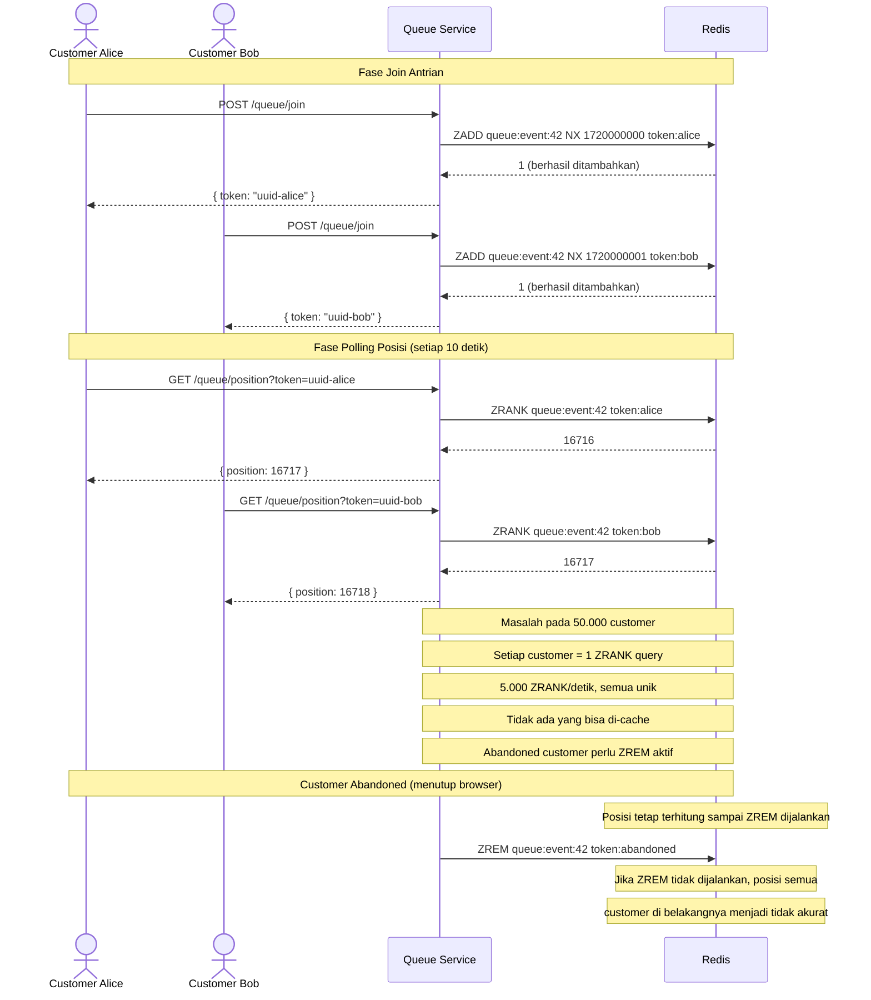
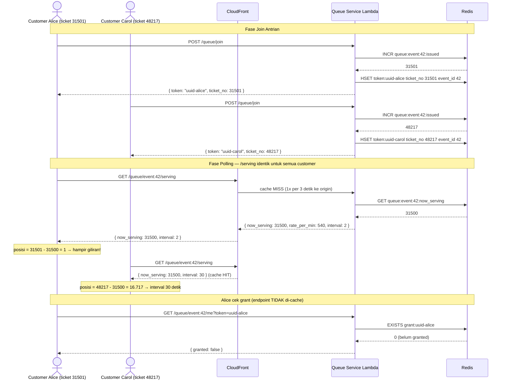
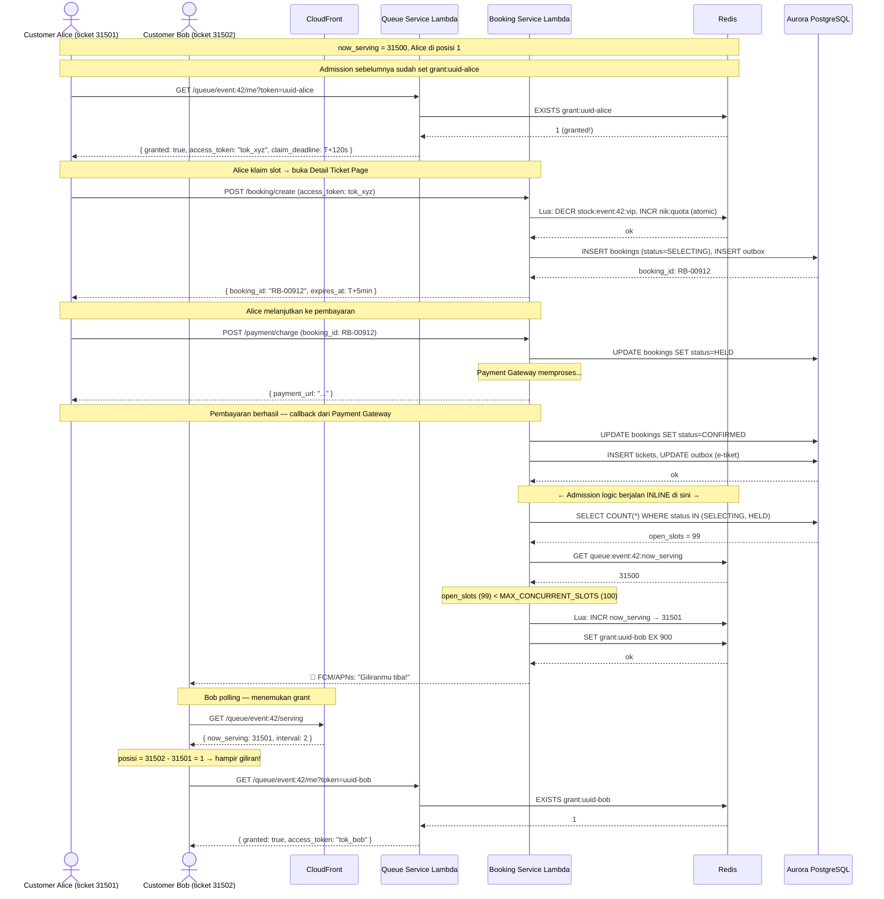
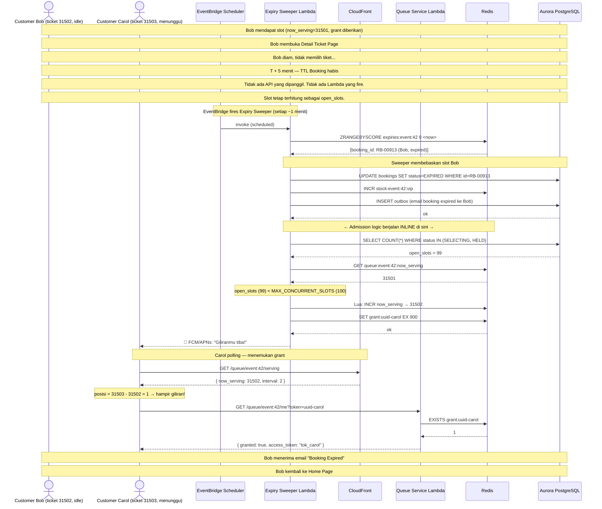

# ADR-002: Mekanisme Penentuan Posisi Antrian per Customer

**Status**: **Accepted — sebagian digantikan ADR-005** (30 Oktober 2026)  
**Tanggal**: 2026  
**Decider**: SJT Team

> **Keputusannya berlaku; transport dan ilustrasinya tidak.** Model counter global
> (`posisi = ticket_no − now_serving`) tetap menjadi dasar ADR-005, dan justru itulah yang
> membuat satu nilai dapat disiarkan ke semua orang. Yang berubah: pengirimannya memakai
> **SSE**, bukan polling ber-cache CDN, sehingga perhitungan `ZRANK` vs cache TTL 3 detik,
> field `interval`, dan "Expiry Sweeper Lambda" di dokumen ini tidak lagi menggambarkan
> sistem yang dibangun — sweep dan admission berjalan dalam satu loop ECS 500 ms.
> Untuk mekanisme yang mengikat, pakai **ADR-005 Bagian 4 dan Bagian 6**.

---

## Konteks

Setelah teknologi antrian ditetapkan (ADR-001), pertanyaan berikutnya adalah **bagaimana
posisi antrian setiap customer dihitung dan diperoleh**. Ini adalah keputusan yang
berdampak langsung pada skalabilitas sistem, karena posisi antrian dibutuhkan secara
terus-menerus oleh setiap customer selama berada di Virtual Waiting Room.

Requirement yang mendorong keputusan ini:

| ID     | Requirement                                                                         |
| ------ | ----------------------------------------------------------------------------------- |
| FR-06  | Sistem menampilkan posisi antrian customer secara tepat ("Anda antrian ke-n")       |
| FR-07  | Posisi antrian diperbarui otomatis setiap antrian di depan berkurang                |
| FR-10  | Posisi antrian tetap konsisten saat customer me-refresh halaman                     |
| NFR-04 | Antrian bersifat FIFO — posisi adil dan tidak bisa dilangkahi                       |
| NFR-06 | Sistem harus mampu menangani lonjakan trafik mendadak jauh melebihi kapasitas tiket |

Masalah inti: pada 50.000 customer yang aktif di waiting room secara bersamaan, sistem
harus mampu menjawab "customer X berada di posisi ke berapa?" dengan latensi rendah
untuk setiap permintaan dari setiap customer, baik melalui polling maupun push.

---

## Opsi yang Dipertimbangkan

### Opsi A: Redis ZSET + ZRANK

Setiap customer yang bergabung ditambahkan ke Redis Sorted Set dengan skor berupa
timestamp bergabung. Posisi diperoleh via perintah `ZRANK` yang mengembalikan posisi
relatif sebuah member dalam sorted set.

```
# Saat bergabung
ZADD queue:event:42 NX <join_timestamp> "token:alice"

# Saat mengambil posisi
ZRANK queue:event:42 "token:alice"  →  16716  (0-indexed, posisi = 16717)
```

**Karakteristik:**

- Posisi yang dikembalikan bersifat **eksak** — tepat berapa banyak customer di depannya
- Posisi dihitung **oleh server** per customer
- `ZRANK` bersifat O(log N) — untuk ZSET dengan 50.000 entry, sekitar 16 langkah
- Setiap customer mendapatkan **nilai berbeda** — tidak ada dua customer dengan posisi sama
- Abandoned customer harus dihapus aktif via `ZREM` untuk menjaga keakuratan posisi

### Opsi B: Counter Model — INCR + now_serving (Dipilih)

Menggunakan dua counter global sederhana per event. Saat bergabung, customer mendapat
nomor tiket unik via `INCR`. Server memelihara satu nilai `now_serving` yang menunjukkan
nomor tiket yang sedang dilayani saat ini. Posisi dihitung **oleh client**, bukan server.

```
# Saat bergabung — customer mendapat nomor tiket
INCR queue:event:42:issued  →  48217  (nomor tiket Alice)

# Nilai global yang disebarkan ke semua customer
GET queue:event:42:now_serving  →  31500

# Posisi dihitung di sisi client
posisi = ticket_no − now_serving  =  48217 − 31500  =  16717
```

**Karakteristik:**

- Posisi merupakan **estimasi konservatif** — angka yang ditampilkan bisa lebih besar dari
  posisi nyata karena adanya celah nomor tiket dari customer yang abandoned
- Posisi dihitung **oleh client** menggunakan dua nilai: `ticket_no` (diterima saat join,
  tidak pernah berubah) dan `now_serving` (diterima dari server secara periodik)
- Semua operasi O(1) — `INCR`, `GET`, `SET`
- Semua customer mendapatkan **nilai yang sama** (`now_serving`) — respons server bersifat
  identik untuk seluruh antrian sehingga dapat di-cache di CDN
- Abandoned customer tidak perlu cleanup aktif — nomor tiket mereka dilewati begitu saja
  saat `now_serving` melewatinya

---

## Keputusan

**Counter model dengan INCR + now_serving (Opsi B)** dipilih sebagai mekanisme penentuan
posisi antrian per customer.

---

## Alasan

### Perbedaan fundamental: per-customer query vs. nilai global

Ini adalah perbedaan yang paling krusial antara kedua opsi.

```
Opsi A — server menghasilkan N jawaban berbeda:

  ZRANK(token:alice)   → 16.717   ← unik untuk Alice
  ZRANK(token:bob)     → 16.716   ← unik untuk Bob
  ZRANK(token:charlie) → 16.715   ← unik untuk Charlie
  ... × 50.000 customer

Opsi B — server menghasilkan 1 jawaban, semua client hitung sendiri:

  GET now_serving      → 31.500   ← sama untuk semua 50.000 customer

  Alice:   48.217 − 31.500 = 16.717   ← Alice yang hitung
  Bob:     48.216 − 31.500 = 16.716   ← Bob yang hitung
  Charlie: 48.215 − 31.500 = 16.715   ← Charlie yang hitung
```

### Perbandingan langsung

| Dimensi                              | ZSET + ZRANK          | Counter + now_serving |
| ------------------------------------ | --------------------- | --------------------- |
| Kompleksitas operasi posisi          | O(log N) per customer | O(1) global           |
| Nilai respons                        | Unik per customer     | Identik untuk semua   |
| Bisa di-cache CDN                    | ❌                    | ✅ TTL 3 detik        |
| Redis query per 50K customer polling | 50.000 ZRANK          | 1 GET (CDN hit)       |
| Komputasi posisi                     | Di server             | Di client             |
| Keakuratan posisi                    | Eksak                 | Estimasi konservatif  |
| Cleanup customer abandoned           | Wajib (`ZREM`)        | Tidak diperlukan      |
| Posisi monotonically decreasing      | Tidak dijamin         | ✅ Dijamin            |

### Dampak pada skalabilitas

Dengan model ZSET, setiap polling dari setiap customer mengharuskan satu `ZRANK` query.
Pada 50.000 customer dengan interval 10 detik:

```
50.000 customer ÷ 10 detik = 5.000 request/detik
Setiap request → 1 ZRANK query ke Redis
Total: 5.000 Redis query/detik — semuanya berbeda, tidak ada yang bisa di-cache
```

Dengan counter model dan CloudFront cache TTL 3 detik:

```
50.000 customer ÷ 10 detik = 5.000 request/detik ke CloudFront
CloudFront cache hit: ~99%+ → hanya ~1 request/3 detik ke origin
Total Redis query: ~20/menit untuk now_serving — turun dari 300.000/menit
```

---

## Sequence Diagram

### Opsi A: ZSET + ZRANK



---

### Opsi B: Counter Model — INCR + now_serving

Admission controller dijalankan oleh **dua mekanisme**:

- **Event-driven (happy path)** — inline di dalam Booking Service Lambda saat slot dibebaskan secara aktif (pembayaran berhasil)
- **Expiry Sweeper Lambda** — mendeteksi dan membebaskan slot yang kedaluwarsa secara pasif (customer idle, TTL habis)

---

#### Opsi B — Diagram 1: Join Antrian & Polling Posisi



---

#### Opsi B — Diagram 2: Admission via Event-Driven (Happy Path)

Mekanisme ini berjalan **inline di dalam Booking Service Lambda** saat pembayaran berhasil.
`now_serving` dimajukan segera, tanpa menunggu sweeper.



---

#### Opsi B — Diagram 3: Admission via Expiry Sweeper (Passive Timeout)

Mekanisme ini berjalan saat customer **idle dan tidak melakukan tindakan apapun**.
Tidak ada API yang dipanggil customer — sweeper yang mendeteksi TTL terlewat.



---

## Konsekuensi

**Positif:**

- Seluruh operasi hot path O(1) — tidak ada penalti performa saat antrian membengkak
  hingga ratusan ribu customer
- Nilai `now_serving` yang identik untuk semua customer memungkinkan response di-cache
  di CDN, memutus ketergantungan antara jumlah poller dan beban origin
- Posisi bersifat _monotonically decreasing_ — tidak pernah terlihat naik dari perspektif
  customer, mencegah kebingungan UX
- Customer abandoned tidak memerlukan mekanisme cleanup aktif — menyederhanakan
  operasional dan menghilangkan risiko race condition saat cleanup
- Estimasi waktu tunggu (FR-09) tersedia gratis dari delta `now_serving` per unit waktu
  tanpa infrastruktur tambahan

**Negatif / Risiko:**

- **Posisi yang ditampilkan adalah estimasi konservatif**, bukan nilai eksak. Celah pada
  sekuens nomor tiket akibat customer abandoned menyebabkan posisi yang ditampilkan
  bisa lebih besar dari jumlah nyata customer di depannya.
  Mitigasi: komunikasikan ke product bahwa angka yang ditampilkan adalah _upper bound_;
  dari perspektif UX ini justru lebih aman (tidak mengecewakan customer dengan angka
  yang tiba-tiba membesar).
- **Admission controller harus atomic.** Dua invokasi bersamaan bisa memajukan
  `now_serving` dua kali lipat jika tidak dilindungi.
  Mitigasi: gunakan Lua script untuk read-advance-write sebagai satu langkah atomic;
  atau set reserved concurrency = 1 pada Lambda admission controller.

---

## Referensi

- `Tender Rusuh Booking Ticket.pdf` — FR-06, FR-07, FR-10, NFR-04, NFR-06
- ADR-001 — Teknologi Antrian untuk Virtual Waiting Room
