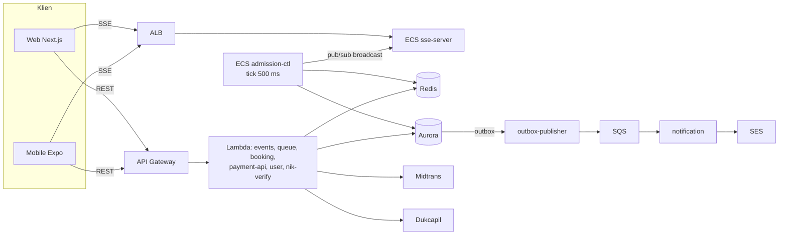
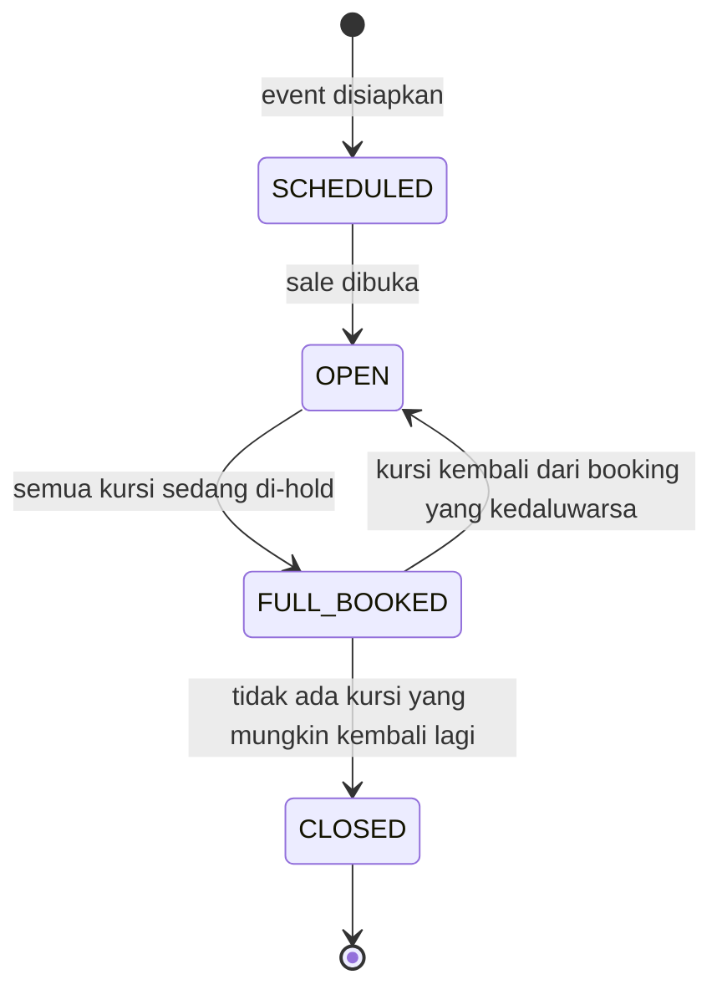

# ADR-005: Arsitektur Final — Antrian Real-time dengan SSE di ECS Fargate, API di Lambda

**Status**: Accepted (13 November 2026)
**Tanggal**: 24 Oktober 2026 · diringkas ulang 13 November 2026
**Decider**: SJT Team
**Menggantikan**: ADR-003, ADR-004
**Diamandemen oleh**: [ADR-006](ADR-006-queue-admission-amendments.md) (antrian), [ADR-007](ADR-007-mobile-webview-payment-handoff.md) (pembayaran di WebView mobile)
**Versi lengkap**: [versi sebelum diringkas (commit `9408e55`)](https://github.com/PTServerJanganTumbang-BookingTicket/documentations/blob/9408e55/adr/ADR-005-final-architecture-decision.md) — teks asli 3.256 baris berisi seluruh alasan, skrip Lua, dan daftar risiko. Dokumen ini adalah ringkasannya dan **sudah memasukkan amandemen ADR-006 dan ADR-007**.

---

## Konteks

Rusuh Booking Tiket menjual tiket konser di bawah beban *flash crowd*: permintaan jauh melampaui stok, dan tantangan
utamanya bukan fitur melainkan menjaga pengalaman pengguna tetap stabil dan adil ketika ratusan ribu orang tiba
bersamaan.

ADR-001 menetapkan teknologi antrian (Redis counter model) dan ADR-002 menetapkan mekanisme penentuan posisi
(`issued` + `now_serving`). ADR-003 memilih SSE sebagai transport dan ADR-004 memilih ECS Fargate sebagai compute.

Dokumen ini adalah **arsitektur of record** untuk build dan untuk jawaban tender. Kebutuhan yang paling menentukan
bentuknya:

| Kebutuhan | Sumber | Akibatnya bagi arsitektur |
|---|---|---|
| Flash crowd: permintaan jauh melebihi stok (target rancangan 300.000 orang bersamaan) | NFR-03 | Jalur join harus murah dan tidak menyentuh database |
| Posisi antrian dan halaman utama terasa *real-time* (p95 < 1 detik) | NFR-06 | Server harus **mendorong** perubahan, bukan menunggu klien bertanya |
| Adil: siapa datang dulu dilayani dulu, tidak bisa dilangkahi | NFR-05 | Satu urutan nomor, satu pemberi giliran |
| "Jangan PHP": yang sudah dapat giliran atau sudah booking dijamin bisa selesai | NFR-02 | Tidak ada jalur yang mencabut slot diam-diam |
| Stok tidak boleh oversell | NFR-04 | Pengurangan stok atomik |
| Email gagal tidak boleh menggagalkan transaksi | NFR-10 | Email asinkron dengan retry dan DLQ |

---

## Ringkasan Keputusan

| Aspek | Keputusan |
|---|---|
| Transport real-time | **Server-Sent Events (SSE)** — web dan mobile; polling REST sebagai fallback |
| Compute SSE | **ECS Fargate** (`sse-server`) di balik ALB |
| Compute admission + expiry + rekonsiliasi | **ECS Fargate** (`admission-ctl`, 1 task, loop 500 ms) |
| Compute REST API | **Lambda + API Gateway** |
| Pemberi giliran | **Hanya `admission-ctl`**; join hanya menerbitkan nomor (ADR-006) |
| Formula admission | `deficit = min(MAX − open, ceil(stok / 3) − browsing)`, hitungan dari Aurora (ADR-006) |
| Autentikasi stream | Header `X-Queue-Token` (web dan mobile), tanpa cookie (ADR-006 §8.20) |
| Verifikasi NIK | **Dukcapil API**, NIK saja. **Tidak dapat diverifikasi → tidak bisa bayar** (fail-closed) |
| Dukcapil / payment gateway tidak tersedia | Breaker **fail-closed** dengan error yang dapat di-retry; antrian tetap maju (ADR-006 §4.3) |
| Pembayaran | Midtrans Core API, VA + GoPay; charge sinkron, `order_id` diturunkan server |
| Konfirmasi pembayaran | **`POST /payments/webhook`** dari gateway; status ditanyakan ke Midtrans sebelum booking di-expire |
| Email | **Outbox → SQS → SES**, satu email ke pembeli, kegagalan tidak membatalkan transaksi |
| Sumber kebenaran deadline | **Aurora** (transaksional); sweep membaca tenggat dari Aurora |
| Anchor TTL | **Berurutan**: booking = `granted_at` + 5 menit; pembayaran = `held_at` + 10 menit (BR-03, BR-05) |
| Proteksi dependensi eksternal | Rate limiter + circuit breaker terdistribusi (Redis) |
| WAF | **Tidak dipakai di POC** — digantikan rate limit Redis + CAPTCHA tak terlihat di join |
| Halaman pembayaran mobile | Halaman web di WebView lewat kode serah-terima sekali pakai (ADR-007) |
| Push notification front-end | **Tidak dibangun** fase ini |
| Target kapasitas | **300.000 concurrent** (NFR-03 meminta 200.000+) |
| Dasar pertimbangan utama | **NFR-06** — p95 < 1 detik |

---

## Keputusan

### 1. Komponen

| Bagian | Pilihan | Alasan singkat |
|---|---|---|
| REST API (event, antrian, booking, pembayaran, akun) | **AWS Lambda** di balik **API Gateway** | Skala otomatis untuk lonjakan, bayar per request |
| Stream posisi antrian | **ECS Fargate** `sse-server` di balik ALB | Koneksi SSE hidup 30–60 menit; Lambda dan API Gateway memutus jauh lebih cepat |
| Pemberi giliran (admission), sweep tenggat, rekonsiliasi | **ECS Fargate** `admission-ctl`, **satu task**, loop 500 ms | Pekerjaan sub-detik; EventBridge minimal 1 menit |
| Data cepat: nomor antrian, stok, token | **Redis** (ElastiCache) | Operasi atomik dalam mikrodetik |
| Catatan resmi: booking, tiket, pembayaran, akun | **Aurora PostgreSQL** | Transaksional, tahan lama |
| Email | **Outbox → SQS → SES**, DLQ | Gagal kirim tidak membatalkan transaksi (NFR-10) |
| Pembayaran | **Midtrans Core API** (VA + GoPay) | Gateway pihak ketiga (di luar lingkup tender) |
| Verifikasi NIK | **Dukcapil** lewat satu service `nik-verify` | Satu-satunya pemegang rahasia NIK |
| Proteksi bot di join | Rate limit Redis per IP + **CAPTCHA tak terlihat** (Cloudflare Turnstile) | Tanpa WAF di POC |



### 2. Antrian berbasis counter

- **Join** (`POST /events/{id}/queue/join`) hanya menulis ke Redis: menaikkan `issued` untuk mendapat `ticket_no` dan
  menyimpan token antrian. Join **selalu** langsung menjawab "antre"; tidak pernah memberi giliran sendiri (ADR-006).
- **`now_serving`** dikirim lewat SSE ke semua orang dalam bentuk **identik**: `{nowServing, state, ratePerMin, serverTime}`.
  Satu pesan untuk semua koneksi, sehingga 300.000 koneksi tidak butuh 300.000 pesan berbeda.
- **Klien menghitung sendiri** posisinya (`ticket_no − nowServing`) dan estimasi waktu tunggunya (dari `ratePerMin`).
  Saat `nowServing ≥ ticket_no`, klien memanggil `GET /events/{id}/queue/me` untuk mengambil `grant_token`.
- **Refresh tidak menghilangkan giliran** (FR-10): token antrian disimpan klien dan dikirim lewat header
  `X-Queue-Token`; `GET …/queue/me` memulihkan keadaan. Bila SSE diblokir jaringan, klien memakai polling
  `GET …/queue/serving`.

### 3. Satu pemberi giliran

Hanya `admission-ctl` yang memberi giliran. Tiap 500 ms ia menghitung berapa orang boleh masuk:

```
deficit = min( MAX_CONCURRENT_SLOTS − orang_di_dalam ,  ceil(stok / 3) − orang_yang_masih_memilih )
```

- Bagian kiri menjaga **kapasitas** (berapa orang boleh berada di halaman tiket/pembayaran sekaligus).
- Bagian kanan menjaga **inventaris** (tiap orang boleh beli sampai 3 tiket, jadi tidak perlu memanggil lebih banyak
  orang daripada yang bisa mendapat tiket).
- Hitungan "di dalam" diambil dari Aurora setiap tick, bukan dari penghitung Redis terpisah. Detailnya: ADR-006.

### 4. Status penjualan per event



- `FULL_BOOKED` **bisa kembali** ke `OPEN`: kursi dari booking yang tidak dibayar dijual lagi kepada yang sedang
  mengantri, sesuai urutan nomor. Antrian tidak di-reset.
- `CLOSED` **final**: stream menutup koneksi dengan `410 Gone` supaya klien tidak terus mencoba menyambung.
- Halaman utama menampilkan satu field, `queue_state`, dengan satu nilai tambahan `FULL_QUEUE` saat antrian sudah
  mencapai kapasitas 300.000 (join ditolak `QUEUE_FULL`). Server juga mengirim `display.enabled`, jadi frontend tidak
  memutuskan sendiri apakah tombol aktif (ADR-006 §8.18).

### 5. Dua jam yang berurutan, dijaga server

| Jam | Mulai | Lama | Habis → |
|---|---|---|---|
| **Booking** (Detail Ticket Page) | saat giliran diberikan (`granted_at`) | 5 menit | booking batal, tempat diberikan ke nomor berikutnya |
| **Pembayaran** | saat tombol Bayar ditekan dan stok di-hold (`held_at`) | 10 menit | booking batal, stok dilepas, email expired |

- Tenggat disimpan di **Aurora** dan ditagih oleh *sweep* di `admission-ctl`. Klien hanya menampilkan hitung mundur
  dengan jam yang dikoreksi `server_time` (BR-10), jadi tidak bisa diakali dengan mengubah jam perangkat (FR-19).
- Setelah 10 menit pembayaran lewat, booking tidak langsung dibatalkan: backend **memastikan dulu ke Midtrans**,
  sehingga pembayaran yang masuk di detik terakhir tetap sah.
- Giliran yang tidak dipakai (halaman tiket tidak dibuka dalam 5 menit) menjadi `LAPSED` dan **tidak** diberi
  kesempatan kedua; customer boleh antre lagi dari belakang.

### 6. Stok dan NIK

- **Hold stok atomik** dalam satu skrip Lua di Redis: semua kategori diperiksa dulu, baru dikurangi; satu gagal, semua
  batal (all-or-nothing). Maksimal **3 tiket per transaksi**, boleh lintas kategori (BR-01).
- **1 NIK = 1 kursi per event** (BR-02). Redis menolak duplikat dengan cepat (`nik:used`), Aurora menjadi penegak akhir
  lewat `UNIQUE (event_id, nik_hmac)` pada `nik_claims`.
- **Redis adalah penghitung cepat, Aurora adalah kebenaran.** Rekonsiliasi berkala memperbaiki stok Redis dari Aurora
  dengan hati-hati: lebih baik menjual kurang daripada menjual dua kali.
- Gagal hold (stok kurang, NIK sudah dipakai) **tidak** menghilangkan giliran; customer tetap di halaman tiket dan
  bisa memperbaiki pilihannya (NFR-02).

### 7. Verifikasi NIK: fail-closed

- Setiap NIK harus pernah dinyatakan valid oleh Dukcapil. Bila Dukcapil tidak bisa dihubungi, booking **diblokir**
  (lebih baik tidak menjual daripada menerbitkan tiket atas NIK yang belum diverifikasi).
- NIK yang sudah terverifikasi disimpan (NIK akun dan Daftar NIK Teman, maks 5) dan **tidak** memanggil Dukcapil lagi,
  untuk menekan biaya panggilan.
- NIK disimpan sebagai **HMAC** dengan *pepper* rahasia, bukan teks asli (UU PDP). Hanya `nik-verify` yang memegang
  pepper.

### 8. Pembayaran

- Dua metode: **Virtual Account** (BCA, BNI, BRI, CIMB) dan **GoPay**. Kartu kredit dan gerai (OTC) tidak dibuka
  karena tidak bisa mengikuti batas 10 menit di sisi gateway.
- Midtrans menerima batas waktu yang sama (`custom_expiry`), jadi VA mati bersamaan dengan booking.
- `order_id = {booking_id}:{percobaan}` diturunkan server; dua klik Bayar menghasilkan satu tagihan.
- **Webhook idempoten**: setiap notifikasi dicatat dengan ID event dari gateway (`UNIQUE`), notifikasi ulang tidak
  berefek (FR-25).
- Ganti metode saat VA masih aktif: transaksi lama **dibatalkan dulu** di Midtrans, baru yang baru dibuat.
- Uang masuk setelah booking batal ditandai *disputed*, customer diberi email, dan refund dilakukan manual di POC.

### 9. Email

Producer menulis baris `outbox` **dalam transaksi yang sama** dengan perubahan status. `outbox-publisher` meneruskan ke
SQS; `notification` mengirim lewat SES dengan retry dan DLQ. E-tiket juga selalu bisa dibuka dari halaman sukses lewat
tautan bertoken, jadi email yang gagal tidak membuat tiket hilang.

### 10. Kredensial

| Kredensial | Dikirim lewat | Membuktikan |
|---|---|---|
| Access token (JWT) | `Authorization: Bearer` | siapa akunnya (login opsional, FR-29) |
| Queue token | `X-Queue-Token` | posisi di antrian |
| Grant token | `X-Grant-Token` | punya giliran di halaman tiket/pembayaran; bisa dicabut seketika |
| Payment session | `X-Payment-Session` | akses halaman pembayaran di WebView mobile (ADR-007) |
| E-ticket token | `?t=` pada tautan | hak membaca satu tiket |

- Pembeli **tamu** diikat ke perangkat lewat `X-Device-Id` (disimpan sebagai HMAC); token dari perangkat lain ditolak.
- Grant milik akun login wajib disertai access token akun yang sama.
- Setiap endpoint yang menerima `booking_id` mengikatnya ke grant pemanggil; tidak cocok → `404`.
- **BR-07**: customer login hanya punya satu keterlibatan aktif per event; join kedua memulihkan yang sudah ada.

### 11. Observability

Service mengirim metrik ke **CloudWatch** (format EMF): kedalaman antrian, laju admission, funnel join → giliran →
hold → lunas, expiry, latensi, dan metrik keamanan stok. Dashboard dan alarm (SNS) dibuat dari template
`infra/observability` (FR-33–36, NFR-09).

---

## Alternatif yang ditolak

| Alternatif | Alasan ditolak |
|---|---|
| WebSocket | Butuh registry koneksi dan fan-out sendiri; komunikasi dua arah tidak terpakai; lebih sering diblokir proxy |
| Short polling untuk semua orang | Satu request per detik per orang selama puluhan menit: boros baterai dan resource |
| AWS AppSync | ±2× biaya per pesan dan menambah GraphQL |
| SSE di Lambda / API Gateway / App Runner | Batas waktu koneksi (29 detik – 15 menit) jauh di bawah lama antrian |
| EventBridge untuk loop admission | Granularitas minimal 1 menit, terlalu lambat |
| Insert ke Aurora saat join | 300.000 join dalam ±1 menit akan membuat database menjadi failure point pada traffic yang sangat tinggi |

---

## Konsekuensi

**Positif**

- Posisi antrian diperbarui di bawah 1 detik untuk semua orang dengan satu pesan broadcast.
- Join hanya menyentuh Redis, sehingga lonjakan tidak membebani database.
- Satu pemberi giliran membuat urutan adil dan mudah diuji.
- Oversell dicegah dua lapis: skrip atomik di Redis dan constraint unik di Aurora.
- Kegagalan email, Dukcapil, atau Midtrans tidak merusak data; setiap jalur gagal berhenti dengan aman.

**Negatif (diterima secara sadar)**

- Compute antrian tidak serverless: ECS harus disiapkan (*pre-scale*) sebelum sale dan diturunkan sesudahnya.
- Dukcapil menjadi titik gagal tunggal untuk NIK baru (fail-closed).
- Tanpa WAF, proteksi bot hanya rate limit + CAPTCHA; pembeli tamu tidak dibatasi BR-07.
- Customer mobile yang aplikasinya tertidur saat gilirannya tiba bisa kehilangan giliran (tidak ada push notification).
- Refund pembayaran terlambat dilakukan manual.

---

## Yang diubah setelah keputusan awal

Perubahan rinci ada di dokumen pengubahnya; ringkasan di atas sudah memakai versi terbaru.

| Topik | Diubah oleh |
|---|---|
| Pemberian giliran yang tahan crash (pending grant), formula admission, hitungan dari Aurora | ADR-006 §2–§3 |
| Join tidak pernah memberi giliran langsung; hanya `admission-ctl` | ADR-006 §4.1, §8.14 |
| Broadcast saja, tanpa event `grant` per customer | ADR-006 §4.2 |
| *Pause admission* saat Dukcapil/Midtrans gangguan dihapus | ADR-006 §4.3 |
| Estimasi waktu tunggu dihitung frontend | ADR-006 §6 |
| `SOLD_OUT` antrian diganti `FULL_BOOKED`; halaman utama hanya `queue_state` + `display.enabled` | ADR-006 §8.10, §8.18 |
| E-tiket ke email pembeli; `terms_version` dihapus | ADR-006 §8.15, §8.16 |
| Cookie `queue_token` dihapus, token antrian lewat header | ADR-006 §8.20 |
| Leader lease, penyimpanan posisi antrian ke Aurora, sharded pub/sub ditunda ke produksi | ADR-006 §9 |
| Kredensial kelima: payment session untuk WebView | ADR-007 |

---

## Referensi

- `requirement/requirements.md` — FR, NFR, BR
- `api/api-contracts.md` dan `api/rusuh-booking-apidog.json` — kontrak API
- [`high-level-design.md`](../high-level-design.md) — gambaran sistem sesuai implementasi
- ADR-001, ADR-002 — model antrian berbasis counter (masih berlaku)
- ADR-003, ADR-004 — digantikan dokumen ini
- `payment-method/` — dua metode Midtrans
