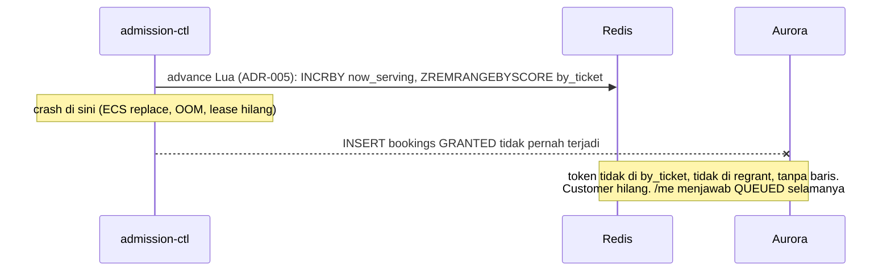
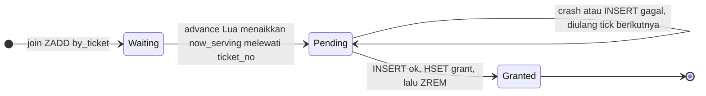
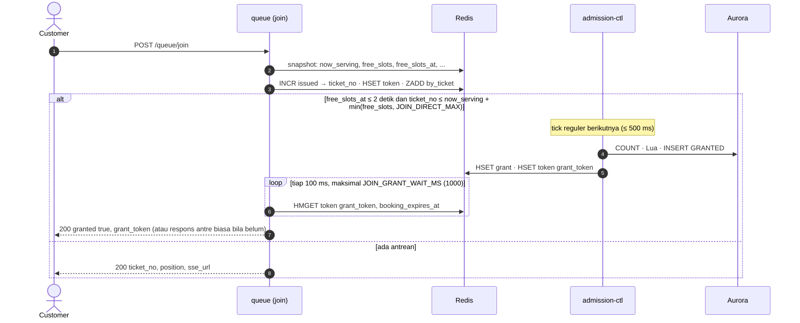

# ADR-006: Amandemen Antrian — Pending Grant, Formula Admission, Satu Penulis Grant, Tanpa Pause, Estimasi Waktu Tunggu

**Status**: Proposed — menunggu review tim
**Tanggal**: 5 November 2026
**Decider**: SJT Team
**Amends**: ADR-005 Bagian 4, 5, 6, 7, 8, 9, 11, 12, 13, 14, 16, 17; `requirements.md` BR-13a, BR-22. **Tidak** menggantikan ADR-005: semua yang tidak disebut di sini tetap berlaku
**Dokumen Referensi**: ADR-005, `requirement/requirements.md` v1.1, `requirement/implementation-plan.md` v2.1, `api/rusuh-booking-apidog.json`, `api/api-contracts.md` v2.7.0, `be-rusuh-war-ticketing/docs/04-queue/`

---

## Konteks

Sebelum implementasi modul antrian dimulai, desain antrian di ADR-005 ditinjau ulang terhadap
requirement, kontrak API, dan rencana implementasi. Tinjauan menemukan:

1. **Celah yang menghilangkan customer.** `advance_now_serving.lua` menghapus token dari
   `by_ticket` *sebelum* baris `GRANTED` ditulis di Aurora. Bila `admission-ctl` mati di antara
   keduanya, token tidak ada di `by_ticket`, tidak ada di `regrant`, dan tidak punya baris: customer
   tidak pernah dilayani dan `/queue/me` menjawab `QUEUED` selamanya.
2. **Antrian membeku di ujung sale.** `target = min(MAX, stock)` membandingkan stok bebas dengan
   *seluruh* slot terbuka, termasuk customer yang kursinya sudah di-hold (dan sudah dikurangkan
   dari stok). Customer itu terhitung dua kali.
3. **Satu customer per tiket di ujung sale**, padahal tiap customer boleh membeli 3 (FR-13).
4. **`now_serving` dapat melewati `issued`.** `INCRBY now_serving deficit` tanpa batas atas: saat
   yang menunggu sedikit, `now_serving` melompat melewati nomor yang belum diterbitkan, sehingga
   pendatang berikutnya mendapat `ticket_no` yang "sudah dilayani".
5. **Kompleksitas yang tersebar.** `slots:open` di Redis harus di-`DECR` tepat sekali oleh empat
   komponen (booking, payment-api, webhook, admission-ctl), padahal ADR-005 sudah menghitung angka
   yang sama dari Aurora setiap 10 detik untuk rekonsiliasi. Ada dua penulis grant (admission-ctl
   dan bypass di Lambda join), dan sse-server harus memetakan token ke koneksi hanya untuk event
   `grant`.
6. **Konflik kontrak** pada `/queue/serving`: "`poll_after_ms` ditentukan server berdasarkan
   posisi", padahal endpoint tidak menerima posisi.
7. **FR-09 tanpa metode.** ADR-005 hanya menyebut "`ratePerMin` pada payload". `position /
   rate_per_min` membagi dengan nol saat T0, dan menjanjikan giliran yang tidak akan
   datang di antrian 300.000 untuk 10.000 tiket.
8. Beberapa butir ADR-005 Bagian 17 dapat diputuskan untuk POC.
9. **Pause admission (BR-13a, BR-22) menambah satu state yang menyentuh semua komponen:**
   gerbang di tick, field `paused` di setiap payload, geser tenggat +60 detik di Aurora dan
   `expiries`, guard `pause:{ev}:grace_applied`, aturan klien "baca ulang `/me` saat `paused`
   berubah", dan cabang tampilan. Untuk POC, kompleksitas itu tidak sebanding dengan manfaatnya.

---

## 1. Ringkasan Keputusan

| # | Keputusan | Menggantikan di ADR-005 | Bagian |
|---|---|---|---|
| 1 | **Pending grant:** token keluar dari `by_ticket` hanya setelah baris `GRANTED` ada. Skor ≤ `now_serving` = pending, diulang tiap tick. `regrant:{ev}` dihapus | §6 Lua, "Baris bookings dibuat saat GRANTED" (kompensasi), "`regrant:{ev}` dan pause/resume", §16 | §2 |
| 2 | **Formula admission:** `deficit = min(MAX − open, ceil(stock / 3) − browsing)` | §6 Lua `target` | §3 |
| 3 | **Hitungan dari Aurora (S1):** `open` dan `browsing` dibaca dari `bookings` tiap tick. `slots:open:{ev}` dihapus | §6 "Kepemilikan `slots:open`", "Rekonsiliasi" (untuk slot) | §3 |
| 4 | **`now_serving` tidak melewati `issued`** | §6 Lua | §3.4 |
| 5 | **Satu penulis grant (S2):** hanya admission-ctl, pada tick tetap 500 ms. Join yang nomornya muat di tempat kosong (`free_slots`) menunggu ≤ 1 detik (§8.11); webhook, outbox-publisher dan abandon tidak melakukan apa pun terkait antrian | §5, §6 "Jalur bypass memakai Lua yang sama", §9 inline best-effort | §4.1 |
| 6 | **Broadcast saja (S3):** payload SSE global dan identik `{nowServing, state, ratePerMin, serverTime}`; klien mendeteksi gilirannya dari `nowServing ≥ ticket_no` lalu memanggil `/me`. Event SSE `grant` dan kanal `sse-grant` dihapus. Event `status {state}` tiap transisi state; indikator basi pindah ke event `stale` | §4, §11 fan-out | §4.2 |
| 6a | **Pause admission dihapus:** tanpa field `paused`, tanpa gerbang di tick, tanpa grace +60 detik. BR-13a dan BR-22 dihapus. Breaker tetap melindungi dependensi (fail fast) | §6 "Apa yang dihentikan `paused`", "`regrant:{ev}` dan pause/resume", §8 tabel breaker "pause admission" | §4.3 |
| 7 | **Satu shard Redis per event** untuk POC | (belum dinyatakan) | §5 |
| 8 | **Estimasi waktu tunggu dihitung frontend** dari `ratePerMin` pada payload; estimasi level sale | §14 FR-09 | §6 |
| 9 | Keputusan lebih kecil: Turnstile, `SALE_WINDOW_SECONDS`, customer idle, `/serving`, `/me`, hapus `GET /bookings/{id}/tickets` | §6 CAPTCHA, §9 langkah 5, §12, §13, §17 | §8 |
| 10 | **Ditunda ke produksi:** leader lease + standby, qpersist + `queue_entries` + rebuild, sharded pub/sub | §11, §12 | §9 |

---

## 2. Pending Grant: `by_ticket` sebagai Baki

### 2.1 Masalah



Redis dan Aurora tidak dapat ditulis secara atomik. Masalahnya bukan celah itu sendiri, melainkan
bahwa satu-satunya catatan customer **dihapus sebelum** catatan yang tahan lama ditulis.

### 2.2 Keputusan

> Anggota `queue:{ev}:by_ticket` dengan skor (`ticket_no`) **≤ `now_serving`** adalah **pending
> grant**: sudah diterima di Redis, barisnya belum terkonfirmasi. **`ZREM by_ticket` selalu langkah
> terakhir**, setelah baris `GRANTED` dan hash grant ada.



- **Lua tidak lagi `ZREM`.** Ia hanya membaca rentang token dan menaikkan `now_serving`.
- **RECOVER di awal tiap tick:** `ZRANGEBYSCORE by_ticket -inf now_serving` → selesaikan token
  yang tertinggal (juga oleh task baru setelah restart).
- **INSERT idempoten:** `UNIQUE (event_id, queue_token)` + `ON CONFLICT DO NOTHING`. Saat konflik,
  baris yang ada dibaca kembali sehingga retry memakai `booking_id`, `grant_token` dan tenggat yang
  sama.
- **Urutan:** INSERT → `HSET grant` + `ZADD expiries` → `ZREM by_ticket` → (akhir tick) broadcast.

### 2.3 `regrant:{ev}` dihapus

`regrant` hanya terisi saat INSERT grant gagal. Dengan pending grant, token yang INSERT-nya gagal
**tetap** di `by_ticket` dan diulang tiap tick, jadi tidak ada lagi yang perlu ditampung.

> **Ini menggantikan `GRANT_INSERT_MAX_RETRIES` + kompensasi `DECRBY` + `SADD regrant`** (ADR-005
> §6, §16 "`regrant` livelock"). Pending grant **diulang tanpa batas, tidak pernah menyerah**:
> menyerah adalah cara customer hilang. Alarm bila `ZCOUNT by_ticket -inf now_serving > 0` lebih
> dari 10 tick (5 detik); perbaikan manual. Satu token yang macet hanya menahan satu slot.

### 2.4 `/queue/me`

- Tidak ada baris dan `ticket_no ≤ now_serving` → **cek ulang sekali di writer** (lag replika).
- Masih tidak ada baris, token ada di `by_ticket` → pending: `QUEUED` posisi 0, "sebentar lagi";
  klien mengulang setelah 1 detik.
- Tidak ada baris dan tidak di `by_ticket` → seharusnya mustahil: metrik `LostGrant` + log uuid.

### 2.5 Alternatif yang ditolak

| Alternatif | Alasan ditolak |
|---|---|
| ZSET terpisah `queue:{ev}:granting` (skor = waktu) | Benar, dan memberi umur pending secara eksplisit, tetapi menambah satu key dan satu jalur `regrant` khusus untuk keuntungan kecil. `by_ticket` sudah menyimpan urutan yang dibutuhkan |
| Insert dulu, baru hapus di Redis (peek → INSERT → Lua commit dengan CAS) | Memindahkan keputusan admission keluar dari Lua; CAS yang gagal meninggalkan baris `GRANTED` untuk token yang masih mengantre |

### 2.6 Konsekuensi

- `by_ticket` punya dua arti (menunggu / pending). Aturannya wajib ditulis di `pkg/rediskeys` dan
  di header Lua.
- **`ZCARD by_ticket` bukan kedalaman antrian.** Kedalaman selalu `issued − now_serving`.
- Rebuild Redis dari Aurora (ADR-005 §12; ditunda ke produksi, §9) tetap konsisten bila ditambahkan: token tanpa baris dengan `ticket_no ≤
  now_serving` masuk kembali ke `by_ticket` sebagai pending dan diselesaikan RECOVER.

---

## 3. Formula Admission dan Hitungan dari Aurora

### 3.1 Masalah

**÷ 3.** `min(MAX, stock)` memberi satu customer per tiket, padahal tiap customer boleh membeli
hingga 3 (FR-13). Di ujung sale, sebagian besar yang diterima tidak menemukan apa pun.

**Dihitung dua kali.** Customer yang sudah HELD / AWAITING_PAYMENT / PENDING_CANCELLATION sudah
mengurangi `stock`, tetapi tetap terhitung di `slots:open`:

| | Nilai |
|---|---|
| Stok bebas | 240 |
| Membayar (kursi sudah di-hold) | 70 |
| Memilih (belum hold) | 10 |
| ADR-005: `min(100, 80) − 80` | **0, antrian membeku** hingga pembayar selesai (≤ 10 menit) |
| Seharusnya | 10 pemilih mengambil ≤ 30 tiket; ~210 tiket tidak dikejar siapa pun; ada 20 tempat → **20** |

**Penghitung yang tersebar.** ADR-005 menjaga `slots:open` di Redis dengan aturan kepemilikan di
empat komponen. Double-DECR → `slots:open` negatif → over-admission, dan rekonsiliasi baru
memperbaikinya setelah ≥ 20 detik dengan dua konfirmasi. Padahal rekonsiliasi itu sendiri sudah
menjalankan `COUNT(*)` di writer setiap 10 detik. Penghitung Redis hanyalah cache dari angka yang
sudah kita hitung dari sumber kebenaran.

### 3.2 Keputusan

```
room    = MAX − (open + pending)                    kapasitas: semua yang di dalam
demand  = ceil(stock / 3) − (browsing + pending)    inventaris: hanya yang masih bisa mengambil stok
deficit = min(room, demand)                         ≤ 0 → tidak ada yang diterima tick ini
```

| Nama | Status | Dari |
|---|---|---|
| `open` | GRANTED, SELECTING, HELD, AWAITING_PAYMENT, PENDING_CANCELLATION | `COUNT` Aurora writer, tiap tick |
| `browsing` | GRANTED, SELECTING | `COUNT` Aurora writer, tiap tick |
| `pending` | — | `ZCOUNT by_ticket -inf now_serving` |
| `stock` | — | `SUM stock:{ev}:{cat}`, dibaca **di dalam** Lua |

```sql
SELECT count(*)                                                  AS open,
       count(*) FILTER (WHERE status IN ('GRANTED','SELECTING')) AS browsing
FROM bookings
WHERE event_id = $1
  AND status IN ('GRANTED','SELECTING','HELD','AWAITING_PAYMENT','PENDING_CANCELLATION');
-- indeks parsial ON bookings (event_id, status) WHERE status IN (…aktif…); ≤ MAX baris, ~1 ms
```

- **`slots:open:{ev}` dihapus.** booking-service, payment-api dan webhook **tidak lagi menyentuh
  penghitung antrian apa pun**. Tabel "Kepemilikan `slots:open`" dan rekonsiliasi slot di ADR-005
  §6 tidak berlaku. (Penghitung `slots:browsing:{ev}` yang sempat diusulkan tidak pernah dibuat.)
- **Awal sale tidak berubah:** `demand` sangat besar, sehingga `deficit = MAX − open`.
- Kekurangan per kategori tetap mungkin (stok dijumlahkan lintas kategori); customer memilih
  kategori lain.

### 3.3 Mengapa hitungan non-atomik aman

COUNT dan Lua **bukan** satu langkah atomik. Aman karena setiap kesalahan condong ke **menerima
lebih sedikit**:

| Kejadian di antara COUNT dan Lua | Hitungan kita | Efek |
|---|---|---|
| CONFIRMED / EXPIRED / LAPSED / ABANDONED | terlalu tinggi | menerima lebih sedikit ≤ 1 tick ✅ |
| SELECTING → HELD | `browsing` terlalu tinggi, stok segar | lebih sedikit ✅ |
| GRANTED → SELECTING | tepat | ✅ |
| **grant baru** | terlalu rendah | ⚠️ dicegah aturan 1 dan 2 |

1. **Satu penulis grant** (§4.1).
2. **Pagar CAS pada `now_serving`:** ctl mengirim nilai yang ia baca; Lua mengembalikan `STALE`
   tanpa menulis apa pun bila nilainya berubah. Di POC hanya ada satu task, tetapi tumpang tindih
   yang tidak disengaja (deploy salah konfigurasi, task kedua manual) tetap aman, dan kelak dua
   leader saat pergantian lease juga (ADR-005 §11 "Lease ganda tidak dicegah — ia dibuat tidak berbahaya").
3. **Urutan baca tetap: snapshot Redis → COUNT Aurora → Lua.** Setiap grant terhitung minimal sekali:
   sebagai baris, sebagai pending, atau keduanya. Grant yang lahir setelah snapshot pasti mengubah
   `now_serving`, sehingga aturan 2 membatalkan.
4. **Stok dibaca di dalam Lua, setelah COUNT.** Hold di antaranya terlihat sebagai stok rendah +
   `browsing` tinggi (aman). Membaca stok lebih dulu bisa over-admit ~2.

**Invarian:** tidak ada transisi yang **kembali masuk** ke GRANTED atau SELECTING. Bila booking
kelak menambah transisi seperti HELD → SELECTING, bagian ini harus ditinjau ulang.

Biaya: 2 query terindeks per detik di writer. Bila writer tidak terjangkau, COUNT gagal, tick
melewati ADVANCE (antrian membeku, tidak ada yang hilang); INSERT grant toh juga akan gagal.

### 3.4 `advance_now_serving.lua` (revisi, menggantikan ADR-005 §6)

Mengikuti `pkg/rediskeys`: `now_serving` adalah field pada hash `queue:{ev}`.

```lua
-- KEYS[1]=queue:{ev} (hash: now_serving)  KEYS[2]=queue:{ev}:state
-- KEYS[3]=queue:{ev}:by_ticket            KEYS[4]=queue:{ev}:issued
-- KEYS[5]=queue:{ev}:full_booked_at          KEYS[6]=queue:{ev}:resume
-- KEYS[7..n]=stock:{ev}:{cat}
-- ARGV[1]=MAX_CONCURRENT_SLOTS  ARGV[2]=open+pending  ARGV[3]=browsing+pending
-- ARGV[4]=now_serving yang dibaca ctl (pagar CAS)    ARGV[5]=now (epoch detik)
--
-- ATURAN PENDING: token TIDAK dihapus di sini. Anggota by_ticket dengan skor
-- <= now_serving adalah pending grant; ctl meng-ZREM setelah baris GRANTED ada.

local ns = tonumber(redis.call('HGET', KEYS[1], 'now_serving') or 0)
if ns ~= tonumber(ARGV[4]) then return {ns, ns, 'STALE', {}} end   -- task lain sudah maju

local state = redis.call('GET', KEYS[2])
if state ~= 'OPEN' and state ~= 'FULL_BOOKED' then
  return {ns, ns, state or 'MISSING', {}}                           -- SCHEDULED / CLOSED / belum di-seed
end

local stock = 0
for i = 7, #KEYS do
  local v = redis.call('GET', KEYS[i])
  if not v then return {ns, ns, 'STOCK_UNINITIALIZED', {}} end      -- key hilang != nol
  stock = stock + tonumber(v)
end

if stock <= 0 then
  if state == 'OPEN' then                                           -- SEMENTARA, bukan terminal
    redis.call('SET', KEYS[2], 'FULL_BOOKED')
    redis.call('SET', KEYS[5], ARGV[5])
  end
  return {ns, ns, 'FULL_BOOKED', {}}
end
if state == 'FULL_BOOKED' then                                         -- stok kembali: lanjutkan FCFS
  redis.call('SET', KEYS[2], 'OPEN')
  redis.call('DEL', KEYS[5])
  redis.call('SET', KEYS[6], 1)
end

local room    = tonumber(ARGV[1]) - tonumber(ARGV[2])
local demand  = math.ceil(stock / 3) - tonumber(ARGV[3])
local deficit = math.min(room, demand)
if deficit <= 0 then return {ns, ns, 'NOOP', {}} end

-- now_serving TIDAK boleh melewati nomor yang sudah diterbitkan
local issued = tonumber(redis.call('GET', KEYS[4]) or 0)
local to = math.min(ns + deficit, issued)
if to <= ns then return {ns, ns, 'EMPTY', {}} end

local tokens = redis.call('ZRANGEBYSCORE', KEYS[3], ns + 1, to)    -- baca saja, TANPA ZREM
redis.call('HSET', KEYS[1], 'now_serving', to)
return {ns + 1, to, 'ADMITTED', tokens}
```

- **Celah di `by_ticket`** (customer pergi) membuat `tokens` lebih sedikit dari `to − ns`. Itu
  benar: nomor kosong dilewati, dan tempat yang tersisa terisi tick berikutnya lewat COUNT.
- **`to ≤ issued`** menutup temuan Konteks #4. Pada ADR-005 pendatang dengan nomor ≤ `now_serving`
  tidak akan pernah terpilih; dengan pending grant mereka justru akan di-grant RECOVER tanpa
  dihitung terhadap MAX. Batas ini mencegah keduanya.

### 3.5 Alternatif yang ditolak

| Alternatif | Alasan ditolak |
|---|---|
| Biarkan antrian membeku di ujung (formula ADR-005) | Tidak pernah oversell, tetapi tiket menganggur hingga 10 menit sementara antrian terlihat macet |
| Penghitung Redis `slots:browsing:{ev}` di samping `slots:open` | Benar dan atomik, tetapi menambah satu penghitung lagi yang harus di-DECR tepat sekali oleh banyak komponen, termasuk perubahan lintas domain di `hold_booking.lua` |
| Pembagi = rata-rata keranjang (≈ 2) alih-alih 3 | Ujung sale lebih cepat, tetapi sebagian customer bisa mendapat kurang dari yang diinginkan. Ditunda: ukur `avg_basket` lebih dulu (§6.3), lalu jadikan konfigurasi bila perlu |

---

## 4. Satu Penulis Grant, Broadcast Saja, Tanpa Pause

### 4.1 Satu penulis grant (S2)

Bypass ADR-005 menjalankan Lua dan INSERT di Lambda join, sehingga ada penulis grant kedua. Dengan
hitungan dari Aurora (§3), dua penulis bisa over-admit, dan Lambda butuh jalur crash sendiri.

**Keputusan:** hanya `admission-ctl` yang memberi grant, pada tick tetap 500 ms. Tidak ada komponen
lain yang memberi sinyal ke ctl. Join yang nomornya **muat di tempat kosong** cukup **menunggu** tick
berikutnya.



- Kontrak FR-05 (`granted: true`) **tetap**. Join hanya membaca.
- **Pemanggil lain juga berhenti memberi grant.** ADR-005 §9 dan implementation-plan §14
  ("Empat pemanggil untuk `advance_now_serving.lua`") menjalankan `DECR slots:open` +
  `EVALSHA advance_now_serving.lua` + `PUBLISH` di luar admission-ctl: payment-api (webhook inline,
  impl-plan §10.5), outbox-publisher (§13.2), dan booking-service saat `ABANDONED` (§5.6). Semua
  itu **dihapus tanpa pengganti**: tempat yang baru bebas terlihat oleh COUNT pada tick berikutnya
  (≤ 500 ms) dan langsung terpakai. `advance_now_serving.lua` kini punya **satu** pemanggil.
- **Menunggu ≤ 1 detik** mencakup minimal satu tick penuh ditambah INSERT; rata-rata ~250–500 ms.
  Sinyal "bangunkan ctl" sempat dipertimbangkan dan **ditolak**: ia hanya menghemat ≤ 500 ms, tetapi
  menambah kanal pub/sub, debounce, dan satu konsep lagi.
- Lambda mati saat menunggu → tidak ada yang hilang; ctl tetap memberi grant, klien tahu lewat
  broadcast + `/me`.

### 4.2 Broadcast saja (S3)

ADR-005 mengirim `event: grant` ke satu koneksi, yang menuntut peta token → koneksi di setiap task
sse-server dan kanal `sse-grant`.

**Keputusan:** semua koneksi sebuah event menerima **byte yang identik**. admission-ctl mem-publish
satu payload global; tidak ada event per customer. Klien menghitung sendiri:

```
position = ticket_no − nowServing
nowServing ≥ ticket_no  →  GET /queue/me  →  grant_token  →  Detail Ticket
menit    = dari position dan ratePerMin (§6.2)
```

**Event SSE:**

| Event | Kapan | `data` |
|---|---|---|
| *(default)* | snapshot saat connect, tiap `nowServing` berubah, heartbeat 10 detik | `{nowServing, state, ratePerMin, serverTime}` + `id` |
| `status` | tiap transisi `state` (`OPEN → FULL_BOOKED`, `FULL_BOOKED → OPEN`, `→ CLOSED`) | `{state, fullBookedAt?}` |
| `stale` | data berhenti segar (Redis putus / tanpa broadcast 30 detik), dan saat pulih | `{stale, reason}` (dulu event `status`) |
| `sold-out` | tepat setelah `status {state: CLOSED}` | `{message}`; klien **wajib** `es.close()` |
| `reconnect` | task shutdown | `retry:` berjitter |

`state` tetap ada di payload default supaya snapshot setelah reconnect lengkap; event `status`
adalah sinyal eksplisit "state baru saja berubah" sehingga klien tidak perlu membandingkan sendiri.

- admission-ctl mem-publish broadcast **setelah** INSERT tick itu, sehingga `/me` biasanya langsung
  menemukan baris. Bila belum (pending, lag replika): §2.4.
- **Masuk normal dan pemulihan menjadi satu jalur.** Klien yang terputus saat gilirannya datang
  melihat `nowServing ≥ ticket_no` pada snapshot pertama setelah reconnect.
- Beban `/me`: ≤ `deficit` customer melewati ambang per tick, jadi ≤ MAX panggilan per tick
  ditambah retry. Tidak bisa di-cache, dan memang tidak perlu.
- **Perubahan kontrak:** event `grant` dihapus; event `status` kini membawa `state`, indikator basi
  menjadi event `stale` (§7).

### 4.3 Pause admission dihapus

**Keputusan:** admission-ctl **tidak pernah** berhenti memberi grant karena dependensi bermasalah.
Yang dihapus: BR-13a (breaker OPEN → pause admission), BR-22 (`PAUSE_TTL_GRACE_SECONDS` +60 detik),
field `paused` di payload SSE dan `/queue/serving`, gerbang ADVANCE di tick, `pause:{ev}:grace_applied`,
metrik `PauseTransitions` / `PauseTtlGrantedSeconds`, dan aturan klien "panggil `/me` lagi saat
`paused` berubah".

**Yang tetap:** circuit breaker Dukcapil dan payment gateway (ADR-005 §8) tetap ada dan tetap
**fail closed**. Bedanya, mereka hanya membuat panggilan itu gagal cepat; mereka tidak lagi
menghentikan antrian.

| Gangguan | Dulu (pause) | Sekarang |
|---|---|---|
| Dukcapil breaker OPEN | antrian berhenti, tenggat yang berjalan +60 detik | antrian tetap maju. Customer yang sedang memilih mendapat error validasi NIK yang dapat di-retry ("Verifikasi NIK sedang gangguan, coba lagi"). Countdown 5 menit tetap berjalan |
| Payment gateway breaker OPEN | sama | `initiate payment` gagal cepat dan dapat di-retry dalam jendela 10 menit pembayaran. Booking `HELD` tetap memegang kursi |
| Gangguan melewati tenggat | grace 60 detik, lalu expire | booking expire / lapse seperti biasa; kursi kembali ke stok dan dipakai giliran berikutnya |

**Konsekuensi yang diterima untuk POC:**
- Pada gangguan Dukcapil yang lama, customer yang mendapat giliran bisa kehabisan waktu tanpa bisa
  menyelesaikan NIK. Ini bertentangan dengan semangat NFR-02 "Jangan PHP" lebih dari desain pause;
  mitigasinya pesan error yang jujur dan retry, bukan perpanjangan waktu.
- Ruang TTL `GRANT_TOKEN_TTL_SECONDS` (1080) terhadap perjalanan maksimum (930) kembali 150 detik.
- **Lebih sederhana:** satu state lebih sedikit di tick, payload, klien, dan pengujian (tidak ada
  geser tenggat ganda, tidak ada pause yang berkedip).
- Jalur produksi bila dibutuhkan: operator menunda sale secara manual, atau pause dikembalikan
  lewat ADR baru.

---

## 5. Satu Shard Redis per Event

Semua key ber-tag `{ev}` berada di satu slot cluster, sehingga **satu event = satu shard**. Ini
**wajib**, bukan efek samping: Lua multi-key (`advance_now_serving.lua`, `hold_booking.lua`) hanya
boleh menyentuh key di satu slot.

- Diterima untuk POC. Target load test: ~30k ops/s pada satu primary.
- Bila kurang: naikkan ukuran node. Sharded pub/sub (`SPUBLISH`/`SSUBSCRIBE`) **ditunda ke produksi**
  (§9); panggilan publish/subscribe berada di balik satu interface sehingga pergantiannya satu adapter.

---

## 6. Estimasi Waktu Tunggu (FR-09)

### 6.1 `rate_per_min`

`rate_per_min` = **berapa nomor tiket yang dilewati `now_serving` per menit**, dalam satuan yang
sama dengan `position` (celah ikut terhitung di keduanya). Dihitung admission-ctl, dikirim sebagai
`ratePerMin` di payload SSE dan `rate_per_min` di `/queue/serving`.

```
tiap tick (BROADCAST):
  bila state == OPEN: simpan (now, now_serving) ke ring buffer 60 detik
  bila buffer < 60 detik (baru buka / task baru restart): rate = MAX / ETA_SEED_SLOT_MINUTES (5)
  selain itu: rate = Δnow_serving / Δt × 60
  saat FULL_BOOKED: pertahankan nilai terakhir
```

- Lonjakan T0 (tick pertama memberi hingga MAX sekaligus) jatuh di 60 detik pertama yang memakai
  seed, jadi tidak membuat estimasi awal terlalu optimis.
- Waktu `FULL_BOOKED` tidak masuk buffer, sehingga laju setelah stok kembali tidak terseret ke 0.

### 6.2 Estimasi per customer: dihitung frontend

**Backend hanya mengirim `nowServing` dan `ratePerMin`; frontend menghitung menit.** Tidak ada
field estimasi atau status estimasi di respons API mana pun. Rumusnya ditulis sekali di kontrak
(api-contracts §3.5) supaya web dan mobile sama:

```
position = ticket_no − nowServing
state == FULL_BOOKED   → tampilkan pesan "semua tiket sedang di-hold", tanpa estimasi
position ≤ 0        → "Giliran Anda sebentar lagi" (dan panggil /me)
ratePerMin ≤ 0      → "Menghitung estimasi…"
selain itu          → estimatedWaitMinutes = bulatkan_ke_atas(ceil(position / ratePerMin))
```

| Menit mentah | Dibulatkan ke atas ke | Contoh |
|---|---|---|
| 1–10 | menit utuh | 4 → 4 |
| 11–30 | kelipatan 5 | 12 → 15 |
| 31–60 | kelipatan 10 | 33 → 40 |
| > 60 | kelipatan 30 | 725 → 750 |

Pembulatan ke atas membuat estimasi condong pesimis dan angkanya berubah dalam langkah besar
(tidak berkedip tiap 500 ms).

| `estimatedWaitMinutes` | Teks |
|---|---|
| 1–59 | "Estimasi waktu tunggu ± {m} menit" (wireframe tender §9.2) |
| 60–180 | "Estimasi waktu tunggu ± {m/60} jam" (mis. 90 → "± 1,5 jam") |
| > 180 | "Estimasi waktu tunggu lebih dari 3 jam" |

**Contoh** (`ratePerMin` = 200): posisi 150 → ± 1 menit; 1.000 → ± 5 menit; 2.400 → ± 15 menit;
6.000 → ± 30 menit; 145.000 → lebih dari 3 jam.

Dalam mode polling (`/queue/serving`) rumusnya sama, memakai `rate_per_min`.

**Ditolak:**
- *Backend menghitung per customer* (`estimated_wait_minutes` + status di join, `/me`, SSE): membuat
  payload SSE berbeda per koneksi dan tidak tersedia di `/serving` yang di-cache CDN.
- *Rentang "sekitar X–Y menit"*: wireframe tender memakai "± N menit".
- *Persentil laju (p25)*: butuh riwayat sampel; dipertimbangkan lagi setelah data sale pertama.

### 6.3 Estimasi level sale (perencanaan)

```
throughput (customer diterima / menit)  ≈ MAX / avg_slot_minutes
pembeli dibutuhkan                       ≈ total_tiket / avg_basket
diterima dibutuhkan                      ≈ pembeli / conversion
waktu hingga habis (menit)               ≈ diterima / throughput
porsi antrian yang mendapat giliran      ≈ diterima / ukuran_antrian
```

| Input | Nilai | Sumber |
|---|---|---|
| total tiket | 10.000 | ADR-005 §6, §12 |
| ukuran antrian | 300.000 | requirements §5 |
| `avg_basket` | 2 | *asumsi* (maks 3, FR-13) |
| `conversion` | 70% | *asumsi* |
| `avg_slot_minutes` | 5 | *asumsi*: median pembeli 2–4 menit (ADR-005 §16), no-show 5 menit (BR-03) |

Hasil: pembeli ≈ 5.000 → diterima ≈ **7.150** → porsi antrian ≈ **2,4%**, sekitar **292.000 orang
tidak pernah mendapat giliran**.

| MAX | Throughput | Waktu hingga habis |
|---|---|---|
| 500 | 100 / menit | ≈ 72 menit |
| 1.000 | 200 / menit | ≈ 36 menit |
| 2.000 | 400 / menit | ≈ 18 menit |

**Batas giliran (~7.150) tidak bergantung pada MAX; hanya kecepatannya.** MAX menukar durasi sale
dengan beban hilir (Dukcapil, payment gateway), jadi MAX dipilih dari load test terhadap batas itu
(ADR-005 §17 #5). Seluruh asumsi diganti data nyata setelah load test / sale pertama.

### 6.4 Diusulkan: petunjuk "kemungkinan habis" di ruang tunggu

**Belum diputuskan.** Ini keputusan pesan dan produk milik pemilik tender (ADR-005 §17 #3).

```
remaining_turns   = max(0, stock / AVG_BASKET − browsing) / CONVERSION
gap_factor        = Δnow_serving / grants pada jendela rate   (≥ 1)
likelyServedUntil = now_serving + ceil(remaining_turns × gap_factor)
```

Satu angka **global** pada broadcast, sehingga cocok dengan model broadcast. Klien dengan
`ticket_no > likelyServedUntil` menampilkan: *"Tiket kemungkinan habis sebelum giliran Anda. Anda
tetap boleh menunggu. Tiket yang tidak dibayar dapat tersedia kembali."* Di balik flag
`SHOW_SELLOUT_HINT`, default **mati**.

---

## 7. Dampak pada Dokumen Lain

| Dokumen | Bagian | Perubahan | Status |
|---|---|---|---|
| ADR-005 | header + §4, §5, §6, §7, §8, §12, §13, §16, §17 (pause: §6 "Apa yang dihentikan `paused`", §8 breaker) | catatan "Diubah oleh ADR-006" di awal tiap bagian terdampak | ✅ dalam PR ini |
| `architecture/high-level-design.md` | §1, §4, §5, §6, §8, §14, Lampiran | diselaraskan (v2.1.0) | ✅ dalam PR ini |
| `requirement/requirements.md` | §5 "Admission formula", alur §6; BR-13a, BR-22, §5 "Degradasi dependensi" / "TTL saat pause" | formula baru; "event grant" → `nowServing ≥ ticket_no`; pause ditandai **dihapus** (baris dipertahankan, dicoret) | ✅ dalam PR ini |
| `api/rusuh-booking-openapi.yaml` | — | **diarsipkan** ke `api/archive/` (tidak dipelihara lagi); sumber kebenaran API = Apidog + api-contracts | ✅ dalam PR ini |
| `api/api-contracts.md` | §3.1–§3.5, §7 (`error_code`), Appendix A, tabel FR | v2.7.0, selaras dengan Apidog | ✅ dalam PR ini |
| `requirement/implementation-plan.md` | §3.1 (`pkg/rediskeys`: hapus `regrant`, `slots:open`, `sse-grant`; `ctl:leader`/`ctl:epoch`/`qpersist` ditunda), §5.6 / §10.5 / §13.2 (DECR + advance Lua + PUBLISH dihapus), §7.2 (bypass → tunggu ≤ 1 detik), §9.2 / §9.7 (lease, drain qpersist: ditunda), §7.4 (`poll_tiers`), §8 (sse-server tanpa peta token), §9.6 (tick baru), §14.1 (Lua §3.4), §14.2 (`hold_booking.lua` tanpa penghitung slot), §18 (kepemilikan) | catatan amandemen di header; rewrite per bagian menyusul saat implementasi | ⚠️ header saja |
| `api/rusuh-booking-apidog.json` | seluruh respons | **sumber kebenaran**: envelope standar (`error_code` pada error), skema event SSE (`itemSchema`), semua contoh tervalidasi terhadap skemanya | ✅ dalam PR ini |
| migrasi | `bookings` | `UNIQUE (event_id, queue_token)` + indeks parsial status aktif | ⏳ build step 2 |
| `be-rusuh-war-ticketing/docs/04-queue/` | semua | rencana per endpoint | ✅ |
| ADR-005 (semua penyebutan `SOLD_OUT`, `sold_out_at`, `SOLD_OUT_HOLD_SECONDS` untuk state antrian), implementation-plan, api-contracts, Apidog | status `FULL_BOOKED` | §8.10 | ✅ (api-contracts v2.10.0) |
| ADR-005 §12, §17 #12, konfigurasi; api-contracts §3.1, §4, §9, Appendix A; implementation-plan `pkg/grantauth` | pengikatan device | §8.9: tanpa rebind | ✅ (api-contracts v2.9.0) |

---

## 8. Keputusan Lebih Kecil

| # | Keputusan | Catatan |
|---|---|---|
| 8.1 | **CAPTCHA: Cloudflare Turnstile** (mode invisible) di balik port `Captcha` + adapter mock | Fail-open tetap (ADR-005 §6). Turnstile memberi lulus/gagal, bukan skor. Kuota 300k `siteverify` / ~60 detik tetap terbuka (ADR-005 §17 #8). Token sekali pakai dan berumur pendek: klien memperbarui bila hampir kedaluwarsa |
| 8.2 | **`SALE_WINDOW_SECONDS` = 21600** (6 jam) untuk POC | Nilai produksi tetap pada pemilik tender (ADR-005 §17 #10) |
| 8.4 | **Customer idle / pergi:** aturan terkunci dipertahankan (requirements §5 "Queue session") | Tanpa eviksi saat menunggu. Ditolak: eviksi heartbeat, check-in dekat depan, jendela klaim pendek, over-admission |
| 8.5 | **`/queue/serving`:** tanpa query string (satu entri CDN), TTL CloudFront 1 detik, respons menambah `poll_tiers` | Server tetap pemilik tabel interval; klien memilih barisnya. Menyelesaikan konflik kontrak di Konteks #6 |
| 8.6 | **`/queue/me` lag replika:** cek ulang sekali di writer bila tanpa baris dan `ticket_no ≤ now_serving` | §2.4 |
| 8.7 | **Koneksi SSE per task:** keluaran load test, bukan keputusan sekarang | Hasil dicatat di ADR-005 §17 #4 |
| 8.9 | **Token antrian hanya berlaku bagi pemiliknya, tanpa rebind** (menggantikan "Toleransi" di ADR-005 §12). Token **tamu** hanya berlaku dari perangkat yang menerimanya: `HMAC(DEVICE_PEPPER, X-Device-Id)` harus sama dengan `device_hash`. Token **akun** hanya berlaku bagi akun yang sama (`account_id` = akun Bearer), dari perangkat mana pun. Tidak cocok → `401 DEVICE_MISMATCH` (tamu) / `401 UNAUTHORIZED` (akun lain); di join cookie `queue_token` dihapus. Berlaku untuk join, `/queue/me` dan semua endpoint ber-grant. `MAX_DEVICE_REBINDS`, field `rebinds` dan metrik `DeviceRebindRate` **dihapus**; gantinya metrik `DeviceMismatch` | Rebind satu kali menambah penghitung, CAS dan aturan "percobaan ketiga" yang harus dijaga di tiga service, untuk kasus yang jarang (tamu menghapus data situs). **Konsekuensi diterima:** tamu yang menghapus data situs, ganti browser atau install ulang aplikasi kehilangan tempatnya dan mulai lagi dari belakang. Customer login tidak terkena: akunnya yang mengikat. Server tidak memvalidasi format `X-Device-Id`; kekuatan pengikatan bergantung pada klien membuat nilai acak 128 bit |
| 8.10 | **Status antrian `SOLD_OUT` diganti `FULL_BOOKED`.** `queue:{ev}:state` ∈ `SCHEDULED \| OPEN \| FULL_BOOKED \| CLOSED`; `sold_out_at` → `full_booked_at`, `soldOutAt` → `fullBookedAt`, `SOLD_OUT_HOLD_SECONDS` → `FULL_BOOKED_HOLD_SECONDS`, error join 409 `SOLD_OUT` → `FULL_BOOKED`, `rediskeys.SoldOutAt` → `FullBookedAt`. **Tetap:** `CLOSED` (satu-satunya keadaan terminal), event SSE `sold-out` (sale selesai, klien wajib `close()`), `SALE_CLOSED` (410) | "Sold out" terdengar final padahal state ini reversibel (kursi dari booking kedaluwarsa kembali); event `sold-out` yang final memakai kata yang sama, sehingga klien menutup stream pada state yang salah. `FULL_BOOKED` = semua kursi sedang di-hold. **Ditolak:** mengganti `CLOSED` menjadi `SOLD_OUT` — memindahkan makna string lama ke keadaan terminal (klien lama diam-diam salah), dan `CLOSED` mungkin kelak berarti sale berakhir bukan karena habis. `status: SOLD_OUT` pada halaman utama (FR-03c, sumbu stok) belum diubah; usulan: ganti bersama FR-03c |
| 8.11 | **Langsung masuk tanpa ruang tunggu bagi semua yang muat** (8 November 2026, memperluas §4.1). Tiap kali Lua membaca hitungan, ia menulis `free_slots = max(0, deficit − (to − now_serving lama))` dan `free_slots_at` (epoch detik) ke `queue:{ev}`, atomik bersama `now_serving`, **juga saat `SCHEDULED`** (hanya dua field itu), sehingga saat T0 nilainya sudah `min(MAX, ceil(stock / 3))`. Join menunggu grant ≤ 1 detik bila `free_slots_at` paling lama `JOIN_FREE_SLOTS_MAX_AGE_SECONDS` (2) dan `ticket_no ≤ now_serving + min(free_slots, JOIN_DIRECT_MAX)` (default 500); selain itu langsung menjawab antre. Join menunggu dengan membaca `token:{qt}` di **Redis**: saat FINISH, ctl menyalin `grant_token`, `booking_id`, `booking_expires_at` ke hash itu (setelah `HSET grant`, sebelum `ZREM`, hanya bila hash masih ada) | Tujuan: batch pertama saat penjualan dibuka (hingga `MAX_CONCURRENT_SLOTS` orang) langsung ke halaman tiket, bukan hanya nomor 1. **Tetap satu penulis grant**: join hanya membaca. Ditolak: join memberi grant sendiri untuk batch pertama (penulis grant kedua, ADR-006 §4.1). `free_slots` setengah detik usang hanya membuat sebagian orang lewat ruang tunggu, atau menunggu 1 detik lalu antre, tanpa grant ganda. ctl mati atau COUNT gagal → `free_slots_at` menua → join tidak menunggu. `JOIN_DIRECT_MAX` membatasi Lambda yang tertahan saat T0 (batas konkurensi Lambda); disetel dari load test. Bentuk respons tidak berubah (kontrak v2.11.0) |
| 8.8 | **`GET /bookings/{id}/tickets` dihapus** (menggantikan ADR-005 §9 langkah 5). `GET /bookings/{id}` saat `PAID` mengembalikan `tickets[].eticket_url` yang sudah membawa `?t={eticket_token}` (`pkg/eticket.Mint`, token yang sama dengan email) | Isi endpoint itu sama dengan `tickets[]` di `GET /bookings/{id}`. Satu-satunya nilai tambahnya, akses QR bagi tamu bila email gagal (NFR-10), kini diberikan tautan bertoken di Success Page. Satu endpoint, satu usecase dan satu handler lebih sedikit. booking-service menjadi penerbit ketiga token e-tiket (bersama notification); verifikasi tetap di user-service |

---

## 9. Cakupan POC dan Jalur Produksi

POC membangun semua yang diminta tender dan requirements v1.1. Tiga mekanisme ADR-005 berikut
**ditunda ke produksi**: semuanya soal ketersediaan pada beban 300.000 nyata, bukan soal kebenaran,
dan desain POC sudah menyisakan tempat untuknya.

| Ditunda | Di POC | Konsekuensi | Untuk menambahkannya |
|---|---|---|---|
| **Leader lease + standby** `admission-ctl` (`ctl:leader`, `ctl:epoch`, ADR-005 §11) | **1 task**. ECS mengganti task yang mati (~30–60 detik). Deployment `minimumHealthyPercent 0` / `maximumPercent 100` agar tidak pernah ada dua task | Antrian membeku hingga ~1 menit saat crash; tidak ada yang hilang (pending grant, §2). Deteksi NFR-14 (indikator stale 30 detik, `CtlHeartbeatAge`) tetap. **Deviasi:** NFR-14 menyebut leader lease sebagai pemulihan; di POC pemulihannya restart ECS | Lease + epoch sesuai ADR-005 §11. Pagar CAS `now_serving` (§3.3) dan CAS sweep sudah membuat 2 task aman |
| **qpersist + `queue_entries` + rebuild dari Aurora** (ADR-005 §12) | Redis Multi-AZ saja. Join tidak `RPUSH qpersist` | Kehilangan Redis **total** menghilangkan posisi antrian. Kursi yang dibayar dan di-hold aman di Aurora | `RPUSH qpersist` di join, drain di ctl, job rebuild |
| **Sharded pub/sub** (`SPUBLISH`/`SSUBSCRIBE`) | `PUBLISH` klasik di balik satu interface | Lalu lintas pub/sub lintas node pada fan-out sangat besar | Ganti adapter |

---

## 10. Yang Masih Terbuka

| # | Butir | Pemilik |
|---|---|---|
| 1 | Nilai `MAX_CONCURRENT_SLOTS` (ADR-005 §17 #5), dari load test terhadap batas Dukcapil dan payment | Tim |
| 2 | Petunjuk "kemungkinan habis" (§6.4) dan pesan jujur 300.000 : 10.000 (ADR-005 §17 #3) | Pemilik tender |
| 3 | Ramp slow-start saat T0 (batas grant baru per tick agar hilir yang masih dingin tidak dibanjiri) | Tim |
| 4 | Pengacakan pre-queue saat T0 (praktik umum industri; **mengubah NFR-05** "FCFS") | Pemilik tender |
| 5 | Jitter reconnect SSE (`retry:` acak + backoff klien) setelah task mati | Tim |
| 6 | Metrik antrian: tingkat no-show, persentil waktu-hingga-grant, `avg_basket`, `conversion`, rasio celah | Tim |
| 7 | Pembagi 3 vs rata-rata keranjang (§3.5), setelah data `avg_basket` tersedia | Tim |

---

## Referensi

- ADR-005 — Keputusan Arsitektur Final *(diamandemen oleh dokumen ini)*
- `architecture/high-level-design.md` v2.1.0
- `be-rusuh-war-ticketing/docs/04-queue/` — rencana per endpoint, terutama `05-admission-controller.md` (§3.5 `rate_per_min`) dan `README.md` §8 (estimasi waktu tunggu)
- `requirement/requirements.md` v1.1 — FR-05, FR-08, FR-09, FR-13, NFR-02, NFR-05, BR-03, §5
