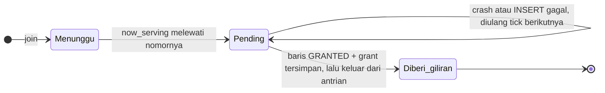
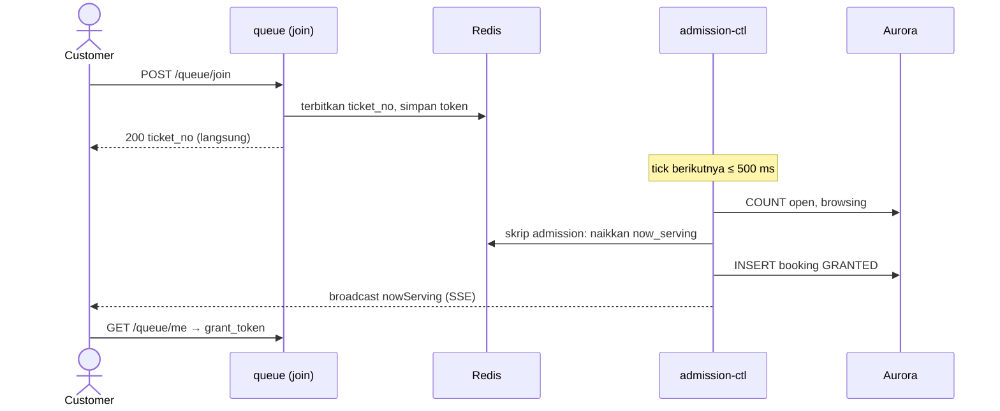

# ADR-006: Amandemen Antrian — Giliran yang Tahan Crash, Formula Admission, Satu Pemberi Giliran

**Status**: Accepted (13 November 2026)
**Tanggal**: 5 November 2026 · keputusan lanjutan sampai 13 November 2026 · diringkas ulang 13 November 2026
**Decider**: SJT Team
**Mengamandemen**: [ADR-005](ADR-005-final-architecture-decision.md). Yang tidak disebut di sini tetap berlaku.
**Versi lengkap**: [versi sebelum diringkas (commit `9408e55`)](https://github.com/PTServerJanganTumbang-BookingTicket/documentations/blob/9408e55/adr/ADR-006-queue-admission-amendments.md) — teks asli dengan skrip Lua, tabel alasan per keputusan, dan dampak ke dokumen lain. Nomor bagian (§2, §8.18, …) di dokumen ini sama dengan versi lengkap.

---

## Konteks

Sebelum modul antrian dibangun, desain antrian ADR-005 ditinjau ulang. Hasilnya tujuh perubahan besar dan
sejumlah keputusan kecil. Intinya:

1. **Customer tidak kehilangan posisi antrean** walau server mati di tengah memberi giliran.
2. **Antrian tidak membeku** di akhir penjualan.
3. **Hanya satu proses** yang memberi giliran, dan semua orang menerima **pesan yang sama**.
4. Fitur yang menambah kerumitan tanpa manfaat sebanding (**pause admission**, **langsung masuk tanpa antre**) dihapus.

---

## Konteks: apa yang ditemukan

| # | Temuan | Akibatnya bila dibiarkan |
|---|---|---|
| 1 | Token dikeluarkan dari antrian Redis **sebelum** baris booking ditulis di Aurora | Bila proses mati di antaranya, customer hilang: tidak di antrian, tidak punya booking |
| 2 | Formula menghitung customer yang sudah membayar dua kali | Antrian membeku sampai 10 menit di akhir sale, padahal tiket masih ada |
| 3 | Satu giliran per tiket, padahal satu customer boleh membeli 3 | Sebagian besar yang dipanggil di akhir sale tidak menemukan tiket |
| 4 | `now_serving` bisa melewati nomor yang belum diterbitkan | Pendatang berikutnya mendapat nomor yang "sudah lewat" |
| 5 | Penghitung slot di Redis harus dikurangi tepat sekali oleh empat service | Mudah salah hitung dan menerima terlalu banyak orang |
| 6 | Estimasi waktu tunggu belum punya rumus | Bagi nol di awal sale, janji yang tidak realistis |
| 7 | *Pause admission* saat Dukcapil/Midtrans gangguan menyentuh semua komponen | Kerumitan besar untuk kasus jarang |

---

## Keputusan utama

### §2. Pending grant: giliran yang tahan crash

**Aturannya:** token baru dikeluarkan dari antrian (`by_ticket`) **paling akhir**, setelah baris booking `GRANTED`
dan grant tersimpan. Token yang nomornya sudah ≤ `now_serving` tetapi masih di antrian berarti *pending*: setiap tick
menyelesaikannya, tanpa batas percobaan.



- Insert idempoten (`UNIQUE (event_id, queue_token)`), jadi pengulangan memakai booking dan grant yang sama.
- Kedalaman antrian selalu `issued − now_serving`, bukan jumlah anggota antrian.

### §3. Formula admission dan hitungan dari Aurora

```
room    = MAX − (open + pending)              kapasitas: semua yang ada di dalam
demand  = ceil(stok / 3) − (browsing + pending)  inventaris: yang masih bisa mengambil stok
deficit = min(room, demand)                    ≤ 0 → tidak ada yang dipanggil tick ini
```

| Nama | Artinya | Diambil dari |
|---|---|---|
| `open` | booking aktif: GRANTED, SELECTING, HELD, AWAITING_PAYMENT, PENDING_CANCELLATION | `COUNT` Aurora tiap tick |
| `browsing` | yang masih memilih: GRANTED, SELECTING | `COUNT` Aurora tiap tick |
| `pending` | giliran yang belum selesai ditulis (§2) | Redis |
| `stok` | total stok semua kategori | Redis, dibaca di dalam skrip atomik |

- Penghitung slot di Redis **dihapus**; tidak ada service lain yang perlu menjaga angka antrian.
- `now_serving` tidak pernah melewati `issued`.
- Hitungan yang meleset sesaat selalu condong ke **memanggil lebih sedikit**, tidak pernah lebih banyak. Dua pengaman
  membuatnya aman: hanya satu pemberi giliran (§4.1) dan skrip menolak bekerja bila `now_serving` sudah berubah sejak
  dibaca (compare-and-set).

### §4.1. Satu pemberi giliran

Hanya `admission-ctl` yang memberi giliran, pada tick 500 ms. Join hanya menerbitkan nomor dan **tidak pernah
menunggu giliran** (§8.14). Webhook pembayaran, outbox, dan booking tidak lagi ikut memanggil skrip admission: tempat
yang kosong terlihat oleh hitungan Aurora pada tick berikutnya (≤ 500 ms).



### §4.2. Broadcast saja

Semua koneksi sebuah event menerima **byte yang sama**: `{nowServing, state, ratePerMin, serverTime}`. Tidak ada event
khusus per customer. Klien melihat sendiri bahwa `nowServing ≥ ticket_no`, lalu memanggil `GET /queue/me`. Masuk normal
dan pemulihan setelah koneksi putus menjadi satu jalur yang sama.

| Event SSE | Kapan |
|---|---|
| *(default)* | saat tersambung, tiap `nowServing` berubah, heartbeat 10 detik |
| `status` | state penjualan berubah |
| `stale` | data berhenti segar (mis. tidak ada broadcast 30 detik), dan saat pulih |
| `sold-out` | penjualan `CLOSED`; klien wajib menutup stream |
| `reconnect` | server dimatikan untuk deploy; klien menyambung ulang dengan jeda acak |

### §4.3. Pause admission dihapus

Antrian **tidak pernah berhenti** karena Dukcapil atau Midtrans gangguan. Circuit breaker tetap ada dan tetap
*fail-closed*, tetapi hanya membuat panggilan itu gagal cepat dengan pesan yang bisa dicoba ulang. BR-13a dan BR-22
dihapus dari requirement.

### §5. Satu event = satu shard Redis

Semua key satu event memakai hash tag `{ev}`, sehingga skrip atomik bisa menyentuh semuanya. Diterima untuk POC.

### §6. Estimasi waktu tunggu dihitung frontend

`admission-ctl` mengukur `ratePerMin` (berapa nomor dilewati per menit, jendela 60 detik; nilai awal dari konfigurasi
saat sale baru dibuka). Frontend menghitung `ceil(posisi / ratePerMin)`, dibulatkan **ke atas** supaya condong pesimis
dan tidak berkedip, lalu menampilkan "± N menit". Rumus lengkap di `api-contracts.md` §3.5.

---

## Keputusan lanjutan

| # | Keputusan | Inti alasannya |
|---|---|---|
| 8.1 | CAPTCHA memakai **Cloudflare Turnstile** mode tak terlihat, *fail-open* | Gangguan provider tidak boleh menghentikan sale |
| 8.2 | `SALE_WINDOW_SECONDS` = 6 jam untuk POC | Umur token antrian dan kunci akun |
| 8.4 | Customer yang menunggu tidak dikeluarkan karena idle | Giliran yang tidak dipakai sudah ditagih oleh jam booking 5 menit |
| 8.5 | `/queue/serving` tanpa query string, cache CDN 1 detik, membawa `poll_tiers` | Satu entri cache untuk semua orang |
| 8.6 | `/queue/me` memeriksa ulang ke writer Aurora bila baris belum terlihat | Menutup lag replika |
| 8.8 | `GET /bookings/{id}/tickets` dihapus; e-tiket lewat `eticket_url` bertoken di `GET /bookings/{id}` | Satu endpoint lebih sedikit |
| 8.9 | Token antrian hanya berlaku bagi pemiliknya, **tanpa rebind**: tamu dari perangkat yang sama, akun dari akun yang sama | Mencegah jual-beli slot; tamu yang menghapus data browser mulai lagi dari belakang |
| 8.10 | State antrian `SOLD_OUT` diganti **`FULL_BOOKED`**; `CLOSED` tetap satu-satunya akhir | "Sold out" terdengar final padahal kursi bisa kembali |
| 8.11 | *(dicabut oleh 8.14)* langsung masuk tanpa ruang tunggu bagi yang muat | — |
| 8.12 | Lebih sedikit key Redis: `state`, `issued`, `full_booked_at` menjadi field hash `queue:{ev}`; ZSET tenggat dihapus, sweep membaca Aurora | Lebih sedikit key yang harus sinkron |
| 8.13 | Isi grant ditetapkan: `event_id`, `booking_id`, `queue_token`, plus `account_id` **atau** `device_hash`; umurnya mencakup seluruh perjalanan sampai pembayaran | Grant tidak boleh mati di tengah pembayaran |
| 8.14 | **Tanpa langsung-masuk**: join selalu menjawab "antre" seketika; bila ada tempat, tick berikutnya (≤ 500 ms) memberi giliran | Join tetap ringan; hanya satu jalur menuju giliran. FR-05 tetap terpenuhi karena customer pindah ke halaman tiket dalam satu tick |
| 8.15 | Semua e-tiket satu booking dikirim ke **email pembeli** (`contact_email`) | Satu email per booking; NIK tetap mengikat kursi |
| 8.16 | `terms_version` dihapus dari booking; persetujuan dicatat saat registrasi | Bukti persetujuan ada di satu tempat |
| 8.17 | Grant milik akun login wajib disertai `Authorization` akun yang sama | Grant yang bocor tidak cukup untuk membeli atas nama akun |
| 8.18 | **`FULL_BOOKED` tetap menerima pendatang baru**; halaman utama hanya mengirim `queue_state` (`SCHEDULED`, `OPEN`, `FULL_QUEUE`, `FULL_BOOKED`, `CLOSED`) dan `display.enabled` (true untuk `OPEN` dan `FULL_BOOKED`) | Kursi yang kembali dilayani menurut nomor; satu field cukup untuk frontend |
| 8.19 | Rekonsiliasi stok hanya mengembalikan "kursi hilang" bila penghitung Redis diam pada dua pembacaan berturut-turut; `PENDING_CANCELLATION` ikut dihitung memegang kursi | Hold yang sedang berjalan terlihat seperti kebocoran; salah koreksi berarti menjual dua kali |
| 8.20 | **Cookie `queue_token` dihapus**; web dan mobile mengirim token lewat header `X-Queue-Token` | Cookie menimbulkan bug saat customer antre di event lain |
| 8.21 | Join **tidak memulihkan tempat yang sudah berakhir** (LAPSED, EXPIRED, ABANDONED, CONFIRMED): customer mendapat nomor baru di belakang | Customer yang kembali setelah kedaluwarsa bisa antre lagi; FCFS tetap terjaga |

---

## §9. Ditunda ke produksi

Ketiganya soal ketersediaan pada beban penuh, bukan soal kebenaran data.

| Ditunda | Di POC | Untuk menambahkannya |
|---|---|---|
| Leader lease + standby untuk `admission-ctl` | 1 task; ECS mengganti task yang mati. Antrian berhenti sebentar, tidak ada yang hilang (§2) | Lease + epoch; pengaman compare-and-set sudah ada |
| Salinan posisi antrian ke Aurora + rebuild Redis | Redis saja | Buffer di join, drain di `admission-ctl`, job rebuild |
| Sharded pub/sub | Pub/sub biasa di balik satu interface | Ganti adapter |

---

## Yang masih terbuka

| # | Butir | Pemilik |
|---|---|---|
| 1 | Nilai `MAX_CONCURRENT_SLOTS` dari load test terhadap batas Dukcapil dan payment gateway | Tim |
| 2 | Petunjuk "tiket kemungkinan habis sebelum giliran Anda" di ruang tunggu | Pemilik tender |
| 3 | Pembatasan laju giliran saat sale baru dibuka | Tim |
| 4 | Pengacakan pra-antrian saat sale dibuka (mengubah FCFS, NFR-05) | Pemilik tender |

---

## Referensi

- ADR-005 — arsitektur yang diamandemen
- `api/api-contracts.md` §2, §3 — perilaku event dan antrian
- `be-rusuh-war-ticketing/docs/04-queue/` — rencana implementasi per endpoint
- `requirement/requirements.md` — FR-03a–e, FR-05, FR-08, FR-09, NFR-02, NFR-05
