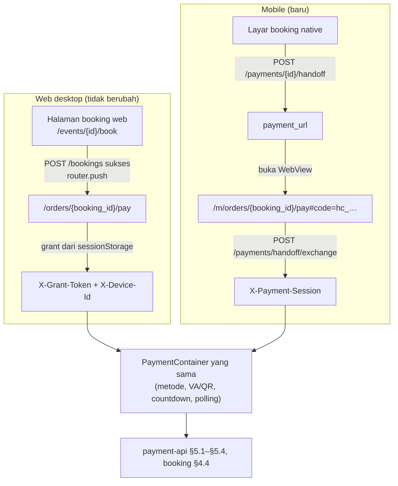
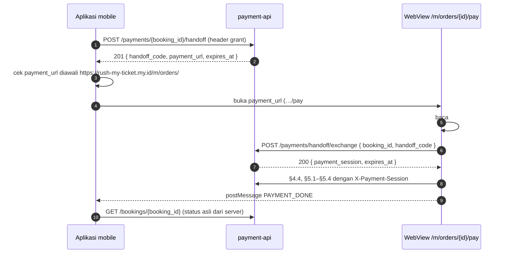
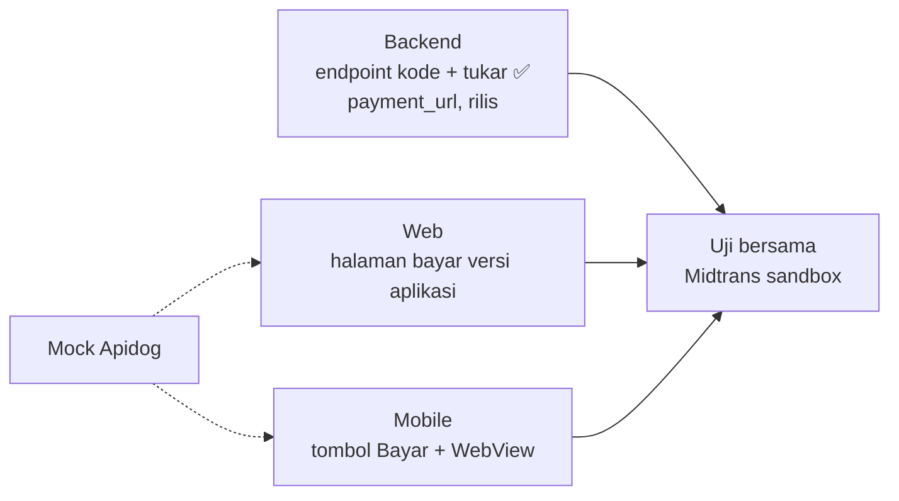
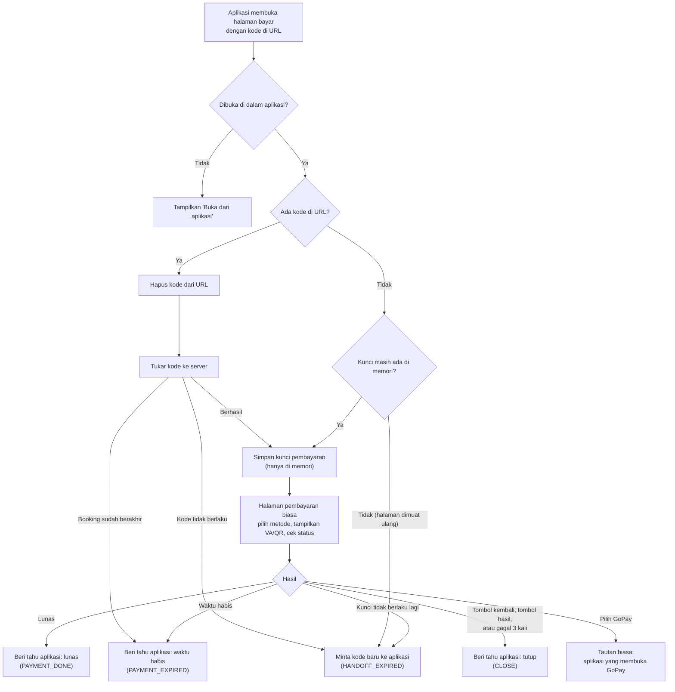
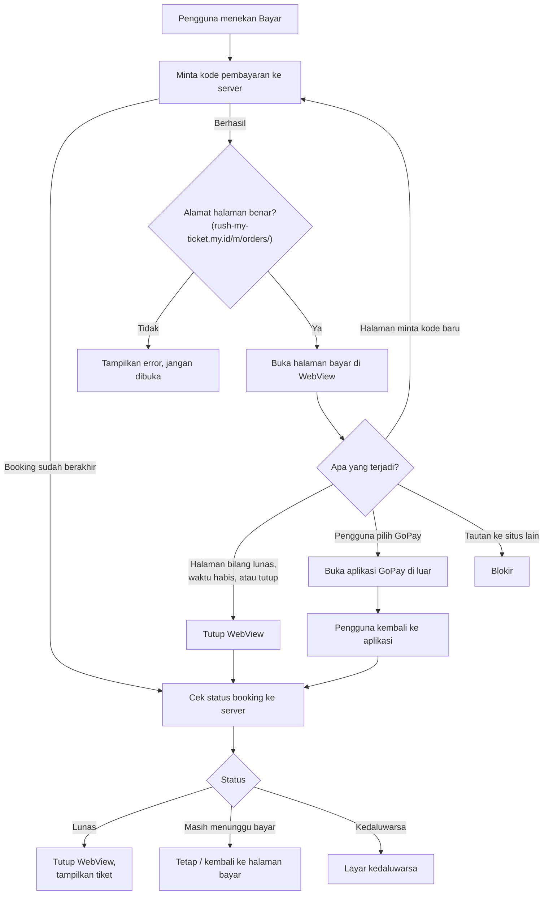

# ADR-007: Serah-Terima Pembayaran dari Aplikasi Mobile ke WebView

**Status**: Proposed — menunggu review tim
**Tanggal**: 12 November 2026
**Decider**: SJT Team
**Amends**: ADR-005 §12 "Empat kredensial, empat slot" (kredensial kelima: payment session); api-contracts §4.4, §5 (v2.25–v2.26)
**Dokumen Referensi**: ADR-005 §9, §12; ADR-006 §8.9, §8.13, §8.17; `api/api-contracts.md` §5.6, §5.7; `api/rusuh-booking-apidog.json`
**Menggantikan**: repo web `docs/adr/0008-webview-payment-embed.md` §1 (cookie + `?code=` + `POST /auth/webview-code`) dan fallback `rusuh://` di §3. Route embed, layout, dan `PaymentResultNotifier` dari ADR-0008 tetap dipakai.
**Menjawab**: repo mobile `docs/CONTRACT-BASELINE.md` §5.1 (cara serah-terima, URL WebView, callback, redirect, GoPay return); issue mobile #14 tidak lagi `blocked-external`

---

## Konteks

Halaman booking di aplikasi mobile bersifat **native**. Halaman pembayaran dibuat **satu kali di web** (Next.js) dan
dibuka di **WebView** dari aplikasi. Semua endpoint pembayaran butuh kredensial yang hanya dimiliki aplikasi
(`X-Grant-Token` + `X-Device-Id` atau `Authorization: Bearer`). Bagaimana kredensial itu sampai ke halaman web
**tanpa ditaruh di URL**? URL tercatat di log, riwayat, `Referer`, dan screenshot.

Web desktop tidak punya masalah ini: halaman booking dan pembayaran ada di tab yang sama, jadi grant sudah tersedia.

## Keputusan

**Aplikasi meminta kode sekali pakai; halaman web menukarnya dengan session yang hanya berlaku untuk satu booking.**
Polanya sama dengan *authorization code* pada OAuth.

Analogi: aplikasi tidak menyerahkan kunci rumah ke kurir. Ia meminta **kode sekali pakai**, kurir menukarnya dengan
**kartu akses yang hanya membuka satu pintu**, dan kartu itu mati saat urusannya selesai.

### Dua sumber, satu halaman pembayaran

Web **tidak membuat dua halaman**. Kedua route hanya file tipis yang merender `PaymentContainer` yang sama
(keduanya sudah ada). Yang berbeda hanya hal-hal berikut, dan dipasang lewat DI:

| | `/orders/{id}/pay` (web desktop) | `/m/orders/{id}/pay` (WebView) |
|---|---|---|
| Dibuka oleh | Web sendiri, setelah booking atau login | Aplikasi mobile saja |
| Gerbang | `proxy.ts` (cookie grant) | Penukaran `#code` |
| Kredensial | `X-Grant-Token` + `X-Device-Id` / `Authorization` | `X-Payment-Session` saja |
| Akhir alur | Layar hasil + tautan | `postMessage` ke aplikasi, tanpa navigasi |

### Alur mobile

### Aturan

1. **Tidak ada kredensial di URL.** URL WebView hanya membawa `booking_id` dan `#code=`. Bagian `#` tidak dikirim ke
   server, jadi tidak masuk log maupun `Referer`; halaman langsung menghapusnya.
2. **Kode serah-terima** (`hc_…`, 256 bit): **sekali pakai**, **60 detik**, untuk satu `booking_id`. Diterbitkan
   setelah pemeriksaan grant yang sama dengan §5, jadi device (tamu) dan Bearer (login) diperiksa di sini, sekali.
3. **`payment_url` dari backend.** Backend menyusunnya dari setelan `PAYMENT_WEB_URL` +
   `/m/orders/{booking_id}/pay#code={handoff_code}`. Bila route web berubah, aplikasi tidak perlu rilis ulang.
   Aplikasi **wajib** memeriksa URL diawali `https://rush-my-ticket.my.id/m/orders/` sebelum membukanya.
4. **Payment session** (`ps_…`, 256 bit), header **`X-Payment-Session`**: hanya untuk `GET /bookings/{booking_id}`
   dan §5.1–§5.4, dan hanya booking miliknya (booking lain → `404`). Hidup selama grant hidup:
   - **PAID:** webhook tidak menghapus grant, jadi session tetap berlaku dan `/status` menjawab `PAID`.
   - **EXPIRED / dibatalkan:** grant dihapus, session ikut mati (`401 PAYMENT_SESSION_INVALID`).
5. **Satu kredensial per request.** `X-Payment-Session` **atau** `X-Grant-Token`; keduanya → `400 VALIDATION_ERROR`.
6. **Session hanya di memori halaman** (bukan `localStorage`, cookie, atau URL). Muat ulang = session hilang = minta
   kode baru ke aplikasi (`HANDOFF_EXPIRED`). Request dari halaman embed memakai `credentials: "omit"`.
7. **Halaman embed tidak pernah berpindah halaman.** Tombol hasil, redirect ke beranda, dan `redirect_url` diganti
   pesan ke aplikasi. Dibuka di browser biasa (tanpa `window.ReactNativeWebView`) → tampilkan "Buka dari aplikasi".
8. **Pesan dari WebView hanyalah sinyal.** Aplikasi selalu memastikan lewat `GET /bookings/{booking_id}`. Yang
   menentukan lunas tetap webhook (ADR-005 §9).
9. **WebView dikunci ke `https://rush-my-ticket.my.id`.** Navigasi ke `gojek.link` / `gopay://` dibuka di luar
   aplikasi dengan `Linking.openURL`; host lain diblokir. Tautan GoPay di halaman cukup `<a href>` biasa.
10. **Kembali dari GoPay tanpa deeplink.** Backend tidak mengirim `callback_url` GoPay, jadi pengguna kembali sendiri
    lewat app switcher. WebView masih terbuka dan polling berjalan lagi. App Link dan `rusuh://` tidak dipakai di POC.
11. **Web desktop tidak berubah**: tanpa kode, tanpa session, tetap `X-Grant-Token`.

### Pesan WebView → aplikasi

`window.ReactNativeWebView.postMessage(JSON.stringify({ type, booking_id }))`

| `type` | Kapan | Aplikasi melakukan |
|---|---|---|
| `PAYMENT_DONE` | `/status` = `PAID` | Tutup WebView, `GET /bookings/{id}`, tampilkan tiket bila `PAID` |
| `PAYMENT_EXPIRED` | `/status` = `EXPIRED`, `PAYMENT_WINDOW_CLOSED`, atau exchange menjawab `401 GRANT_TOKEN_INVALID` | Tutup WebView, `GET /bookings/{id}`, layar kedaluwarsa |
| `HANDOFF_EXPIRED` | Exchange menjawab `401 HANDOFF_CODE_INVALID`, halaman dimuat ulang, atau **setiap** `401 PAYMENT_SESSION_INVALID` | Minta kode baru (§5.6) dan muat ulang. Bila §5.6 menjawab `401 GRANT_TOKEN_INVALID`, booking sudah berakhir: cek `GET /bookings/{id}` |
| `CLOSE` | Tombol "kembali" atau tombol hasil, atau `MAX_ATTEMPTS_EXCEEDED` | Tutup WebView, `GET /bookings/{id}`, tampilkan layar sesuai status |

## Alternatif yang ditolak

| Alternatif | Alasan ditolak |
|---|---|
| Grant / Bearer di query string | Bocor lewat log, riwayat, `Referer`, screenshot |
| Header khusus atau `injectedJavaScript` berisi token | Header hanya ikut request pertama; token mentah di halaman bisa bocor bila origin tidak dikunci |
| Exchange mengembalikan grant + Bearer mentah | Web memegang sesi akun penuh; satu XSS di halaman pembayaran = akun diambil alih |
| Cookie HttpOnly untuk session | Butuh perlindungan CSRF dan CORS `credentials`; perilaku cookie WebView iOS/Android berbeda |
| Aplikasi menyusun URL sendiri | Bila route web berubah, aplikasi harus rilis ulang |
| Halaman pembayaran native | Tanpa endpoint baru, tetapi tim ingin satu halaman pembayaran untuk web dan mobile. **Cadangan** bila waktu tidak cukup |

## Konsekuensi

Diurutkan dari yang paling menentukan.

### Kelebihan

| # | Kelebihan | Mengapa penting |
|---|---|---|
| 1 | **Tidak ada kredensial di URL** | Grant dan Bearer tidak pernah masuk log, riwayat WebView, `Referer`, atau screenshot |
| 2 | **Kode yang bocor tidak berguna** | Sekali pakai, 60 detik, satu booking. URL WebView yang tersalin tidak membuka apa pun |
| 3 | **Dampak kebocoran kecil** | Session hanya bisa melihat dan membayar satu booking. Bearer akun tidak pernah sampai ke web |
| 4 | **Memenuhi requirement** | Satu halaman pembayaran web dipakai ulang di mobile (`requirements.md` §8), API pembayaran sama (FR-24, NFR-08), halaman dijaga token (NFR-07) |
| 5 | **Perubahan kecil** | Backend tanpa migrasi; web tanpa halaman baru; session mati sendiri bersama grant |

### Kekurangan

| # | Kekurangan | Mitigasi |
|---|---|---|
| 1 | **Tiga tim berkoordinasi**, dan `postMessage` menjadi kontrak baru web ↔ mobile | Pesan dan tugas tertulis di ADR ini; web dan mobile bisa mulai dengan mock Apidog |
| 2 | **Muat ulang WebView menghilangkan session** | `HANDOFF_EXPIRED` → kode baru → muat ulang. Grant tetap sama (BR-09) |
| 3 | **Lebih banyak bagian**: dua endpoint, kredensial kelima, dua guard per rute | Memakai ulang grant guard; diuji per rute |
| 4 | **Session masih berlaku setelah `PAID`** sampai grant habis | Hanya bisa membaca status booking itu; sama dengan perilaku grant hari ini |

**Tidak berubah:** alur Midtrans, webhook, status booking, dan web desktop.

## Tugas per tim

### Backend (Erma, Handoko)

1. ✅ §5.6 handoff, §5.7 exchange, guard `X-Payment-Session` di §4.4 dan §5.1–§5.4, CORS, uji unit + integrasi
   (branch `feature/payment-handoff`).
2. Tambah `payment_url` di respons §5.6 dan setelan `PAYMENT_WEB_URL` per environment.
3. Merge ke `main` dan deploy, supaya web dan mobile bisa uji ke API sungguhan.

### Web (Muzaki, Akbar) — route yang sudah ada `src/app/(embed)/m/orders/[orderId]/pay`

Alur halaman `/m/orders/{booking_id}/pay`:

1. Baca `#code`, hapus dengan `history.replaceState`, panggil §5.7. Route ini tetap di luar matcher `proxy.ts`.
2. Kredensial embed: `payment_session` di memori; pengganti `grantHeaders` yang mengirim `X-Payment-Session` saja;
   HTTP client `credentials: "omit"`. `GET /events/{id}` tetap tanpa kredensial.
3. `PaymentResultNotifier` versi WebView: kirim pesan sesuai tabel; hapus fallback `rusuh://`; tombol hasil dan
   redirect ke beranda menjadi pesan. Tanpa `window.ReactNativeWebView` → "Buka dari aplikasi".
4. Setiap `401 PAYMENT_SESSION_INVALID`: hentikan polling, kirim `HANDOFF_EXPIRED`.
5. Instruksi VA/QR hilang saat muat ulang (disimpan di memori). Bila booking sudah menunggu pembayaran tetapi instruksi
   tidak ada, panggil §5.2 lagi dengan metode yang sama (idempoten, tanpa charge kedua). Berlaku juga untuk web desktop.
6. Header route embed: `Referrer-Policy: no-referrer`.
7. Tandai ADR-0008 §1 dan fallback `rusuh://` sebagai digantikan ADR-007.

### Mobile (Rosyid) — Expo, issue #13 (fake) dan #14 (real)

Alur tombol "Bayar":

1. `npx expo install react-native-webview`.
2. Tombol "Bayar": panggil §5.6 dengan header grant yang sudah ada; pastikan `payment_url` diawali
   `https://rush-my-ticket.my.id/m/orders/`; buka segera (kode hanya 60 detik). Minta kode baru setiap membuka WebView.
3. Kunci WebView: `originWhitelist={['https://rush-my-ticket.my.id']}`; `onShouldStartLoadWithRequest` membuka
   `gojek.link` / `gopay://` dengan `Linking.openURL` dan memblokir host lain; `setSupportMultipleWindows={false}`;
   `allowFileAccess={false}`.
4. `onMessage`: abaikan pesan bila `nativeEvent.url` bukan `https://rush-my-ticket.my.id`; tangani sesuai tabel.
5. Saat aplikasi kembali ke foreground (setelah GoPay) dan setelah WebView ditutup: `GET /bookings/{booking_id}`.
6. Tandai pertanyaan di `docs/CONTRACT-BASELINE.md` §5.1 yang dijawab ADR-007.

### Bersama

1. Uji end-to-end di Midtrans sandbox: tamu dan login × VA dan GoPay, di Android dan iOS.
2. Uji negatif: putar ulang kode, kode setelah 60 detik, salin URL WebView ke browser lain, ganti `booking_id`,
   muat ulang WebView (instruksi VA/QR harus tetap tampil).

## Pertanyaan terbuka

1. Batas 10 kode/menit per grant: cukup untuk muat ulang wajar? (usul: ya)
