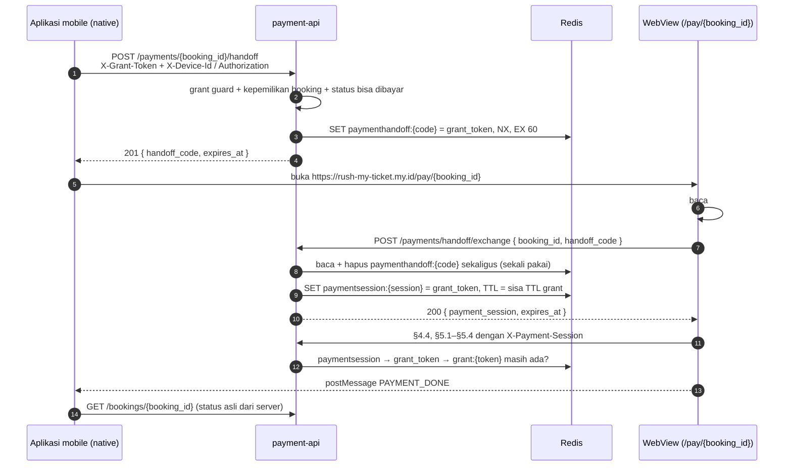
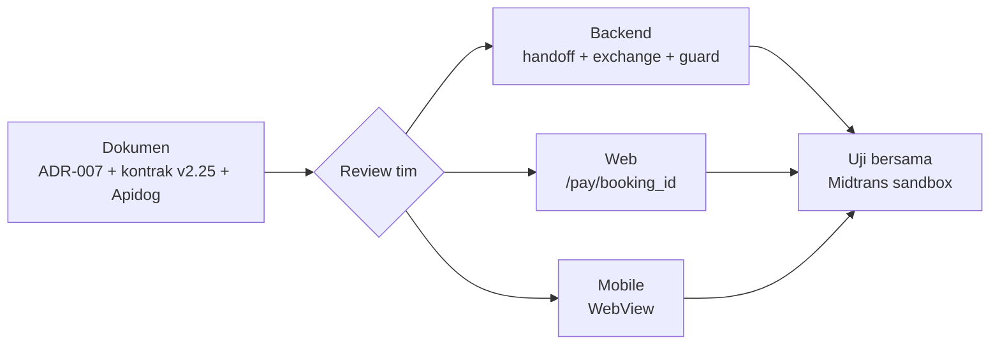

# ADR-007: Serah-Terima Pembayaran dari Aplikasi Mobile ke WebView

**Status**: Proposed — menunggu review tim
**Tanggal**: 12 November 2026
**Decider**: SJT Team
**Amends**: ADR-005 §12 "Empat kredensial, empat slot" (kredensial kelima: payment session); api-contracts §4.4, §5 (v2.25.0)
**Dokumen Referensi**: ADR-005 §9, §12; ADR-006 §8.9, §8.13, §8.17; `api/api-contracts.md` §5.6, §5.7; `api/rusuh-booking-apidog.json`

---

## Konteks

Halaman booking di aplikasi mobile (React Native) bersifat native. Halaman pembayaran dibuat **satu kali di web**
(Next.js, `https://rush-my-ticket.my.id/pay/{booking_id}`) dan dibuka di **WebView** dari aplikasi.

Masalahnya: semua endpoint pembayaran (§5) butuh kredensial yang hanya dimiliki aplikasi, yaitu
`X-Grant-Token` ditambah `X-Device-Id` (tamu) atau `Authorization: Bearer` (login). Bagaimana kredensial itu
sampai ke halaman web **tanpa bocor**?

Cara yang paling mudah adalah yang paling berbahaya:

| Cara | Masalah |
|---|---|
| `…/pay/RB-00912?grant_token=gt_…` | URL tercatat di log CDN / API Gateway, riwayat WebView, header `Referer`, dan screenshot. Grant akun login juga membuktikan identitas (ADR-006 §8.17), jadi URL yang bocor = identitas yang bocor |
| Header khusus pada load pertama WebView | Hanya terkirim pada request dokumen pertama, tidak pada panggilan API halaman itu, hilang saat redirect di Android, dan tidak dapat dibaca JavaScript |
| Suntik token lewat JavaScript (`injectedJavaScript`) | Token mentah berada di halaman; WebView yang dibuka ke domain lain ikut menerimanya bila origin tidak dikunci dengan benar |
| Kirim Bearer akun ke web | Halaman pembayaran memegang sesi akun penuh (22740 detik), padahal ia hanya perlu membayar satu booking |

## Keputusan

**Kode serah-terima sekali pakai, ditukar dengan sesi pembayaran yang hanya berlaku untuk satu booking.**
Polanya sama dengan *authorization code* pada OAuth.

Analogi: aplikasi tidak menyerahkan kunci rumah ke kurir. Ia meminta **kode sekali pakai** dari satpam,
kurir menukarnya di pos dengan **kartu akses yang hanya membuka satu pintu**, dan kartu itu mati saat urusannya selesai.

### Aturan

1. **Token tidak pernah ada di URL.** URL WebView hanya membawa `booking_id` dan `#code=`. Bagian `#fragment`
   tidak dikirim ke server mana pun, sehingga tidak masuk log maupun `Referer`; halaman menghapusnya segera.
2. **Kode serah-terima**: acak 256 bit (`hc_…`), **sekali pakai** (dibaca dan dihapus sekaligus, juga saat percobaan gagal),
   **60 detik**, terikat ke satu `booking_id`. Diterbitkan hanya setelah grant guard yang sama dengan §5 lolos,
   jadi pengikatan device (tamu) dan pemeriksaan Bearer (login) terjadi **di sini**, sekali.
3. **Payment session**: opaque acak 256 bit (`ps_…`), dikirim lewat header **`X-Payment-Session`**.
   Isinya hanya `grant_token` (booking diambil dari grant), dan ia **hidup selama grant hidup**: setiap request
   memeriksa `grant:{token}` masih ada, dan TTL-nya = sisa TTL grant.
   - **PAID:** webhook **tidak** menghapus grant (hanya `token:` dan `acct:`), jadi session tetap berlaku sampai
     grant habis (`GRANT_TOKEN_TTL_SECONDS`, 1080 detik sejak `granted_at`). Polling `/status` menjawab `PAID`.
   - **EXPIRED / dibatalkan:** sweep menghapus grant, session ikut mati tanpa langkah tambahan. Polling menjawab
     `401 PAYMENT_SESSION_INVALID`; aplikasi memastikan statusnya (lihat tabel pesan).
4. **Lingkup sempit**: session hanya diterima pada `GET /bookings/{booking_id}` dan `/payments/{booking_id}/…`
   (§5.1–§5.4), dan hanya untuk `booking_id` miliknya. `booking_id` lain → `404 NOT_FOUND` (sama dengan aturan
   kepemilikan ADR-005 §12).
5. **Satu kredensial per request**: `X-Payment-Session` **atau** `X-Grant-Token`. Keduanya dikirim bersamaan →
   `400 VALIDATION_ERROR`. `X-Device-Id` atau `Authorization` yang ikut terkirim bersama session diabaikan.
   Web desktop tetap memakai `X-Grant-Token` seperti sekarang.
6. **Web menyimpan session di memori saja** (bukan `localStorage`/cookie). Tanpa cookie tidak ada CSRF.
   Bila halaman dimuat ulang, session hilang: web meminta kode baru ke aplikasi (`HANDOFF_EXPIRED`).
   Hal yang sama untuk setiap `401 PAYMENT_SESSION_INVALID`: web **tidak** menebak penyebabnya, aplikasi yang
   memutuskan (kode baru, atau layar kedaluwarsa bila §5.6 menjawab `401 GRANT_TOKEN_INVALID`).
7. **Pesan dari WebView hanyalah sinyal.** Aplikasi tidak pernah mempercayai `PAYMENT_DONE`; ia selalu
   memastikan lewat `GET /bookings/{booking_id}`. Yang menentukan lunas tetap webhook (ADR-005 §9).
8. **WebView dikunci ke `https://rush-my-ticket.my.id`.** Domain lain dibuka di luar aplikasi. Deeplink GoPay
   (`gojek.link`, `gopay://`) dibuka dengan `Linking.openURL`; kembali ke aplikasi lewat **App Link / Universal Link**,
   bukan skema `rusuh://` (skema khusus dapat diklaim aplikasi lain).

### Pesan WebView → aplikasi

`window.ReactNativeWebView.postMessage(JSON.stringify({ type, booking_id, url? }))`

| `type` | Kapan | Aplikasi melakukan |
|---|---|---|
| `PAYMENT_DONE` | `/status` = `PAID`. Web **mengabaikan** `redirect_url` pada respons itu (dipakai web desktop saja) | Tutup WebView, panggil `GET /bookings/{id}`, tampilkan tiket bila `PAID` |
| `PAYMENT_EXPIRED` | `/status` = `EXPIRED`, atau exchange menjawab `401 GRANT_TOKEN_INVALID` | Tutup WebView, layar kedaluwarsa (setelah cek `GET /bookings/{id}`) |
| `HANDOFF_EXPIRED` | Exchange menjawab `401 HANDOFF_CODE_INVALID`, halaman dimuat ulang tanpa session, atau **setiap** `401 PAYMENT_SESSION_INVALID` (termasuk dari polling `/status`) | Minta kode baru (§5.6), muat ulang WebView. Bila §5.6 menjawab `401 GRANT_TOKEN_INVALID` → booking sudah berakhir: cek `GET /bookings/{id}`, tampilkan layar yang sesuai |
| `OPEN_EXTERNAL` | Pengguna memilih GoPay (`deeplink_url`) | `Linking.openURL(url)` hanya untuk host yang diizinkan |
| `CLOSE` | Pengguna menekan "kembali" di halaman | Tutup WebView; booking tetap menunggu pembayaran sampai tenggat |

## Alternatif yang ditolak

| Alternatif | Alasan ditolak |
|---|---|
| Grant / Bearer di query string | Bocor lewat log, riwayat, `Referer` (lihat Konteks) |
| Exchange mengembalikan grant + Bearer mentah ke web | Lebih sederhana di backend, tetapi web memegang sesi akun penuh; satu XSS di halaman pembayaran = akun diambil alih |
| Cookie HttpOnly untuk session | Butuh perlindungan CSRF dan perubahan CORS `credentials`; WebView iOS/Android berbeda perilaku cookie pihak ketiga (`api.` vs web) |
| Halaman pembayaran native | Paling aman dan tanpa endpoint baru (Core API hanya mengembalikan nomor VA / QR). **Tetap pilihan cadangan** bila waktu tidak cukup; tidak dipilih karena tim ingin satu halaman pembayaran untuk web dan mobile |

## Konsekuensi

Diurutkan dari yang paling menentukan.

### Kelebihan

| # | Kelebihan | Mengapa penting |
|---|---|---|
| 1 | **Tidak ada kredensial di URL** | Grant dan Bearer tidak pernah masuk log CDN / API Gateway, riwayat WebView, `Referer`, atau screenshot. Kode dibawa di `#fragment`, yang tidak dikirim ke server |
| 2 | **Kode yang bocor tidak berguna** | Sekali pakai, 60 detik, hanya untuk satu booking. URL WebView yang tersalin tidak membuka apa pun |
| 3 | **Dampak kebocoran kecil** | Session hanya bisa melihat dan membayar **satu** booking. Bearer akun tidak pernah sampai ke halaman web, jadi XSS di halaman pembayaran tidak dapat mengambil alih akun |
| 4 | **Memenuhi requirement** | Satu halaman pembayaran web dipakai ulang di WebView mobile (`requirements.md` §8 Dalam Lingkup), memakai API pembayaran yang sama (FR-24, NFR-08), dan halaman tetap dijaga token (NFR-07) |
| 5 | **Perubahan backend kecil** | Tanpa migrasi; handler dan query pembayaran tidak berubah (guard mengubah session kembali menjadi grant). Session mati sendiri bersama grant, tanpa kode pembersihan |

### Kekurangan

| # | Kekurangan | Mitigasi |
|---|---|---|
| 1 | **Tiga tim harus berkoordinasi**: backend, web, dan mobile berubah, dan pesan `postMessage` menjadi kontrak baru antara web dan mobile | Pesan dan langkah per anggota tertulis di ADR ini; web dan mobile dapat mulai dengan mock Apidog |
| 2 | **Muat ulang WebView menghilangkan session** (disimpan di memori saja), sehingga aplikasi harus meminta kode baru | Alur `HANDOFF_EXPIRED` → kode baru → muat ulang. Grant tetap sama, jadi BR-09 terpenuhi |
| 3 | **Lebih banyak bagian**: dua endpoint baru, kredensial kelima (`X-Payment-Session`), dan dua guard yang dipilih per rute | Memakai ulang grant guard dan `pkg/ratelimit`; tabel rute di `07-payment/06-grant-guard.md` §12, diuji per rute |
| 4 | **Session masih berlaku setelah `PAID`** sampai grant habis (paling lama `GRANT_TOKEN_TTL_SECONDS` sejak `granted_at`) | Hanya bisa membaca status dan detail booking itu; tidak ada yang bisa dibayar atau diubah. Sama dengan perilaku grant hari ini |

**Tidak berubah:** alur Midtrans, webhook, status booking, dan web desktop.

## Rencana per anggota

Web dan mobile dapat mulai paralel memakai mock Apidog sebelum backend selesai.

### Backend (Erma, Handoko) — `services/payment-api`, `pkg/grantauth`, `pkg/rediskeys`

1. Plan `be-rusuh-war-ticketing/docs/07-payment/07-webview-handoff.md`; tambah `paymenthandoff:` dan `paymentsession:` ke `redis-keys.md`.
2. `POST /payments/{booking_id}/handoff` (§5.6): grant guard, kepemilikan, status bisa dibayar, batas 10 kode/menit per grant, `SET NX EX 60`.
3. `POST /payments/handoff/exchange` (§5.7): baca dan hapus kode sekaligus, cocokkan `booking_id`, cek grant masih ada, buat session dengan TTL = sisa TTL grant.
4. Grant guard: jalur `X-Payment-Session` → `grant_token` → jalur kepemilikan SQL yang sama; tolak session yang dikirim bersama `X-Grant-Token`.
5. Pasang guard baru di §4.4 (`services/booking`) dan §5.1–§5.4; CORS mengizinkan header `X-Payment-Session` dari `https://rush-my-ticket.my.id`.
6. Uji (unit + integrasi Redis): kode hanya sekali; kode kedaluwarsa ditolak; kode booking A tidak membuka booking B;
   session mati saat grant dihapus (EXPIRED); session **masih** menjawab `/status` = `PAID` setelah webhook;
   session tidak membuka booking lain; session + `X-Grant-Token` → 400.
7. `make verify` + review independen (menyentuh grant token).

### Web (Muzaki, Akbar) — Next.js `/pay/[booking_id]`

1. Baca `#code`, langsung `history.replaceState` untuk menghapusnya, panggil §5.7.
2. Simpan `payment_session` di state/ref React; kirim `X-Payment-Session` pada §4.4 dan §5.1–§5.4.
3. Deteksi WebView (`window.ReactNativeWebView`): kirim pesan pada tabel di atas, alih-alih redirect
   (`redirect_url` dari `/status` diabaikan).
4. Setiap `401 PAYMENT_SESSION_INVALID` (termasuk dari polling `/status`): hentikan polling, kirim `HANDOFF_EXPIRED`.
5. Tanpa `#code` dan tanpa WebView → jalur web biasa (grant dari sesi web sendiri).
6. Header halaman: `Referrer-Policy: no-referrer`, CSP tanpa skrip pihak ketiga yang tidak perlu.
7. Host `/.well-known/assetlinks.json` dan `/.well-known/apple-app-site-association` untuk App Link (data dari mobile).

### Mobile (Rosyid) — React Native

1. Tombol "Bayar": panggil §5.6, buka WebView ke `https://rush-my-ticket.my.id/pay/{booking_id}#code={handoff_code}`.
2. Kunci WebView: `originWhitelist={['https://rush-my-ticket.my.id']}`, `onShouldStartLoadWithRequest` menolak host lain,
   `allowFileAccess={false}`, tanpa bridge native tambahan.
3. `onMessage`: abaikan pesan bila `nativeEvent.url` bukan `https://rush-my-ticket.my.id`; tangani `type` sesuai tabel.
4. GoPay: buka `deeplink_url` dengan `Linking.openURL`; daftarkan App Link / Universal Link untuk kembali.
5. Setelah WebView ditutup (apa pun sebabnya): `GET /bookings/{booking_id}` untuk status sebenarnya.

### Bersama (semua)

1. Uji end-to-end di Midtrans sandbox: tamu dan login × VA dan GoPay.
2. Uji negatif: putar ulang kode, kode setelah 60 detik, salin URL WebView ke browser lain, ganti `booking_id`, muat ulang WebView.

## Pertanyaan terbuka

1. Batas 10 kode/menit per grant: cukup untuk muat ulang wajar? (usul: ya)
2. Apakah web desktop juga beralih ke session (satu jalur untuk semua)? Usul: **tidak** untuk POC; web desktop tetap memakai grant.
