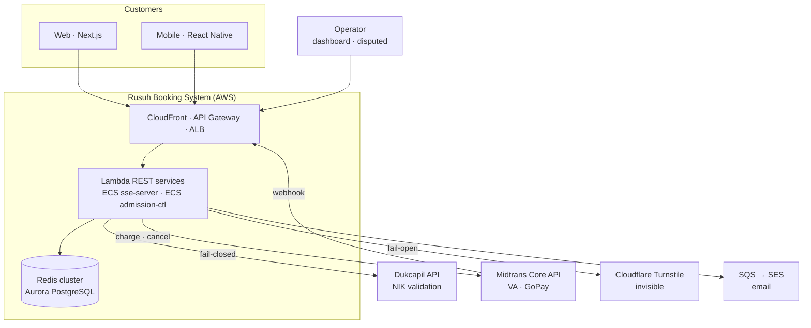
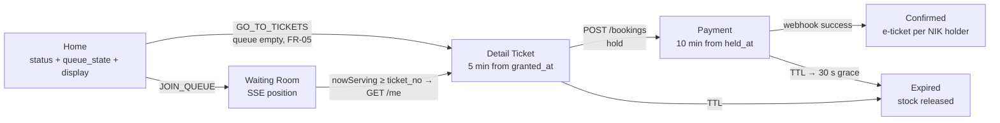
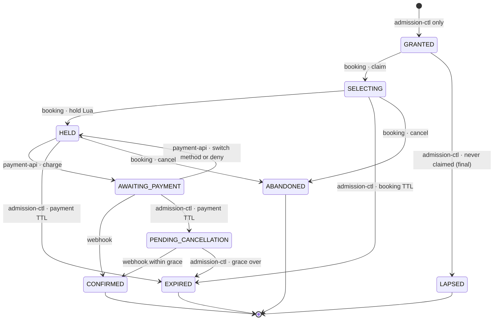
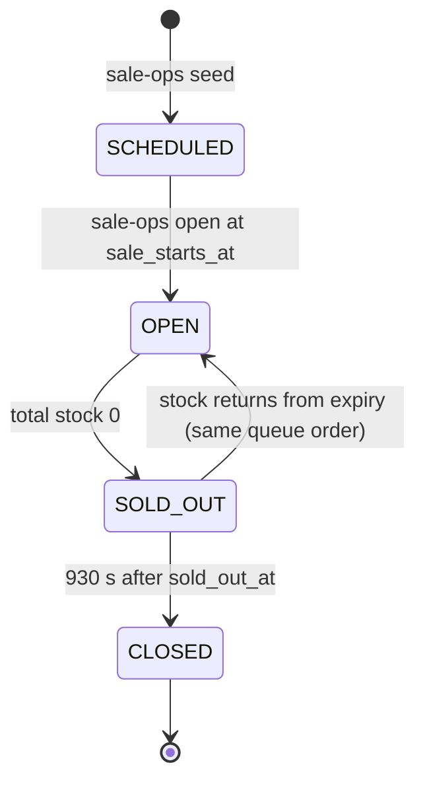
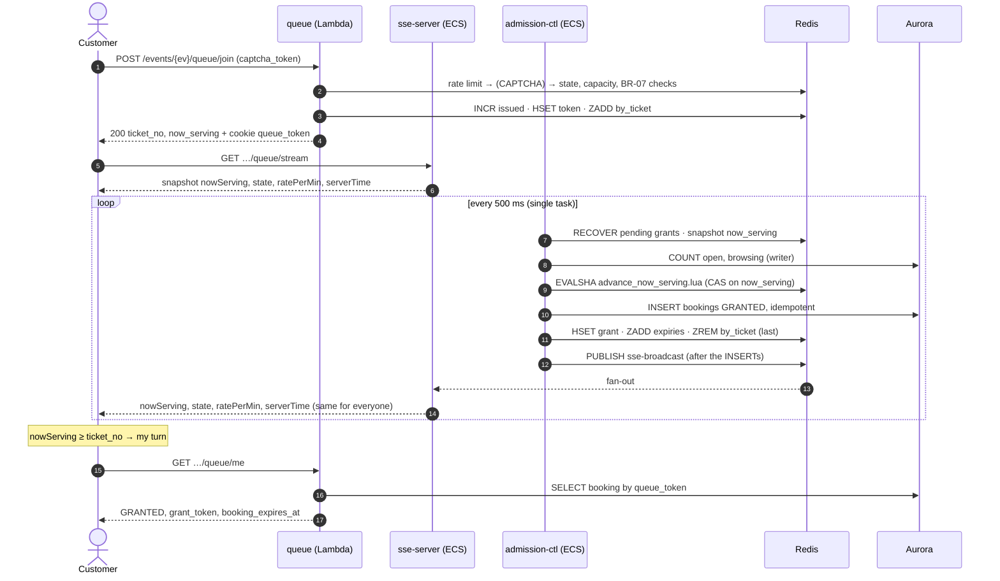
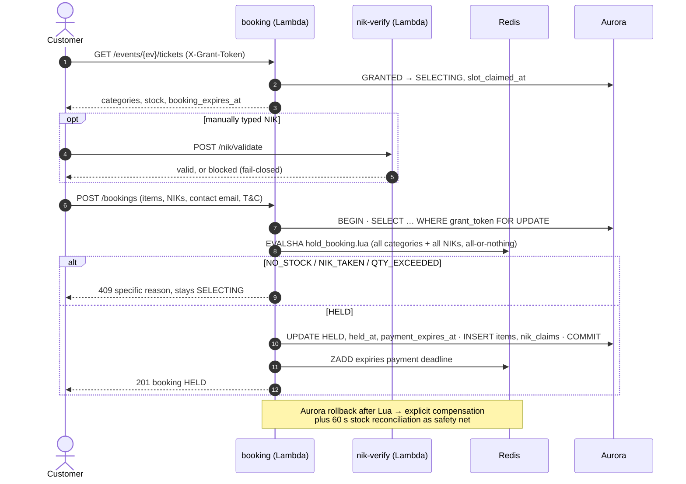
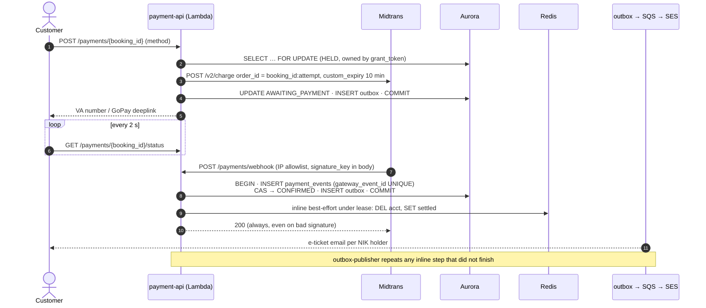
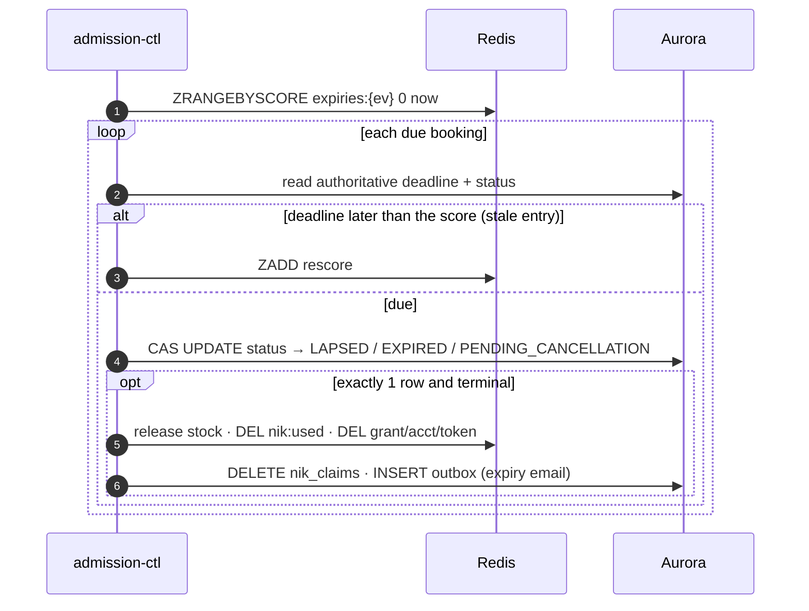
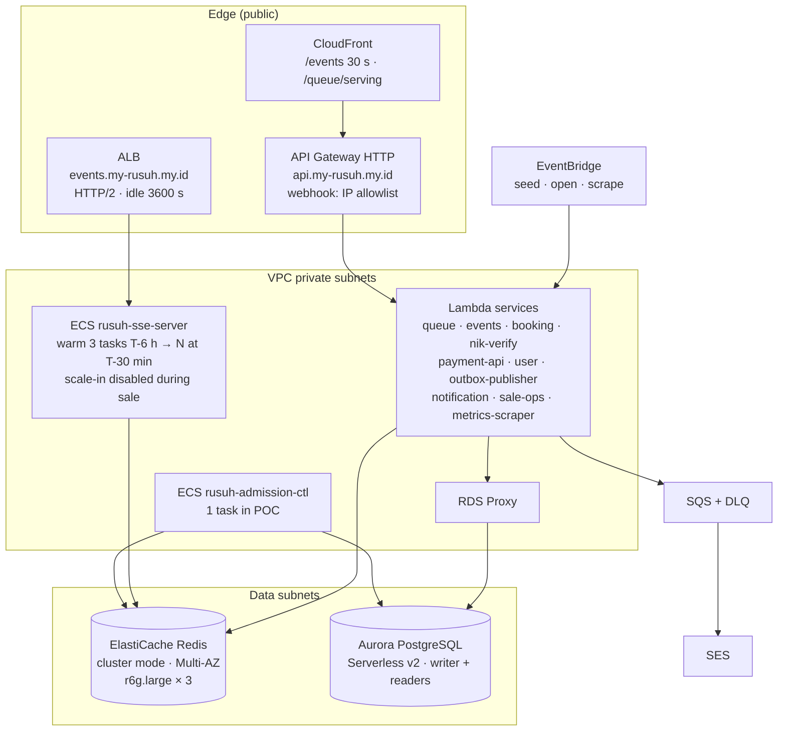

# High-Level Design: Rusuh Booking Ticket System

> **Version:** 2.1.0
> **Last updated:** 2026-11-05 (queue amendments from ADR-006)
> **Status:** Draft for POC. Summary of the architecture of record
> **Target load:** 300,000 concurrent users (NFR-03 requires 200,000+), about 10,000 tickets per event

This document is the **one-page-per-topic overview**. It does not decide anything new. When it
disagrees with a source below, the source wins and this document gets fixed.

| Source | Role |
|---|---|
| `requirement/requirements.md` v1.1 | what (FR / NFR / BR) |
| `adr/ADR-005-final-architecture-decision.md` | how, and why: **architecture of record** |
| `adr/ADR-006-queue-admission-amendments.md` | amends ADR-005 for the queue: pending grants, admission formula, counts from Aurora, one grant writer, broadcast-only, wait-time estimate |
| `requirement/implementation-plan.md` v2.1 | build plan per service and package |
| `api/rusuh-booking-apidog.json` (source of truth), `api/api-contracts.md` v2.7.0 | API contract. OpenAPI YAML archived in `api/archive/` |

**Changes from v1.0:** target 50K → 300K. `waiting-room` renamed `rusuh-sse-server`.
admission-ctl runs as 1 task in the POC (leader + standby deferred, ADR-006 §9). Lua scripts are removed from this document (the v1.0
copies were outdated; see §8). Key names follow `pkg/rediskeys`. NFR table renumbered to
requirements v1.1. Payment methods are VA + GoPay (card and OTC out of scope). `LAPSED` is final.
`SOLD_OUT` is reversible. ASCII diagrams replaced with Mermaid. **v2.1 (ADR-006 §4.3): admission pause and its +60 s grace are removed.**

---

## 1. Executive Summary

A virtual waiting room plus ticket booking for flash-crowd concert sales. Customers join a
FCFS queue, watch their position over SSE, get a 5-minute slot to pick up to 3 tickets with one
verified NIK per seat, then have 10 minutes to pay through Midtrans.

**Guiding principles** (requirements §1): keep UX stable whatever happens behind it.
**"Jangan PHP"**: once admitted, a customer can always finish. **Transparency**: what the
customer sees is what is true.

### Key design decisions

| Decision | Rationale | ADR |
|---|---|---|
| **Counter queue:** `INCR issued` + one global `now_serving`; clients compute their position | One value to broadcast instead of 300,000 | §6, ADR-002 |
| **SSE on ECS Fargate** for queue updates, REST polling as fallback | Meets p95 < 1 s for every position without client battery cost or a WebSocket registry | §2, §3 |
| **Lambda + API Gateway** for REST | Bursty, stateless, zero idle cost | §1 |
| **Redis for the hot path**, atomic Lua scripts | Sub-ms admission and all-or-nothing multi-category holds | §6, §8 |
| **Aurora is authoritative** for deadlines and states. The Redis ZSET only schedules | Crash windows between the two stores always resolve toward Aurora | §7 |
| **One grant writer:** only admission-ctl grants. An empty-queue join just waits ≤ 1 s for the next 500 ms tick | No second path that can drift or over-admit | ADR-006 §4 |
| **Admission counts read from Aurora each tick**, no Redis slot counters | Nothing to keep in sync across booking, payment and webhook; a count can't drift | ADR-006 §3 |
| **Broadcast only:** clients detect their turn from `nowServing ≥ ticket_no` and call `/me` | sse-server sends identical bytes to everyone, with no per-customer routing. Named `status` event on each sale-state change | ADR-006 §4 |
| **Pending grants:** a token leaves `by_ticket` only after its `GRANTED` row exists | A crash between Redis and Aurora can't lose a customer | ADR-006 §2 |
| **Fail-closed on Dukcapil** (correctness), **fail-open on CAPTCHA** (fairness only) | "Fail closed when correctness is at stake, open when only fairness is" | §6, §8 |
| **No admission pause.** Dependency breakers fail fast (fail closed) but the queue keeps moving; deadlines never shift | One state fewer in tick, payload, client and tests. Accepted: a long outage can make admitted customers lapse | ADR-006 §4.3 |
| **Transactional outbox → SQS → SES** | Email failure never cancels a transaction (NFR-10) | §9 |

---

## 2. System Context



---

## 3. Component Catalog

### 3.1 Compute

| Service | Runtime | Responsibility | Build status (2026-11-04) |
|---|---|---|---|
| `queue` | Lambda, provisioned concurrency from T-30 min | join (empty queue: waits ≤ 1 s for the grant, read only), `/me` entry and recovery, `/serving` fallback | not started |
| `rusuh-sse-server` | ECS Fargate, 2 vCPU / 4 GB, pre-scaled to N, max 60 | 300k SSE connections, pub/sub fan-out, stale detector | not started |
| `rusuh-admission-ctl` | ECS Fargate, **1 task** (deploy min 0 % / max 100 %), 500 ms tick. Leader + standby deferred | the only grant writer: advance, sweep, broadcast, stock reconciliation, SOLD_OUT → CLOSED (publishes the `status` event on each state change) | not started |
| `events` | Lambda + CloudFront 30 s | event list and detail with `status` / `queue_state` / `display` | not started |
| `booking` | Lambda | claim (`GET …/tickets`), hold (`POST /bookings`), booking detail, abandon | in-memory scaffold |
| `nik-verify` | Lambda | Dukcapil call, rate limit, breaker, 24 h cache, reuse of stored proof | built (branch) |
| `payment-api` | Lambda, provisioned concurrency | charge, switch method, status, webhook, disputed list | not started |
| `user` | Lambda | magic-link auth, register + NIK + consent, saved NIKs, my tickets, e-ticket | built (branch) |
| `outbox-publisher` | Lambda, every 1 s | outbox → SQS fallback, per-type side effects | partial (branch) |
| `notification` | Lambda, SQS consumer | SES email per NIK holder, dedup | built (branch) |
| `sale-ops` | Lambda, EventBridge | `seed` at T-30 min, `open` at `sale_starts_at`, `rebuild` after Redis loss | not started |
| `metrics-scraper` | Lambda, EventBridge 1 min | FR-33/34/35 dashboard metrics | not started |

Detail per service: implementation-plan §5–§13.

### 3.2 Data stores

| Store | Spec | Holds | Authority |
|---|---|---|---|
| **Redis** (ElastiCache, cluster mode, Multi-AZ, `r6g.large` × 3) | about 80 MB working set. Sized for ops/s, not memory | queue counters and tokens, stock, `nik:used`, grants, expiries ZSET, rate limits, breakers, leader lease, pub/sub | stock and queue fast path |
| **Aurora PostgreSQL** (Serverless v2, writer + readers, RDS Proxy, PITR) | | bookings, items, NIK claims, payments, tickets, outbox, accounts, consent, queue_entries | **deadlines, states, money** |

### 3.3 External integrations

| System | Purpose | Failure policy |
|---|---|---|
| **Dukcapil** | NIK existence (NIK only) | **Fail-closed.** Unverified NIK + Dukcapil down → booking blocked. Breaker OPEN → NIK validation fails fast with a retryable error; the queue keeps moving. Accepted SPOF (mock in POC) |
| **Midtrans Core API** | VA (BCA/BNI/BRI/CIMB) + GoPay, `custom_expiry` = 10 min | Breaker OPEN → `PAYMENT_GATEWAY_UNAVAILABLE` (503, retryable). Webhook is the confirmation of record |
| **CAPTCHA**: Cloudflare Turnstile (invisible mode) | bot friction on `/join` | **Fail-open** with alarm (`CaptchaFailOpenSeconds`) |
| **SQS → SES** | e-tickets, expiry and failure emails | async with retry + DLQ, never blocks a transaction |

---

## 4. Customer Journey and States

### 4.1 End-to-end journey



Maximum journey: 5 min + 10 min + 30 s = **15.5 min** (930 s).

### 4.2 Booking status (owned transitions)



**Admission counts come from these statuses, read from Aurora each tick (ADR-006 §3):**
`open` = GRANTED + SELECTING + HELD + AWAITING_PAYMENT + PENDING_CANCELLATION, and
`browsing` = GRANTED + SELECTING. No service updates a queue counter on a transition. The
counting relies on one invariant: **no transition goes back into GRANTED or SELECTING**. A success callback after
`EXPIRED` marks the booking **Disputed** (`payment_disputed`) for manual refund (FR-23c, BR-19).

### 4.3 Sale state per event (`queue:{ev}:state`)



The home page shows two separate fields. `status` (`AVAILABLE / SELLING_OUT_FAST / SOLD_OUT`)
describes stock. `queue_state` (`NOT_OPEN / DIRECT / OPEN / FULL`) describes entry. The server also sends a
ready-to-render `display` block (ADR-005 §6).

---

## 5. Key Flows

### 5.1 Join and wait



Join never touches Aurora on the hot path. Durable positions (`qpersist` → `queue_entries`,
ADR-005 §12) are **deferred to production** (ADR-006 §9); the POC relies on Redis Multi-AZ.

### 5.2 Claim and hold



### 5.3 Payment and webhook



### 5.4 Expiry sweep (admission-ctl)



### 5.5 Wait-time estimate (FR-09)

admission-ctl computes `rate_per_min` = how many ticket numbers `now_serving` passes per minute,
over the last 60 s while `OPEN`. It uses a seed (`MAX / 5 min`) for the first 60 s so the T0 burst
doesn't skew it. It's sent as `ratePerMin` (SSE) and `rate_per_min` (`/serving`).

The **frontend computes the estimate** with one written rule (api-contracts §3.5, ADR-006 §6.2):

```
position = ticket_no − nowServing
SOLD_OUT → sold-out message · position ≤ 0 → "sebentar lagi" + GET /me · ratePerMin ≤ 0 → "Menghitung estimasi…"
else minutes = ceil(position / ratePerMin) rounded UP (1–10 as is, 11–30 → ×5, 31–60 → ×10, > 60 → ×30) → "± N menit"
```

No API response carries an estimate field.

**Sale-level planning numbers** (assumptions: basket 2, conversion 70%, 5 min per slot):

| | Value |
|---|---|
| Customers that must be admitted to sell 10,000 tickets | ≈ 7,150 |
| Share of a 300,000 queue that gets a turn | ≈ 2.4% |
| Time to sell out at MAX 500 / 1,000 / 2,000 | ≈ 72 / 36 / 18 min |

The cut-off (about 7,150 turns) doesn't depend on MAX; only the speed does. Details:
`be-rusuh-war-ticketing/docs/04-queue/README.md` §8.

---

## 6. Redis Keyspace

All names come from `pkg/rediskeys` (implementation-plan §3.1). Keys touched by one Lua script
share the `{ev}` hash tag, so **all hot state of one event lives on one cluster shard**.

| Group | Keys |
|---|---|
| Queue | `queue:{ev}:state`, `queue:{ev}:issued`, `queue:{ev}` (hash: `now_serving`, `rate_per_min`), `queue:{ev}:by_ticket` (zset; score ≤ `now_serving` = pending grant), `queue:{ev}:capacity`, `queue:{ev}:sold_out_at`. No slot counters (ADR-006 §3); `qpersist:{ev}` deferred to production |
| Credentials | `token:{uuid}`, `grant:{token}` (EX 1080), `acct:{ev}:{account_id}` (BR-07), `settled:{uuid}` (tombstone) |
| Booking | `stock:{ev}:{cat}`, `nik:used:{ev}:{hmac}`, `nik:valid:{hmac}` (EX 86400), `expiries:{ev}` (zset, scheduler only) |
| Control | Production only (deferred): `ctl:leader` (NX EX 5), `ctl:epoch` (fencing). `pause:{ev}`, `pause:{ev}:grace_applied` removed (ADR-006 §4.3) |
| Dependencies | `breaker:{dukcapil\|payment-gateway}:state/failures`, `rl:{service}` |
| Ingress | `rl:join:{ip}`, `rl:sse:{ip}`, `rl:pay:{booking_id}` |
| Outbox | `processed:{outbox_id}` (lease 30 s → done EX 86400) |
| Pub/Sub | `sse-broadcast`, `sse-status` (state changes incl. CLOSED; replaces `sse-sold-out`) (classic `PUBLISH`; sharded pub/sub deferred) |

---

## 7. Aurora Schema (summary)

Full DDL: ADR-005 §4 and migrations `0001`–`0007` (implementation-plan §4).

| Table | Purpose | Key constraints |
|---|---|---|
| `bookings` | one row per engagement from `GRANTED` | separate `queue_token` and `grant_token` (unique). Status CHECK. `contact_email` / `terms_accepted_at` required after SELECTING / HELD. **BR-07 partial UNIQUE** `(event_id, account_id)` over live states |
| `booking_items` | one row per seat | `UNIQUE (booking_id, nik_hmac)` |
| `nik_claims` | BR-02 across bookings | `UNIQUE (event_id, nik_hmac)` |
| `payment_events` | gateway notifications | `gateway_event_id UNIQUE` (idempotency) |
| `tickets` | issued e-tickets | `UNIQUE (booking_item_id)` (no duplicate QR on retry) |
| `outbox` | side-effect intents | partial index on unpublished rows |
| `queue_entries` | durable queue positions (async) | PK `(event_id, queue_token)`, `UNIQUE (event_id, ticket_no)` |
| `event_queue_state` | sale state transitions | written on transition only |
| `ticket_categories` | capacity and price | **capacity immutable during a sale** (stock reconciliation baseline) |
| `accounts`, `saved_niks`, `consent_records` | identity and NIK proof | `UNIQUE (nik_hmac)` global. `saved_niks.verified_at NOT NULL`. consent **append-only** (UU PDP) |

NIKs are stored as **HMAC with a KMS-managed pepper** plus a masked display form. Plaintext is
never stored and never returned (NFR-11, FR-32c).

---

## 8. Atomic Operations

| Script | Called by | Guarantees | Source |
|---|---|---|---|
| `advance_now_serving.lua` | admission-ctl only | CAS fence on `now_serving` (guards against two tasks), SOLD_OUT ↔ OPEN, stock read inside, `deficit = min(MAX − open, ceil(stock / 3) − browsing)` with `open` / `browsing` passed in from the Aurora COUNT. **Does not ZREM**: tokens stay in `by_ticket` as pending grants until their row exists | ADR-006 §2–§3 |
| `hold_booking.lua` | booking | quota across categories, check **all** stock before decrementing any, NIK `SET NX` with rollback, missing key ≠ zero (`STOCK_UNINITIALIZED`) | ADR-005 §8 · impl-plan §14.2 |
| `adjust_if_unchanged.lua` | admission-ctl stock reconciliation | compare-and-adjust so a double run never corrects twice | ADR-005 §6 · impl-plan §14.3 |
| lease renew / release | admission-ctl, **production only** | owner-checked `PEXPIRE` / `DEL` | ADR-005 §11, deferred (ADR-006 §9) |

> Scripts live in `pkg/redisscript` only. Don't copy them into documents again. The copies in
> HLD v1.0 drifted and were wrong.

---

## 9. Credentials

Four credentials, each in its own transport slot (api-contracts §9).

| Credential | Slot | Proves | Revocable |
|---|---|---|---|
| Access token (JWT session) | `Authorization: Bearer` | who the account is | at expiry |
| Grant token (`gt_…`, opaque) | `X-Grant-Token` | holder has a slot. Guards all booking and payment routes | instantly (`DEL grant:{token}`) |
| Queue token | cookie `queue_token` (web) / `X-Queue-Token` (mobile) | queue position. Never in a URL | at sale window end |
| E-ticket token | `?t=` on email link | read one ticket | — |

Anonymous grants are additionally bound to `X-Device-Id` (stored as HMAC).

---

## 10. NFR Traceability

| NFR | Requirement | How it is met | Owner |
|---|---|---|---|
| NFR-01 | UX holds under any condition | waiting room, sold-out `status` event, stale indicator, server-rendered `display` | queue, sse-server, events |
| NFR-02 | "Jangan PHP" | INSERT before PUBLISH, pending grants retried until their row exists (idempotent INSERT), honest retryable errors when a dependency is down, 30 s payment grace | admission-ctl, payment-api |
| NFR-03 | 300k concurrent | Redis-only join, pre-scaled SSE fleet, CDN for home and serving, provisioned Lambda | infra |
| NFR-04 | no oversell | `hold_booking.lua` all-or-nothing, Aurora reconciliation every 60 s | booking, admission-ctl |
| NFR-05 | FCFS, no cutting in line | `INCR issued` + `by_ticket`, rate limit then invisible CAPTCHA, BR-07 for logged-in users. No WAF in POC (accepted gap) | queue |
| NFR-06 | p95 < 1 s position updates, all positions | SSE push on change + 10 s heartbeat, adaptive polling fallback | sse-server |
| NFR-07 | protected pages, PCI-DSS | grant token on booking and payment routes. Card data never touches us | booking, payment-api |
| NFR-08 | platform-agnostic API | REST/JSON + SSE, same for web and mobile | all |
| NFR-09 | real-time observability | EMF metrics via metrics-scraper (queue depth, conversion, expiry, drift) | metrics-scraper |
| NFR-10 | email never fails a transaction | outbox → SQS → SES + DLQ | outbox-publisher, notification |
| NFR-11 | UU PDP compliance | explicit consent, append-only records, NIK as HMAC | user, nik-verify |
| NFR-12 | Dukcapil cost | registered NIK + saved NIKs + 24 h cache reuse verification proof | nik-verify |
| NFR-13 | queue capacity 300k | `QUEUE_FULL` fail-fast at join, `FULL` shown on home | queue, events |
| NFR-14 | freshness detection | sse-server stale after 30 s without broadcast. `CtlHeartbeatAge` pages ops | sse-server |

---

## 11. Failure Modes and Recovery

| Failure | Detection | Customer impact | Recovery |
|---|---|---|---|
| Dukcapil down | breaker OPEN | NIK validation fails fast (retryable); queue keeps moving; customers who can't finish in time lapse and their seats return to stock | breaker half-open probe → auto recover |
| Midtrans down | breaker OPEN | same as above | same as above |
| CAPTCHA provider down | verify errors | none (fail-open) | alarm `CaptchaFailOpenSeconds` |
| admission-ctl task dies | ECS health / `CtlHeartbeatAge` | queue freezes about 30–60 s, nothing lost (pending grants) | ECS replaces the task. Production: standby takes the lease in ≤ 5.5 s (deferred) |
| admission-ctl fully stuck | no broadcast for 30 s | "reconnecting…" indicator | `CtlHeartbeatAge` pages ops |
| sse-server task lost | ALB health | stream drops | jittered client reconnect, snapshot restores position (FR-10) |
| Redis failover | client errors | brief stale indicator | Multi-AZ failover. Missing stock keys re-seeded immediately by reconciliation |
| Redis total loss | — | **paid and held seats safe in Aurora; queue positions lost** in the POC | POC: re-seed and reopen the sale. Production: `sale-ops rebuild` from `queue_entries` (deferred) |
| Aurora failover (~30 s) | connection errors | join keeps working (Redis only). Claim, hold and pay fail and retry | Aurora failover via RDS Proxy |
| Email failure | SQS retries → DLQ | e-ticket delayed, ticket still in `/users/me/tickets` | DLQ redrive |

---

## 12. Deployment Topology



**Pre-sale schedule** (ADR-005 §11): warm floor at T-6 h, scheduled pre-scale to N tasks at
T-30 min, full rehearsal (300k synthetic joins, fan-out, sold-out and resume) at T-2 days.
Reactive autoscaling can't absorb a ramp of about 5,000 connections/s at T=0. It's only a margin.

---

## 13. Cost Estimate

From ADR-005 §15, at 300k per sale event:

| | Amount |
|---|---|
| Variable per event (SSE ECS ~$10.6, SSE egress ~$17.5, ALB ~$3, API GW ~$2.5, Lambda ~$0.8, Aurora ~$1.05, SQS+SES ~$0.09) | **~$36** + Dukcapil (per contract, unknown) |
| Fixed per month (Redis $477, Aurora Serverless v2 $44, RDS Proxy $44, KMS $3, ALB idle $16, scheduled Lambda $21) | **~$605** |
| Total at 2 events / month | **~$677** |

SSE egress is the biggest variable. Publishing only when `now_serving` changes keeps it in
proportion to admission rate.

---

## 14. Open Questions

From ADR-005 §17 and ADR-006 §10, plus items raised in architecture review on 2026-11-04 that are
**not in any ADR yet** (marked *proposed*).

| # | Question | Owner |
|---|---|---|
| 1 | Dukcapil rate limit, SLA, and cost per call | tender owner |
| 2 | Honest messaging for 300,000 people chasing 10,000 tickets | tender owner |
| 3 | Measured connections per SSE task (drives N and cost) | team, before load test |
| 4 | `MAX_CONCURRENT_SLOTS` value: still open, set by load test. Admission formula **decided in ADR-006 §3:** `deficit = min(MAX − open, ceil(stock / 3) − browsing)`, with counts read from Aurora | team |
| 5 | `SALE_WINDOW_SECONDS`: **POC decided 21600 (6 h)**. Production value still with the tender owner | team + tender owner |
| 6 | Turnstile (decided provider) capacity for 300k `siteverify` calls in ~60 s, and Midtrans webhook IPs | team, T-7 days |
| 7 | **Decided in ADR-006 §2:** crash window between the advance Lua and the GRANTED INSERT closed by pending grants (`by_ticket` as the tray, `regrant` removed) | team: impl-plan §9.6, §14.1 to follow |
| 8 | *Proposed:* explicit cancel endpoint for `ABANDONED` (status exists, contract has no route) | team |
| 9 | *Proposed:* admin authorization for `/admin/reconciliation/disputed` (today a customer Bearer token is accepted) | team |
| 10 | **Decided in ADR-006 §5:** one Redis shard per event for the POC. Confirm about 30k ops/s by load test. If short: scale up the node. Sharded pub/sub deferred (ADR-006 §9) | team |
| 11 | *Proposed (ADR-006 §6.4):* sell-out hint in the waiting room (`likelyServedUntil`), behind a flag, off by default | tender owner (with #2) |
| 12 | Slow-start ramp at T0, pre-queue randomization at T0 (changes NFR-05), SSE reconnect jitter (ADR-006 §10) | team |
| 13 | **Deferred to production (ADR-006 §9):** admission-ctl leader lease + standby, qpersist + `queue_entries` + rebuild, sharded pub/sub | team, after the POC |

---

## Appendix A: Glossary

| Term | Definition |
|---|---|
| `ticket_no` | FCFS queue number from `INCR issued` at join |
| `now_serving` | global watermark. Numbers ≤ it have had their turn |
| Slot | one customer in the booking funnel, from `GRANTED` to a terminal state. Capped by `MAX_CONCURRENT_SLOTS` |
| Grant | permission to enter Detail Ticket. Starts the 5-minute clock |
| Hold | stock and NIKs reserved by `hold_booking.lua`. Starts the 10-minute payment clock |
| Grace | 30 s after payment TTL where a late success callback still confirms |
| Pause | *removed (ADR-006 §4.3).* Was: no new grants while a dependency breaker is OPEN, +60 s grace |
| Disputed | success callback after final cancellation. Flagged for manual refund |
| `open` / `browsing` | admission counts read from Aurora each tick: everyone inside / inside but not holding seats yet |
| pending grant | a `by_ticket` member with score ≤ `now_serving`: admitted in Redis, row not yet confirmed. Retried every tick. Replaces the old `regrant` set. **Not** a second chance for no-shows |
| NIK | 16-digit Indonesian national ID. 1 NIK = 1 seat per event |

## Appendix B: Related Documents

| Document | Path |
|---|---|
| Requirements v1.1 | `requirement/requirements.md` |
| Architecture of record | `adr/ADR-005-final-architecture-decision.md` (supersedes ADR-003, ADR-004) |
| Queue amendments | `adr/ADR-006-queue-admission-amendments.md` (amends ADR-005) |
| Queue technology and position | `adr/ADR-001-…`, `adr/ADR-002-…` |
| Implementation plan v2.1 | `requirement/implementation-plan.md` |
| API | `api/rusuh-booking-apidog.json` (source of truth), `api/api-contracts.md` |
| Payment methods | `payment-method/README.md` |
| Cost model | `infra-cost-model/rusuh-queue-cost-model.xlsx` |
| Backend per-endpoint plans | `be-rusuh-war-ticketing/docs/` |
