# High-Level Design: Rusuh Booking Ticket System

> **Version:** 3.0.0
> **Last updated:** 2026-11-13 (synced with the code on `main` of the backend, web and mobile repos)
> **Status:** As built for the POC. Summary of the architecture of record
> **Target load:** 300,000 concurrent users (NFR-03 requires 200,000+), about 10,000 tickets per event

This document is the **one-page-per-topic overview**. It does not decide anything new. When it
disagrees with a source below, the source wins and this document gets fixed.

| Source | Role |
|---|---|
| `requirement/requirements.md` v1.1 | what (FR / NFR / BR) |
| `adr/ADR-005-final-architecture-decision.md` | how, and why: **architecture of record** |
| `adr/ADR-006-queue-admission-amendments.md` | amends ADR-005 for the queue: pending grants, admission formula, counts from Aurora, one grant writer, broadcast-only, wait-time estimate |
| `adr/ADR-007-mobile-webview-payment-handoff.md` | the web payment page inside the mobile WebView |
| `api/rusuh-booking-apidog.json` (source of truth), `api/api-contracts.md` v2.29.0 | API contract. OpenAPI YAML archived in `api/archive/` |

**Changes from v2.1:**
- Build status is now "built" for every service; the component catalog follows the deployed templates.
- Join never waits for a grant (ADR-006 §8.14).
- The home page sends one field, `queue_state` (`SCHEDULED / OPEN / FULL_QUEUE / FULL_BOOKED / CLOSED`), plus
  `display.enabled` (ADR-006 §8.18). New customers may join while `FULL_BOOKED`.
- The queue token travels only in the `X-Queue-Token` header, with no cookie (ADR-006 §8.20).
- Deadlines are swept straight from Aurora; the Redis expiry ZSET is gone (ADR-006 §8.12).
- Overdue payments are checked with Midtrans before they expire.
- Payment session for the mobile WebView (ADR-007).
- Metrics are emitted by each service; dashboards and alarms come from `infra/observability`.
- A clients section is added. Key flows cover payment handoff, overdue payments, stock reconciliation and email.

---

## 1. Executive Summary

A virtual waiting room plus ticket booking for flash-crowd concert sales. Customers join a
FCFS queue, watch their position over SSE, get a 5-minute slot to pick up to 3 tickets with one
verified NIK per seat, then have 10 minutes to pay through Midtrans. The web payment page is reused
inside the mobile app's WebView.

**Guiding principles** (requirements §1): keep UX stable whatever happens behind it.
**"Jangan PHP"**: once admitted, a customer can always finish. **Transparency**: what the
customer sees is what is true.

### Key design decisions

| Decision | Rationale | ADR |
|---|---|---|
| **Counter queue:** `HINCRBY issued` + one global `now_serving`; clients compute their position | One value to broadcast instead of 300,000 | ADR-002, ADR-005 §2 |
| **SSE on ECS Fargate** for queue updates, REST polling as fallback | Meets p95 < 1 s for every position without client battery cost or a WebSocket registry | ADR-005 |
| **Lambda + API Gateway** for REST | Bursty, stateless, zero idle cost | ADR-005 |
| **Redis for the hot path**, atomic Lua scripts | Sub-ms admission and all-or-nothing multi-category holds | ADR-005 §6 |
| **Aurora is authoritative** for deadlines, states and money | Sweeps read deadlines from Aurora; Redis is a fast copy | ADR-005 §5, ADR-006 §8.12 |
| **One grant writer:** only admission-ctl grants, on a 500 ms tick. Join only issues a number and answers at once | No second path that can drift or over-admit | ADR-006 §4.1, §8.14 |
| **Admission counts read from Aurora each tick**, no Redis slot counters | Nothing to keep in sync across booking, payment and webhook | ADR-006 §3 |
| **Broadcast only:** clients detect their turn from `nowServing ≥ ticket_no` and call `/me` | sse-server sends identical bytes to everyone, with no per-customer routing | ADR-006 §4.2 |
| **Pending grants:** a token leaves `by_ticket` only after its `GRANTED` row exists | A crash between Redis and Aurora can't lose a customer | ADR-006 §2 |
| **Fail-closed on Dukcapil** (correctness), **fail-open on CAPTCHA** (fairness only) | "Fail closed when correctness is at stake, open when only fairness is" | ADR-005 §7 |
| **No admission pause.** Dependency breakers fail fast but the queue keeps moving | One state fewer in tick, payload, client and tests | ADR-006 §4.3 |
| **Check with Midtrans before expiring a payment** | A payment made in the last seconds is never thrown away | ADR-005 §5 |
| **One-time handoff code → payment session** for the mobile WebView | The app never hands its grant to a web page | ADR-007 |
| **Transactional outbox → SQS → SES** | Email failure never cancels a transaction (NFR-10) | ADR-005 §9 |

---

## 2. System Context

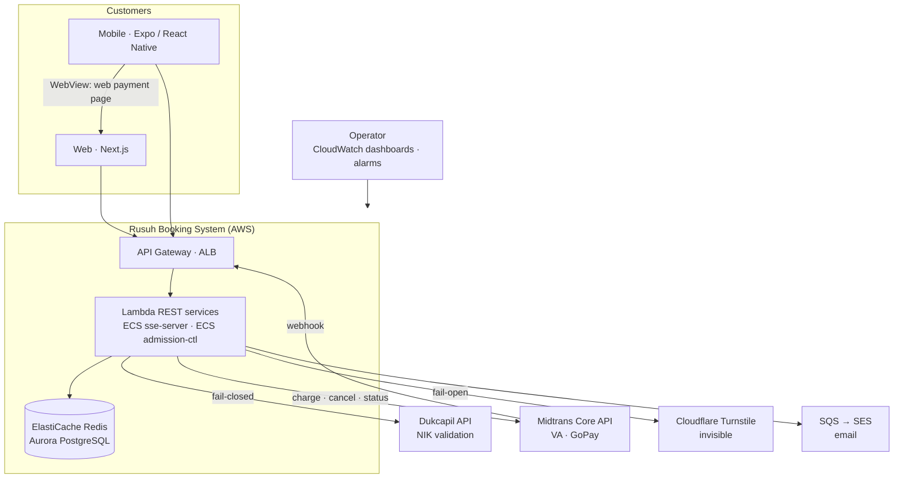

---

## 3. Component Catalog

### 3.1 Compute

| Service | Runtime | Responsibility | Status |
|---|---|---|---|
| `queue` | Lambda | join (always answers at once, ADR-006 §8.14): rate limit, CAPTCHA, BR-07, capacity; `/me` entry and recovery; `/serving` polling fallback | built |
| `sse-server` | ECS Fargate behind ALB (HTTPS) | SSE connections, pub/sub fan-out, stale detector, freshness metric | built |
| `admission-ctl` | ECS Fargate, **1 task** (deploy min 0 % / max 100 %), 500 ms tick | the only grant writer: sweep (LAPSED, SELECTING and HELD expiry), recover, advance, broadcast, `rate_per_min`, FULL_BOOKED → CLOSED, stock reconciliation every 60 s, asks payment-api to settle overdue payments | built |
| `events` | Lambda, `Cache-Control` 30 s | event list and detail with `queue_state`, `display.enabled`, live stock per category, CAPTCHA site key | built |
| `booking` | Lambda | ticket page (`GET …/tickets`, GRANTED → SELECTING), hold (`POST /bookings`), booking detail | built |
| `nik-verify` | Lambda | Dukcapil call, rate limit, breaker, 24 h cache; the only holder of the NIK pepper. Called over HTTP and by direct invoke from booking | built |
| `payment-api` | Lambda | payment methods, charge, switch method, status, webhook, WebView handoff and exchange, overdue-payment sweep | built |
| `user` | Lambda | magic-link auth, register + NIK + consent, saved NIKs, profile, my tickets, e-ticket | built |
| `outbox-publisher` | Lambda, EventBridge every 1 min | outbox → SQS with a Redis lease | built |
| `notification` | Lambda, SQS consumer | SES email, dedupe, DLQ after 5 attempts | built |

Sale data (events and categories in Aurora, sale state and stock in Redis) is loaded with the seed stack in `infra/seed`.
Backend code: Go 1.26 multi-module workspace, hexagonal layout per service, shared `pkg/`.

### 3.2 Data stores

| Store | Spec | Holds | Authority |
|---|---|---|---|
| **Redis** (ElastiCache) | POC: one `cache.t4g.micro` node. Production sizing (ADR-005): cluster mode, Multi-AZ, `r6g.large` × 3; working set about 80 MB, sized for ops/s | queue hash and tokens, stock, `nik:used`, grants, rate limits, breakers, pub/sub | stock and queue fast path |
| **Aurora PostgreSQL** (Serverless v2) | POC: scales to 0 and auto-pauses | bookings, items, NIK claims, payments, tickets, outbox, accounts, consent | **deadlines, states, money** |

### 3.3 External integrations

| System | Purpose | Failure policy |
|---|---|---|
| **Dukcapil** | NIK existence (NIK only); live, mock or stub per environment | **Fail-closed.** Unverified NIK + Dukcapil down → booking blocked with a retryable error; the queue keeps moving |
| **Midtrans Core API** | VA (BCA/BNI/BRI/CIMB) + GoPay, `custom_expiry` = payment deadline | Breaker OPEN → `PAYMENT_GATEWAY_UNAVAILABLE` (503, retryable). Webhook is the confirmation of record; status query before any expiry |
| **CAPTCHA**: Cloudflare Turnstile (invisible mode) | bot friction on join | **Fail-open** with alarm |
| **SQS → SES** | e-tickets, expiry and failure emails | async with retry + DLQ, never blocks a transaction |

### 3.4 Clients

| | Web (`fe-web-rusuh-war-ticketing`) | Mobile (`fe-mobile-rusuh-war-ticketing`) |
|---|---|---|
| Stack | Next.js 16, React 19, TypeScript, Tailwind 4, TanStack Query, Awilix DI | Expo SDK 58, React Native 0.88, TypeScript, Expo Router |
| Layout | Feature modules (`catalog`, `queue`, `booking`, `payment`, `auth`, `ticket`, `help`), layers `domain → application → data → controllers → views` | Feature modules (`events`, `queue`, `booking`, `payment`, `auth`, `eticket`), layers `domain → data → presentation` |
| Screens on the real API | home, event list and detail, waiting room, ticket selection, payment, login and registration, account, my tickets, e-ticket | home (event list), waiting room |
| Other screens | — | ticket selection (fixture data), payment WebView component, e-ticket placeholder |
| Queue updates | `fetch`-based SSE client with `X-Queue-Token`, polling fallback | SSE client with `X-Queue-Token` |
| Payment | `/orders/{id}/pay`; `/m/orders/{id}/pay` for the WebView | opens `/m/orders/{id}/pay` with a one-time handoff code (ADR-007) |
| Hosting | Vercel, Cloudflare DNS | Expo build |

Both clients render `queue_state` and `display.enabled` as sent; neither decides button state on its own.

---

## 4. Customer Journey and States

### 4.1 End-to-end journey

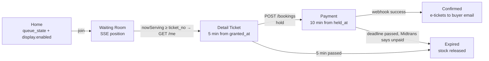

With free places and nobody ahead, the next tick (≤ 500 ms) grants the turn, so the customer goes almost straight to
the ticket page (FR-05).

### 4.2 Booking status (owned transitions)

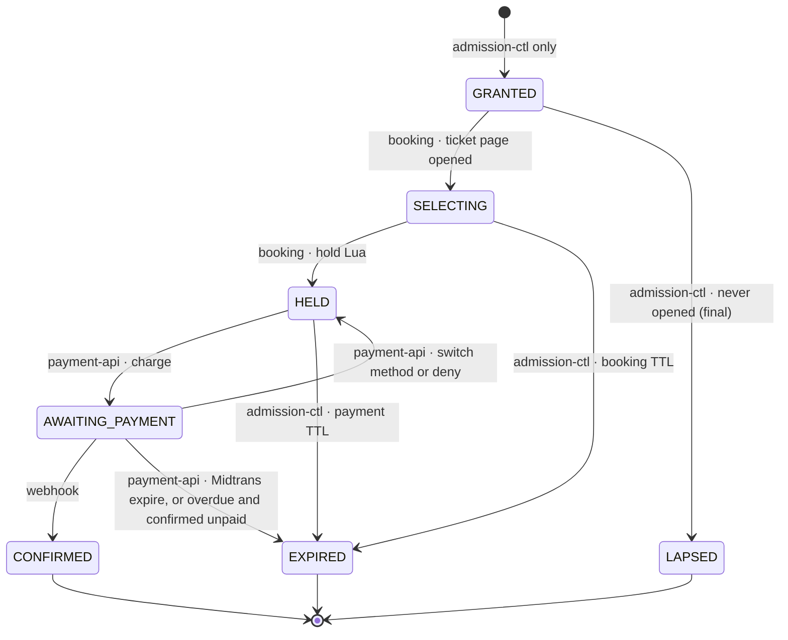

**Admission counts come from these statuses, read from Aurora each tick (ADR-006 §3):**
`open` = every active status (GRANTED through AWAITING_PAYMENT), and `browsing` = GRANTED + SELECTING. No service
updates a queue counter on a transition. The counting relies on one invariant: **no transition goes back into GRANTED
or SELECTING**. A success callback after `EXPIRED` marks the booking **Disputed** (`payment_disputed`) for manual
refund (FR-23c, BR-19). A customer whose place has ended may join again, at the back (ADR-006 §8.21).

### 4.3 Sale state per event (field `state` of `queue:{ev}`)

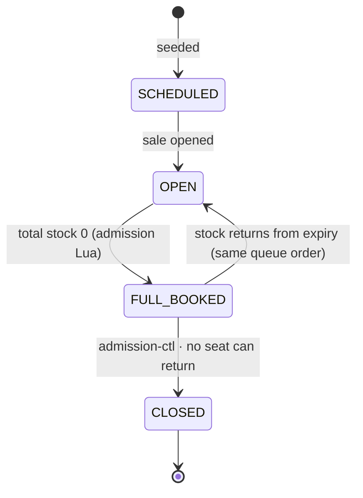

The home page shows one field, `queue_state`: the sale state above, plus `FULL_QUEUE` when `issued − now_serving`
reaches the queue capacity (300,000). The server also sends `display.enabled` (true for `OPEN` and `FULL_BOOKED`),
so the button is decided server-side (FR-03e).

---

## 5. Key Flows

### 5.1 End-to-end purchase

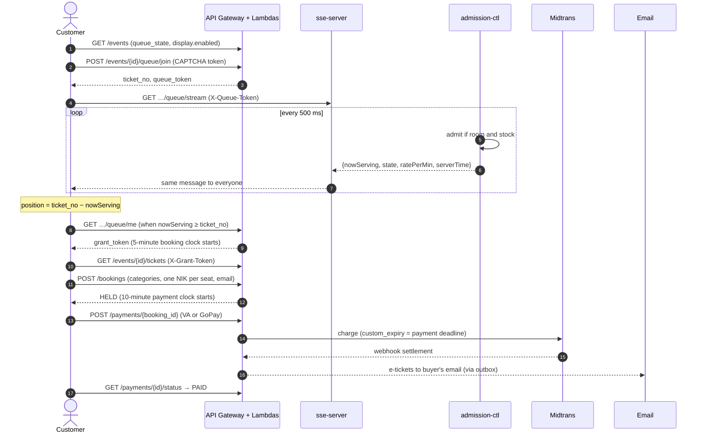

### 5.2 Join and wait

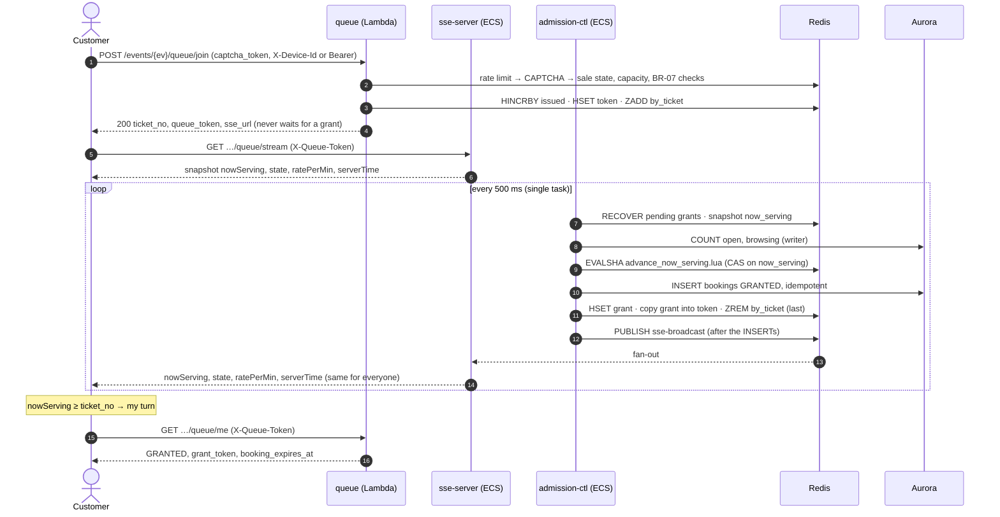

- If SSE is blocked, the client polls `GET …/queue/serving` with the interval from `poll_tiers`.
- A customer whose place has ended (`LAPSED`, `EXPIRED`, `CONFIRMED`) gets a new number at the back on the next join.

### 5.3 Claim and hold

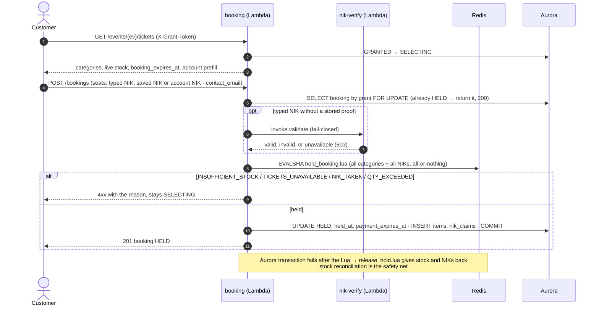

### 5.4 Payment and webhook

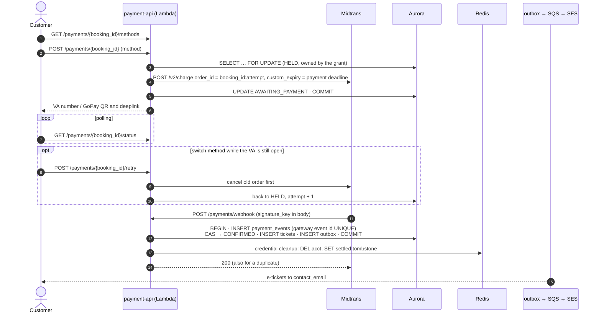

A success notification for a booking that already expired marks it **disputed**, emails the customer, and raises an
alarm for a manual refund.

### 5.5 Mobile payment handoff (WebView)

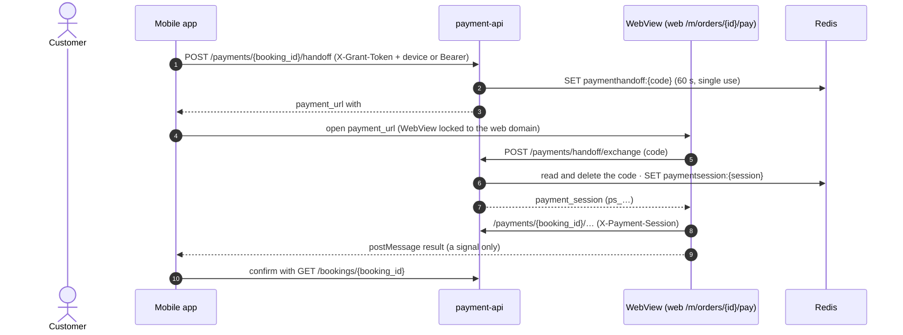

The session works only for one booking and stops working when the grant ends (ADR-007).

### 5.6 Expiry sweep and overdue payments

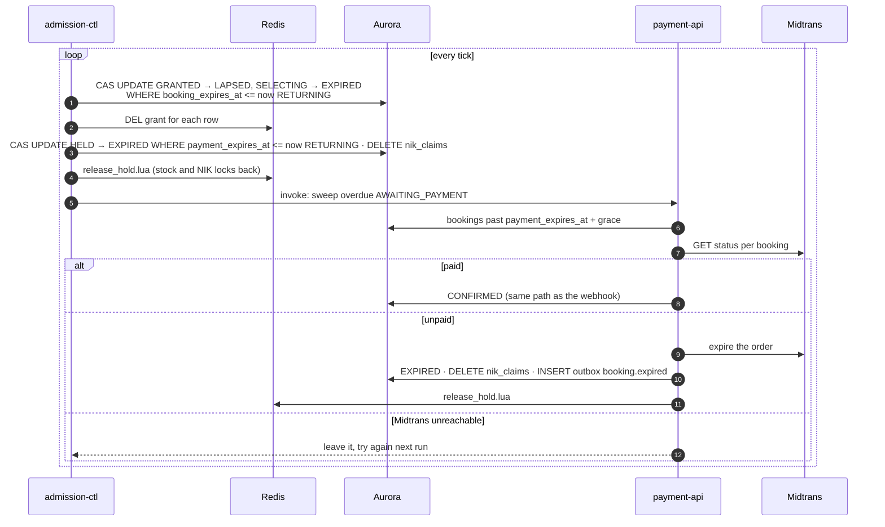

The freed places are picked up by the next admission tick through the Aurora COUNT; no other service signals
admission-ctl.

### 5.7 Stock reconciliation

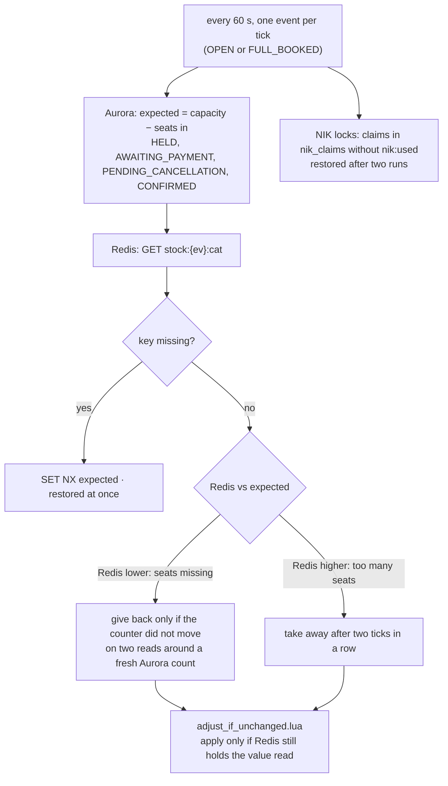

Large differences raise an alarm instead of being corrected.

### 5.8 Email

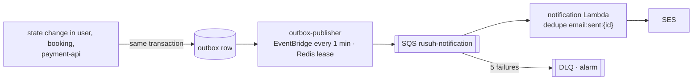

Event types: `auth.magic_link`, `account.verify`, `ticket.issue`, `booking.expired`, `payment.failed_notice`,
`payment.refund`, `account.deleted`.

### 5.9 Wait-time estimate (FR-09)

admission-ctl computes `rate_per_min` = how many ticket numbers `now_serving` passes per minute,
over the last 60 s while `OPEN`. It uses a seed (`MAX / 5 min`) for the first 60 s so the T0 burst
doesn't skew it. It's sent as `ratePerMin` (SSE) and `rate_per_min` (`/serving`).

The **frontend computes the estimate** with one written rule (api-contracts §3.5, ADR-006 §6.2):

```
position = ticket_no − nowServing
FULL_BOOKED → fully-booked message · position ≤ 0 → "sebentar lagi" + GET /me · ratePerMin ≤ 0 → "Menghitung estimasi…"
else minutes = ceil(position / ratePerMin) rounded UP (1–10 as is, 11–30 → ×5, 31–60 → ×10, > 60 → ×30) → "± N menit"
```

No API response carries an estimate field.

**Sale-level planning numbers** (assumptions: basket 2, conversion 70%, 5 min per slot):

| | Value |
|---|---|
| Customers that must be admitted to sell 10,000 tickets | ≈ 7,150 |
| Share of a 300,000 queue that gets a turn | ≈ 2.4% |
| Time to sell out at MAX 500 / 1,000 / 2,000 | ≈ 72 / 36 / 18 min |

The cut-off (about 7,150 turns) doesn't depend on MAX; only the speed does.

---

## 6. Redis Keyspace

All names come from `pkg/rediskeys`. Keys touched by one Lua script share the `{ev}` hash tag, so **all hot state of
one event lives on one cluster shard**.

| Group | Keys |
|---|---|
| Queue | `queue:{ev}` (hash: `state`, `issued`, `now_serving`, `full_booked_at`, `rate_per_min`, `name`, `sale_starts_at`), `queue:{ev}:by_ticket` (zset; score ≤ `now_serving` = pending grant). No slot counters (ADR-006 §3) |
| Credentials | `token:<queue_token>`, `grant:<grant_token>` (fields `event_id`, `booking_id`, `queue_token`, plus `account_id` or `device_hash`, ADR-006 §8.13), `acct:{ev}:<account_id>` (BR-07), `settled:<queue_token>` (paid tombstone), `paymenthandoff:<code>` and `paymentsession:<session>` (ADR-007) |
| Booking | `stock:{ev}:<category>`, `nik:used:{ev}:<hmac>`, `nik:valid:<hmac>` (24 h) |
| Dependencies | circuit breakers and rate limiters per dependency (Dukcapil, payment gateway) |
| Ingress | `rl:join:<ip>`, `rl:joinacct:<account_id>`, `rl:sse:<ip>`, `rl:handoff:<grant_token>` |
| Messaging | `processed:<outbox_id>` (publisher lease), `email:sent:<outbox_id>` (notification dedupe) |
| Pub/Sub | `sse-broadcast` (numbers), `sse-status` (state changes, including CLOSED) |

---

## 7. Aurora Schema (summary)

Full DDL: migrations `0001`–`0019` in `be-rusuh-war-ticketing/migrations/`.

| Table | Purpose | Key constraints |
|---|---|---|
| `events`, `ticket_categories` | catalog: date, venue, sale start; price, capacity, sort order | capacity fixed during a sale (stock reconciliation baseline) |
| `bookings` | one row per engagement from `GRANTED` | `UNIQUE (event_id, queue_token)` (idempotent grant), grant token unique, status CHECK, `contact_email` required from HELD, **BR-07 partial UNIQUE** `(event_id, account_id)` over live states, partial indexes on deadlines |
| `booking_items` | one row per seat | `UNIQUE (booking_id, nik_hmac)` |
| `nik_claims` | BR-02 across bookings | `UNIQUE (event_id, nik_hmac)` |
| `payment_events` | gateway notifications | gateway event id `UNIQUE` (idempotency) |
| `payment_method_switches` | history of method changes | — |
| `tickets` | issued e-tickets | `UNIQUE (booking_item_id)` (no duplicate QR on retry) |
| `outbox` | side-effect intents | partial index on unpublished rows |
| `accounts`, `saved_niks`, `consent_records` | identity and NIK proof | `UNIQUE (nik_hmac)` global. `saved_niks.verified_at NOT NULL`. consent **append-only** (UU PDP) |
| `magic_tokens`, `refresh_tokens` | passwordless login, rotating refresh | stored as hashes |
| `queue_entries` | durable queue positions (reserved for production, ADR-006 §9) | PK `(event_id, queue_token)` |

NIKs are stored as **HMAC with a KMS-managed pepper** plus a masked display form. Plaintext is
never stored and never returned (NFR-11, FR-32c).

---

## 8. Atomic Operations

| Script | Called by | Guarantees |
|---|---|---|
| `advance_now_serving.lua` | admission-ctl only | CAS fence on `now_serving`, FULL_BOOKED ↔ OPEN, stock read inside, `deficit = min(MAX − open, ceil(stock / 3) − browsing)` with `open` / `browsing` passed in from the Aurora COUNT, `now_serving` never passes `issued`. **Does not ZREM**: tokens stay in `by_ticket` as pending grants until their row exists |
| `hold_booking.lua` | booking | quota across categories, check **all** stock before decrementing any, NIK `SET NX` with rollback, missing key ≠ zero (`STOCK_UNINITIALIZED`) |
| `release_hold.lua` | admission-ctl sweeps, payment-api expiry, booking (undo when the Aurora transaction fails) | gives stock and NIK locks back |
| `adjust_if_unchanged.lua` | admission-ctl stock reconciliation | compare-and-adjust so a double run never corrects twice |
| `hset_if_exists.lua` | admission-ctl | writes grant fields to a token hash only if it still exists (never recreates it without a TTL) |

> Scripts live in `pkg/redisscript` only, each with a `.feature` file describing its rules. Don't copy them into
> documents.

---

## 9. Credentials

Five credentials, each in its own transport slot (api-contracts §9).

| Credential | Slot | Proves | Revocable |
|---|---|---|---|
| Access token (JWT session) | `Authorization: Bearer` | who the account is | at expiry; refresh token rotates |
| Grant token (`gt_…`, opaque) | `X-Grant-Token` | holder has a slot. Guards all booking and payment routes | instantly (`DEL grant:<token>`) |
| Queue token (`qt_…`) | `X-Queue-Token` (web and mobile, no cookie) | queue position. Never in a URL | at sale window end |
| Payment session (`ps_…`) | `X-Payment-Session` | payment page in the mobile WebView, one booking only (ADR-007) | dies with the grant |
| E-ticket token | `?t=` on email and success-page links | read one ticket | — |

Guest grants are additionally bound to `X-Device-Id` (stored as HMAC). Grants of logged-in customers also require the
same account's `Authorization` (ADR-006 §8.17). Every route that takes a `booking_id` checks it belongs to the grant;
otherwise `404`.

---

## 10. NFR Traceability

| NFR | Requirement | How it is met | Owner |
|---|---|---|---|
| NFR-01 | UX holds under any condition | waiting room, `status` and `sold-out` events, stale indicator, server-decided `display.enabled` | queue, sse-server, events |
| NFR-02 | "Jangan PHP" | INSERT before PUBLISH, pending grants retried until their row exists, failed hold keeps the slot, Midtrans checked before a payment expires | admission-ctl, booking, payment-api |
| NFR-03 | 300k concurrent | Redis-only join, one broadcast per event, ECS for long-lived connections, cacheable home and `/serving` responses | queue, sse-server, events |
| NFR-04 | no oversell | `hold_booking.lua` all-or-nothing, `UNIQUE (event_id, nik_hmac)`, reconciliation every 60 s | booking, admission-ctl |
| NFR-05 | FCFS, no cutting in line | `HINCRBY issued` + `by_ticket`, one grant writer, rate limit then invisible CAPTCHA, BR-07 for logged-in users | queue, admission-ctl |
| NFR-06 | p95 < 1 s position updates, all positions | SSE push on change + 10 s heartbeat, polling fallback with server-sent `poll_tiers` | sse-server, queue |
| NFR-07 | protected pages, PCI-DSS | grant token on booking and payment routes, payment session in the WebView. Card data never touches us | booking, payment-api |
| NFR-08 | platform-agnostic API | REST/JSON + SSE, same for web and mobile | all |
| NFR-09 | real-time observability | services emit CloudWatch EMF metrics; sale and API dashboards, SNS alarms | all, `infra/observability` |
| NFR-10 | email never fails a transaction | outbox → SQS → SES + DLQ; e-ticket link on the success page | outbox-publisher, notification |
| NFR-11 | UU PDP compliance | explicit consent, append-only records, NIK as HMAC | user, nik-verify |
| NFR-12 | Dukcapil cost | registered NIK + saved NIKs + 24 h cache reuse verification proof | nik-verify |
| NFR-13 | queue capacity 300k | `QUEUE_FULL` fail-fast at join, `FULL_QUEUE` shown on home | queue, events |
| NFR-14 | freshness detection | sse-server stale after 30 s without broadcast; queue-stalled and admission-ctl-down alarms | sse-server, observability |

---

## 11. Failure Modes and Recovery

| Failure | Detection | Customer impact | Recovery |
|---|---|---|---|
| Dukcapil down | breaker OPEN | NIK validation fails fast (retryable); queue keeps moving | breaker half-open probe → auto recover |
| Midtrans down | breaker OPEN | charge fails fast (retryable) within the payment window | same as above |
| Webhook never arrives | overdue-payment sweep | none: status is asked from Midtrans, then confirmed or expired | automatic |
| CAPTCHA provider down | verify errors | none (fail-open) | alarm |
| admission-ctl task dies | ECS health, `admission-ctl-down` alarm | queue pauses until ECS replaces the task; nothing lost (pending grants) | ECS replaces the task |
| admission-ctl stuck | no broadcast for 30 s | "reconnecting…" indicator | `queue-stalled` alarm |
| sse-server task lost | ALB health | stream drops | jittered client reconnect; snapshot restores position (FR-10) |
| Redis key lost | reconciliation | none or brief | missing stock keys re-seeded immediately; `nik:used` restored from `nik_claims` |
| Aurora failover | connection errors | join keeps working (Redis only); claim, hold and pay fail and retry | Aurora failover |
| Email failure | SQS retries → DLQ | e-ticket email delayed; ticket still on the success page and in my tickets | DLQ alarm, redrive |

---

## 12. Deployment Topology

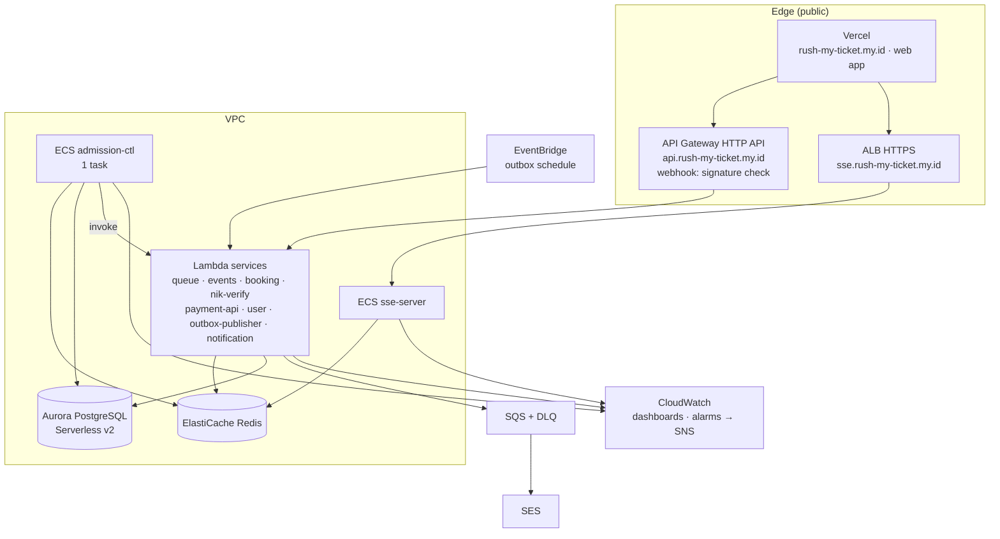

**Infrastructure as code:** CloudFormation stacks `infra/foundation` (VPC, Aurora, ElastiCache, KMS, secrets, SES),
one template per service, `infra/ecs`, `infra/api-gateway` (one HTTP API for every route), `infra/observability`,
`infra/seed`. **CI/CD:** GitHub Actions runs lint, unit tests with an 80% coverage gate, govulncheck and SonarCloud,
then deploys in waves (foundation → services → API gateway → smoke test), with a separate ECS job.

**Pre-sale schedule for production** (ADR-005): warm floor at T-6 h, scheduled pre-scale of sse-server to N tasks at
T-30 min, full rehearsal at T-2 days. Reactive autoscaling can't absorb a ramp of about 5,000 connections/s at T=0.

---

## 13. Cost Estimate

| | Amount |
|---|---|
| POC, idle (`CostOptimized`, DEPLOY.md) | **~$58 / month** (NAT gateway ~$43, ElastiCache ~$12, secrets, KMS; Aurora scales to 0) |
| Production, variable per event at 300k (ADR-005): SSE ECS, SSE egress, ALB, API GW, Lambda, Aurora, SQS+SES | **~$36** + Dukcapil (per contract) |
| Production, fixed per month (ADR-005): Redis, Aurora, RDS Proxy, KMS, ALB, scheduled Lambda | **~$605** |
| Production total at 2 events / month | **~$677** |

SSE egress is the biggest variable. Publishing only when `now_serving` changes keeps it in proportion to the admission
rate.

---

## 14. Open Questions

From ADR-005 and ADR-006 §10.

| # | Question | Owner |
|---|---|---|
| 1 | Dukcapil rate limit, SLA, and cost per call | tender owner |
| 2 | Honest messaging for 300,000 people chasing 10,000 tickets; the "likely sold out before your turn" hint (ADR-006 §6.4) | tender owner |
| 3 | `MAX_CONCURRENT_SLOTS` value, from a load test against Dukcapil and payment gateway limits | team |
| 4 | Measured connections per SSE task (drives task count and cost) | team |
| 5 | Slow-start ramp at T0, pre-queue randomization at T0 (changes NFR-05) | team, tender owner |

---

## Appendix A: Glossary

| Term | Definition |
|---|---|
| `ticket_no` | FCFS queue number from `HINCRBY issued` at join |
| `now_serving` | global watermark. Numbers ≤ it have had their turn |
| Slot | one customer in the booking funnel, from `GRANTED` to a terminal state. Capped by `MAX_CONCURRENT_SLOTS` |
| Grant | permission to enter Detail Ticket. Starts the 5-minute clock |
| Hold | stock and NIKs reserved by `hold_booking.lua`. Starts the 10-minute payment clock |
| `queue_state` | what the home page shows: `SCHEDULED`, `OPEN`, `FULL_QUEUE`, `FULL_BOOKED`, `CLOSED` |
| `FULL_BOOKED` | every seat is held right now; reversible, new customers may still join |
| Disputed | success callback after final cancellation. Flagged for manual refund |
| `open` / `browsing` | admission counts read from Aurora each tick: everyone inside / inside but not holding seats yet |
| pending grant | a `by_ticket` member with score ≤ `now_serving`: admitted in Redis, row not yet confirmed. Retried every tick. **Not** a second chance for no-shows |
| Handoff code | one-time, 60-second code the mobile app exchanges for a payment session (ADR-007) |
| NIK | 16-digit Indonesian national ID. 1 NIK = 1 seat per event |

## Appendix B: Related Documents

| Document | Path |
|---|---|
| Requirements v1.1 | `requirement/requirements.md` |
| Architecture of record | `adr/ADR-005-final-architecture-decision.md` (supersedes ADR-003, ADR-004) |
| Queue amendments | `adr/ADR-006-queue-admission-amendments.md` (amends ADR-005) |
| Mobile WebView payment | `adr/ADR-007-mobile-webview-payment-handoff.md` |
| Queue technology and position | `adr/ADR-001-…`, `adr/ADR-002-…` |
| API | `api/rusuh-booking-apidog.json` (source of truth), `api/api-contracts.md` |
| Payment methods | `payment-method/README.md` |
| Cost model | `infra-cost-model/rusuh-queue-cost-model.xlsx` |
| Backend per-endpoint plans, deploy and runbook | `be-rusuh-war-ticketing/docs/`, `DEPLOY.md`, `RUNBOOK.md` |
| Web architecture | `fe-web-rusuh-war-ticketing/docs/` |
