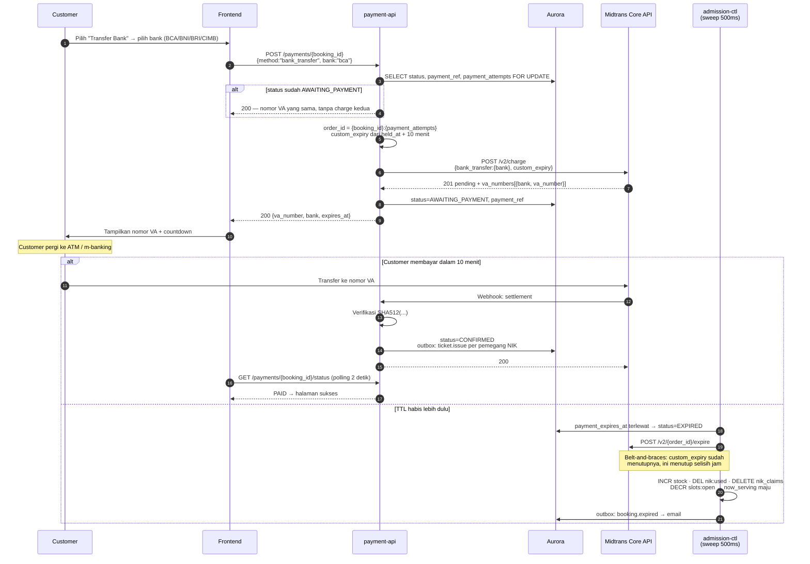

# Metode Pembayaran — Transfer Bank (Virtual Account)

**`payment_type`**: `bank_transfer`
**Bank POC**: `bca`, `bni`, `bri`, `cimb` — **hanya empat ini**
**Sumber**: [Core API Bank Transfer Integration](https://docs.midtrans.com/docs/coreapi-core-api-bank-transfer-integration)
**Sifat**: asinkron — customer membayar di ATM atau m-banking, bisa belasan menit kemudian

---

## Satu metode, bukan dua

Wireframe tender menampilkan "Virtual Account" dan "Transfer Bank" sebagai dua pilihan
terpisah. Di Core API keduanya adalah **metode yang sama**: `payment_type: bank_transfer`,
customer memilih bank, Midtrans mengembalikan nomor VA. Tidak ada jalur transfer manual
dengan unggah bukti — Midtrans tidak memverifikasi bukti transfer.

UI boleh tetap menampilkan satu entri bernama "Transfer Bank / Virtual Account" dengan empat
pilihan bank di bawahnya.

---

## Mengapa hanya empat bank

Midtrans mendokumentasikan kasus **reversal**: `settlement` dapat berubah menjadi `deny`,
umumnya dalam 1–5 menit, dana kembali ke customer, dan pesanan harus dianggap belum dibayar.
Kasus ini tercatat **hanya** untuk Permata, Mandiri Bill Payment, dan Indomaret.

Konsekuensinya bila terjadi pada sistem ini berat: booking sudah `CONFIRMED`, slot sudah
dilepas, tiket sudah terbit, dan e-tiket sudah terkirim ke tiap pemegang NIK. Menanganinya
berarti menarik kembali tiket yang sudah di tangan customer.

Dengan membatasi POC pada BCA, BNI, BRI, dan CIMB — keempatnya di bawah `bank_transfer` dan
tidak termasuk daftar reversal — **kelas kegagalan itu tidak dapat terjadi**, dan handler
reversal tidak perlu dibangun.

Permata dan Mandiri Bill juga memakai bentuk request/respons berbeda (`payment_type:
permata` dan `echannel`, respons `permata_va_number` dan `bill_key`/`biller_code`), sehingga
pengecualiannya sekaligus menghapus dua cabang kode.

> **Sebelum produksi**: menambahkan Permata atau Mandiri Bill **mewajibkan** handler reversal
> lebih dulu.

---

## Alur



---

## Request charge

```json
{
  "payment_type": "bank_transfer",
  "transaction_details": {
    "order_id": "RB-00912:1",
    "gross_amount": 1500000
  },
  "bank_transfer": {
    "bank": "bca"
  },
  "custom_expiry": {
    "order_time": "2026-10-25 10:15:00 +0700",
    "expiry_duration": "10",
    "unit": "minute"
  },
  "customer_details": {
    "email": "buyer@example.com"
  }
}
```

| Field | Wajib | Catatan |
|---|---|---|
| `bank_transfer.bank` | ✅ | `bca` \| `bni` \| `bri` \| `cimb` |
| `custom_expiry.order_time` | ✅ | **`held_at`**, WIB (GMT+7), format `YYYY-MM-DD HH:MM:SS +0700` |
| `custom_expiry.expiry_duration` | ✅ | `"10"` — menyamai `PAYMENT_TTL_SECONDS` |
| `custom_expiry.unit` | ✅ | `minute` |

> `order_time` diisi `held_at`, bukan waktu request. Anchor TTL pembayaran adalah saat
> tombol bayar ditekan (BR-05), sehingga jendela Midtrans dan jendela kita berakhir
> bersamaan. Mengisinya dengan `now()` memberi customer beberapa detik ekstra di sisi
> Midtrans — cukup untuk membayar kursi yang baru saja dijual ulang.

## Respons charge

```json
{
  "status_code": "201",
  "transaction_id": "9aed5972-5b6a-401e-894b-a32c91ed1a3a",
  "order_id": "RB-00912:1",
  "gross_amount": "1500000.00",
  "payment_type": "bank_transfer",
  "transaction_status": "pending",
  "fraud_status": "accept",
  "va_numbers": [ { "bank": "bca", "va_number": "8801234567890" } ]
}
```

Keempat bank POC mengembalikan `va_numbers` sebagai array. (Permata mengembalikan
`permata_va_number` dan Mandiri Bill `bill_key`/`biller_code` — keduanya di luar lingkup.)

---

## Status

| `transaction_status` | Arti | Status booking |
|---|---|---|
| `pending` | VA terbit, belum dibayar | `AWAITING_PAYMENT` |
| `settlement` | Dana diterima | → `CONFIRMED` |
| `expire` | Tidak dibayar dalam jendela | → `EXPIRED` |
| `deny` | Ditolak bank | → `HELD` |
| `cancel` | Dibatalkan merchant | → `EXPIRED` |

Tidak ada `capture` pada metode ini; `pending` langsung menjadi `settlement`.

---

## Expiry: dua lapis, disengaja

**Lapis 1 — `custom_expiry` saat charge.** Default Midtrans adalah **24 jam**. Tanpa
parameter ini, VA tetap dapat dibayar sepanjang hari setelah sweep melepas stoknya.

**Lapis 2 — `POST /v2/{order_id}/expire` dari sweep.** Dipanggil saat booking di-expire.

Keduanya dipasang karena jam Midtrans dan jam kita tidak dijamin identik. Selisih beberapa
detik sudah cukup untuk menerima pembayaran atas kursi yang sudah dijual ulang — jalur yang
berakhir pada `payment.refund` dan alarm `LatePaymentRefund` (ADR-005 Bagian 9). Lapis kedua
membuat jalur itu tetap menjadi kekecualian, bukan lalu lintas rutin.

---

## Kegagalan dan penanganannya

| Kejadian | Penanganan |
|---|---|
| Charge timeout / 5xx | Jangan kirim ulang. Get Status dengan `order_id` yang sama; `404` berarti VA belum terbit dan aman dikirim ulang |
| Customer membayar setelah TTL | Seharusnya mustahil karena dua lapis expiry. Bila tetap terjadi: webhook `settlement` atas baris `EXPIRED` → `payment.refund` + alarm |
| Customer transfer dengan nominal salah | Midtrans tidak menyatakan `settlement`; VA tetap `pending` sampai expire |
| Webhook duplikat | `gateway_event_id UNIQUE` → transaksi batal, tetap `200` |
| Customer ingin ganti bank | `POST /payments/{booking_id}/retry` → `payment_attempts` naik → `order_id` baru → VA baru. VA lama di-expire |
