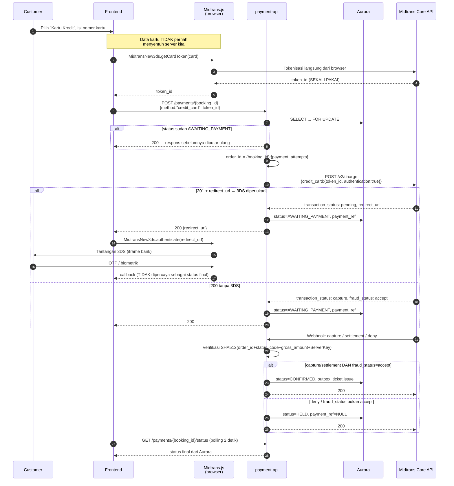

# Metode Pembayaran — Kartu Kredit/Debit

**`payment_type`**: `credit_card`
**Sumber**: [Core API Card Payment Integration](https://docs.midtrans.com/docs/coreapi-card-payment-integration)
**Sifat**: sinkron — hasil diketahui dalam hitungan detik, berbeda dari dua metode lain

---

## Yang membedakan metode ini

Kartu adalah **satu-satunya** dari tiga metode yang memberi hasil langsung. VA dan e-wallet
menunggu customer bertindak di tempat lain; kartu selesai di halaman yang sama.

Konsekuensinya tiga hal yang tidak berlaku pada metode lain:

1. Ada langkah **tokenisasi di browser** sebelum backend dipanggil sama sekali
2. Ada langkah **3DS** yang dapat menyela alur
3. **`custom_expiry` tidak berlaku** — Midtrans menyatakannya eksplisit

---

## Alur



---

## Request charge

```http
POST https://api.midtrans.com/v2/charge
Authorization: Basic base64(ServerKey:)
Content-Type: application/json
```

```json
{
  "payment_type": "credit_card",
  "transaction_details": {
    "order_id": "RB-00912:1",
    "gross_amount": 1500000
  },
  "credit_card": {
    "token_id": "48111111sHfSakAvHvFQFEjTivUV1114",
    "authentication": true
  },
  "customer_details": {
    "email": "buyer@example.com"
  }
}
```

| Field | Wajib | Catatan |
|---|---|---|
| `payment_type` | ✅ | Selalu `credit_card` |
| `transaction_details.order_id` | ✅ | `{booking_id}:{payment_attempts}` |
| `transaction_details.gross_amount` | ✅ | Rupiah, tanpa desimal |
| `credit_card.token_id` | ✅ | Dari Midtrans.js. **Sekali pakai** |
| `credit_card.authentication` | ✅ | `true` — 3DS. Direkomendasikan Midtrans untuk keamanan dan pencegahan fraud |
| `custom_expiry` | ❌ | **Tidak berlaku untuk kartu** |

## Respons charge

| Kondisi | `status_code` | `transaction_status` | Tindakan |
|---|---|---|---|
| 3DS diperlukan | `201` | `pending` + `redirect_url` | Kirim `redirect_url` ke frontend |
| Lunas tanpa 3DS | `200` | `capture` + `fraud_status: accept` | Tunggu webhook untuk konfirmasi |
| Ditolak | — | `deny` | Kembali ke `HELD`, tawarkan metode lain |

Field lain yang dikembalikan: `transaction_id`, `masked_card`, `bank`, `card_type`,
`three_ds_version`, `channel_response_message`.

---

## Status dan artinya

| `transaction_status` | Arti | Status booking |
|---|---|---|
| `capture` + `fraud_status: accept` | Dana terpotong | → `CONFIRMED` |
| `capture` + `fraud_status` lain | **Belum lunas** | tetap `AWAITING_PAYMENT` |
| `pending` | Menunggu 3DS | tetap `AWAITING_PAYMENT` |
| `deny` | Ditolak penerbit kartu atau FDS Midtrans | → `HELD` |
| `expire` | 3DS tidak diselesaikan tepat waktu | → `EXPIRED` |

`capture` menjadi `settlement` pada hari berikutnya tanpa tindakan apa pun. Keduanya
diperlakukan lunas, sehingga sale yang berlangsung melewati tengah malam tidak perlu
penanganan khusus.

---

## Tiga hal yang mudah salah

### `token_id` sekali pakai

Midtrans: *"The token_id is valid for one transaction only."* Setelah charge ditolak,
`POST /payments/{booking_id}/retry` menaikkan `payment_attempts`, dan frontend **wajib
melakukan tokenisasi ulang** sebelum charge berikutnya. Mengirim ulang token lama akan gagal.

Ini salah satu alasan retry adalah aksi customer, bukan loop backend: hanya browser yang
memegang data kartu untuk membuat token baru.

### PCI-DSS bergantung pada Midtrans.js, bukan pada niat baik

NFR-07 menyatakan *"tidak ada data kartu yang melewati sistem ini"*. Klaim itu benar
**hanya** selama tokenisasi dilakukan Midtrans.js di browser: nomor kartu bergerak langsung
dari browser ke Midtrans.

> **Batasan arsitektural, bukan asumsi.** Bila suatu saat ada form kartu yang mengirim
> nomor kartu ke backend kita, klaim NFR-07 runtuh dan cakupan PCI-DSS sistem ini meluas
> drastis. Tidak ada endpoint di `api-contracts.md` yang boleh menerima field nomor kartu.

### Callback frontend bukan status final

Midtrans memperingatkan bahwa callback 3DS di browser dapat mengembalikan `pending`
sementara verifikasi 3DS 2 masih berjalan. Status final hanya dari webhook atau Get Status.
Frontend tetap polling `GET /payments/{booking_id}/status` setelah 3DS selesai.

---

## Kegagalan dan penanganannya

| Kejadian | Penanganan |
|---|---|
| Charge timeout / 5xx | Jangan kirim ulang. Get Status dengan `order_id` yang sama; `404` berarti belum sampai dan aman dikirim ulang |
| `deny` | Booking kembali ke `HELD`, stok tetap milik customer sampai TTL, tawarkan metode lain |
| Customer menutup iframe 3DS | Transaksi tetap `pending` sampai expire; sweep melepasnya pada TTL dan memanggil `/v2/{order_id}/expire` |
| Webhook duplikat | `payment_events.gateway_event_id UNIQUE` → transaksi batal, tetap `200` |
| `fraud_status: deny` pada `capture` | Diperlakukan **belum lunas**. Tiket tidak diterbitkan |
