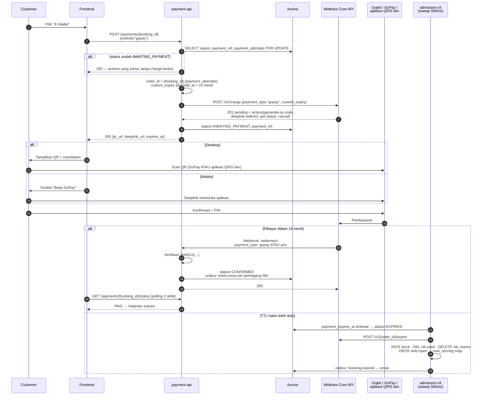

# Metode Pembayaran — E-Wallet (GoPay)

**`payment_type`**: `gopay`
**Sumber**: [Core API E-Money Integration](https://docs.midtrans.com/docs/coreapi-e-money-integration)
**Sifat**: asinkron — customer menyelesaikan pembayaran di aplikasi Gojek/GoPay atau aplikasi
QRIS apa pun

---

## Satu `payment_type`, dua cara membayar

Charge selalu dikirim sebagai `gopay`. Yang berbeda adalah cara customer membayar, dan itu
ditentukan perangkatnya:

- **Desktop/tablet** → tampilkan QR dari action `generate-qr-code`
- **Mobile** → buka aplikasi lewat action `deeplink-redirect`

> **QR itu QRIS, dan customer boleh memakai aplikasi apa pun.** Bila ia membayar dengan
> aplikasi selain GoPay, webhook datang dengan **`payment_type: qris`**, bukan `gopay`.
> Handler webhook **wajib menerima tipe yang tidak pernah kita kirim**. Mencocokkan
> `payment_type` respons charge dengan `payment_type` webhook akan menolak pembayaran yang sah.

---

## Alur



> Alur callback opsional (`enable_callback` + `callback_url`) **tidak dipakai**. Ia
> mengembalikan customer ke halaman kita dengan `result=success|failure`, dan Midtrans
> menyatakan eksplisit bahwa itu tidak boleh dijadikan dasar status. Halaman pembayaran
> sudah polling, sehingga callback hanya menambah jalur tanpa menambah informasi.

---

## Request charge

```json
{
  "payment_type": "gopay",
  "transaction_details": {
    "order_id": "RB-00912:1",
    "gross_amount": 1500000
  },
  "custom_expiry": {
    "order_time": "2026-10-25 10:15:00 +0700",
    "expiry_duration": "10",
    "unit": "minute"
  },
  "customer_details": {
    "email": "buyer@example.com"
  }
}
```

Tidak ada field wajib khusus e-wallet. Objek `gopay` opsional hanya berisi `enable_callback`
dan `callback_url`, keduanya tidak dipakai.

## Respons charge

```json
{
  "status_code": "201",
  "transaction_id": "d0f0a3b2-...",
  "order_id": "RB-00912:1",
  "payment_type": "gopay",
  "transaction_status": "pending",
  "actions": [
    { "name": "generate-qr-code",   "method": "GET",  "url": "https://api.midtrans.com/v2/gopay/.../qr-code" },
    { "name": "deeplink-redirect",  "method": "GET",  "url": "https://gojek.link/..." },
    { "name": "get-status",         "method": "GET",  "url": "https://api.midtrans.com/v2/.../status" },
    { "name": "cancel",             "method": "POST", "url": "https://api.midtrans.com/v2/.../cancel" }
  ]
}
```

Backend meneruskan `generate-qr-code` dan `deeplink-redirect` ke frontend. Dua action lain
dipakai server-side saja; URL-nya **tidak** dikirim ke klien.

---

## Status

| `transaction_status` | Arti | Status booking |
|---|---|---|
| `pending` | QR/deeplink terbit, belum dibayar | `AWAITING_PAYMENT` |
| `settlement` | Dana diterima | → `CONFIRMED` |
| `expire` | Tidak dibayar dalam jendela | → `EXPIRED` |
| `deny` | Ditolak penyedia | → `HELD` |
| `cancel` | Dibatalkan merchant | → `EXPIRED` |
| `refund` | Dikembalikan merchant | jalur `payment.refund` |

Seperti VA, tidak ada `capture`; `pending` langsung menjadi `settlement`.

---

## Expiry

`custom_expiry` **berlaku** untuk e-wallet (berbeda dari kartu), diisi sama persis seperti
VA: `order_time` = `held_at`, durasi 10 menit. Sweep tetap memanggil
`POST /v2/{order_id}/expire` sebagai lapis kedua.

Action `cancel` dari respons charge adalah alternatif yang setara untuk metode ini; sweep
memakai `/expire` agar satu jalur yang sama berlaku untuk ketiga metode.

---

## Kegagalan dan penanganannya

| Kejadian | Penanganan |
|---|---|
| Charge timeout / 5xx | Jangan kirim ulang. Get Status dengan `order_id` yang sama; `404` berarti aman dikirim ulang |
| Customer membayar dengan aplikasi QRIS lain | **Normal.** Webhook datang sebagai `payment_type: qris` dan diproses sama |
| Deeplink gagal membuka aplikasi | QR tetap tersedia sebagai cadangan di halaman yang sama |
| Saldo GoPay kurang | `deny` → kembali ke `HELD`, customer dapat memakai `/retry` dan memilih metode lain |
| Customer menutup aplikasi tanpa membayar | Tetap `pending` sampai expire; sweep melepas stok pada TTL |
| Webhook duplikat | `gateway_event_id UNIQUE` → transaksi batal, tetap `200` |
