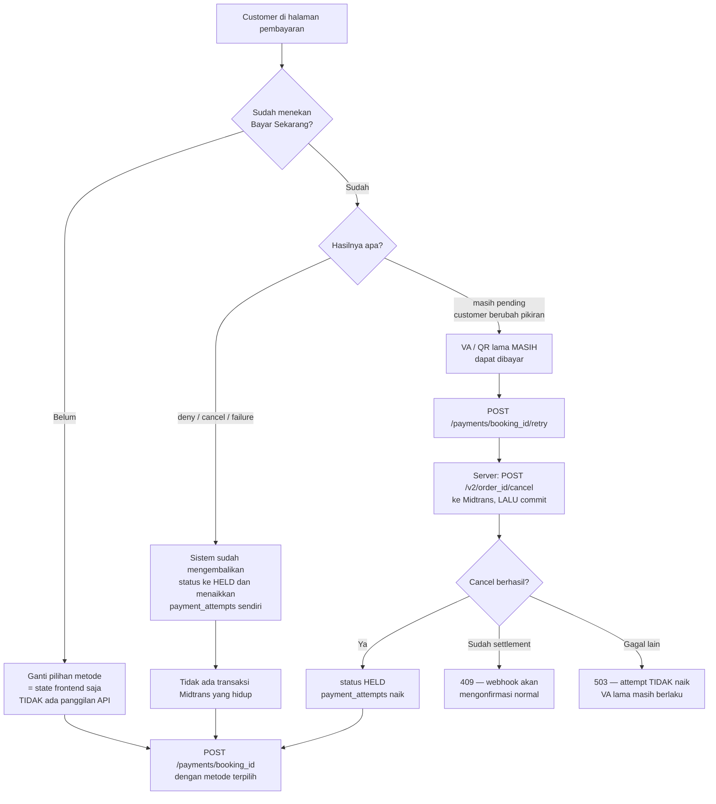

# Metode Pembayaran — Rusuh Booking Tiket

**Gateway**: Midtrans **Core API** (custom interface)
**Tanggal**: 25 Oktober 2026
**Status**: Accepted
**Selaras dengan**: ADR-005 Bagian 9, `api/api-contracts.md` §5

POC ini membuka **dua** metode pembayaran dari katalog Midtrans. Masing-masing punya
dokumen sendiri karena bentuk alurnya berbeda — bukan sekadar nilai `payment_type` yang
berbeda.

| Metode | `payment_type` | Dokumen | Sifat |
|---|---|---|---|
| Transfer Bank (VA) | `bank_transfer` | [01-bank-transfer-va.md](./01-bank-transfer-va.md) | Asinkron, customer bayar di ATM/m-banking |
| E-Wallet (GoPay) | `gopay` | [02-e-wallet-gopay.md](./02-e-wallet-gopay.md) | Asinkron, customer bayar di aplikasi |

> **Keduanya asinkron, dan itu bukan kebetulan.** Kartu kredit dikeluarkan dari POC justru
> karena ia satu-satunya metode yang tidak dapat menghormati TTL pembayaran di sisi
> gateway — lihat keputusan 3 di bawah.

---

## Yang berlaku untuk keduanya

**Satu endpoint charge.** `POST /v2/charge` dengan Basic Auth (`base64(ServerKey:)`).
Yang berbeda hanya isi body dan bentuk respons.

**`order_id` adalah pembawa idempotency.** Midtrans menolak `order_id` yang sudah dipakai,
sehingga percobaan ulang **wajib** memakai nilai baru. Sistem ini memakai
`{booking_id}:{payment_attempts}` — percobaan pertama `RB-00912:1`, setelah ditolak dan
customer menekan coba lagi menjadi `RB-00912:2`. Lihat ADR-005 Bagian 8.

**Status tidak pernah dipercaya dari frontend.** Midtrans menyatakannya eksplisit untuk
e-wallet: callback di browser dapat mengembalikan `pending` sementara verifikasi
masih berjalan. Kebenaran hanya datang dari **webhook** atau **Get Status API**.

**Verifikasi tanda tangan webhook**:

```
signature_key == SHA512(order_id + status_code + gross_amount + ServerKey)
```

Konkatenasi polos, tanpa pemisah. Tidak cocok → **abaikan notifikasi**, jangan proses.

> Dokumentasi Midtrans memuat **dua** skema tanda tangan. SHA256withRSA pada halaman
> *Security Specification* berlaku untuk lini API lain (B2B / Transactional API), **bukan**
> untuk webhook Core API. Mengimplementasikan skema yang salah membuat endpoint praktis
> tidak terverifikasi.

**Status sukses butuh dua field.** `transaction_status` saja tidak cukup:

| `transaction_status` | `fraud_status` | Perlakuan |
|---|---|---|
| `settlement` | `accept` | **Lunas** — satu-satunya jalur sukses untuk VA dan GoPay |
| `settlement` | `deny` / `challenge` | **Bukan lunas** — jangan terbitkan tiket |
| `pending` | — | Belum dibayar; booking tetap `AWAITING_PAYMENT` |
| `deny`, `cancel`, `failure` | — | Gagal; kembali ke `HELD`, customer boleh pilih metode lain |
| `expire` | — | Kedaluwarsa; lepas stok dan NIK |

> **`capture` tidak akan muncul.** Ia khusus kartu kredit, yang di luar cakupan POC. Namun
> `fraud_status` **tetap wajib dibaca** bersama `transaction_status`: Midtrans mengirimkannya
> pada metode apa pun, dan `settlement` + `deny` bukan pembayaran yang sah.

---

## Ganti metode pembayaran

Dua situasi yang sering tertukar, dan hanya satu memerlukan pemanggilan API tambahan.



**Mengapa cancel sebelum commit.** Bila commit lebih dulu lalu cancel gagal, customer
memiliki attempt yang sudah naik **dan** VA lama yang masih hidup — dua instrumen untuk satu
booking, dan keduanya dapat dibayar. Urutan sebaliknya hanya meninggalkan VA yang tidak lagi
berfungsi, yang terlihat pada polling status dan dibersihkan sweep pada TTL.

**TTL tidak ikut mundur.** `order_time` diisi `held_at`, bukan waktu request, sehingga VA
baru mewarisi sisa jendela yang benar — anchor 10:15 + 10 menit tetap berakhir 10:25 walau
charge kedua terjadi pukul 10:23. Dengan `now()`, setiap pergantian metode akan memberi 10
menit baru dan TTL tidak pernah habis.

**Dibatasi `MAX_PAYMENT_ATTEMPTS`.** Tiap percobaan menerbitkan VA atau QR baru di Midtrans;
tanpa batas, satu customer dapat menerbitkan puluhan dalam satu jendela TTL.

---

## Halaman pembayaran di frontend

**Tidak ada halaman baru.** Halaman pembayaran punya dua state, dan seluruh alur — termasuk
ganti metode — bergerak di antara keduanya.

| State | Isi layar |
|---|---|
| **A — memilih** | Daftar metode (§5.1), tombol "Bayar Sekarang", countdown |
| **B — instruksi** | Nomor VA atau QR/deeplink GoPay, countdown, polling status tiap 2 detik |

`POST /payments/{booking_id}` membawa A → B. Yang mengembalikan B → A ada dua, dan keduanya
berbeda di kode:

| Pemicu | Siapa memulai | Panggilan API |
|---|---|---|
| Pembayaran ditolak | sistem, lewat polling `status: FAILED` | **tidak ada** — langsung ke state A |
| Customer berubah pikiran | customer, lewat tautan | `POST /payments/{id}/retry` dulu |

### Penanganan tautan "Ganti metode pembayaran"

```
klik tautan
  → dialog konfirmasi            ← WAJIB: nomor VA lama berhenti berlaku
  → POST /payments/{booking_id}/retry
       200                        → kosongkan instruksi → state A
       409 PAYMENT_ALREADY_SETTLED → ternyata sudah lunas → halaman tiket
       409 status lain             → GET /payments/{id}/status, ikuti hasilnya
       429 MAX_ATTEMPTS_EXCEEDED   → nonaktifkan tautan
       503                         → tetap di state B; VA lama masih berlaku
```

Tiga hal yang mudah salah:

**Dialog konfirmasi tidak opsional.** Customer mungkin sudah berdiri di ATM dengan nomor VA
diketik. Membatalkannya diam-diam membuatnya terdampar. Dialog harus menyebut bahwa nomor
lama berhenti berlaku.

**Polling tetap jalan selama dialog terbuka.** Bila VA justru lunas pada jendela itu, polling
mengembalikan `PAID`, dialog menutup sendiri, dan customer diarahkan ke halaman tiket —
alih-alih membatalkan pembayaran yang sudah ia lakukan. `409 PAYMENT_ALREADY_SETTLED` adalah
separuh pengaman yang sama di sisi server.

**Countdown tetap terlihat dan terus berjalan** selama pergantian. Ia tidak di-reset: customer
yang berganti metode pada menit ke-8 menerima VA baru dengan sisa 2 menit. Menyembunyikan
countdown saat transisi akan menyiratkan 10 menit baru.

### Dua countdown, dua deadline

Masing-masing halaman menjalankan countdown-nya sendiri dari deadline-nya sendiri. Tidak ada
polling yang terlibat untuk menjalankannya — deadline datang sekali, sisanya aritmetika klien.

| Halaman | Deadline | Sumber | Mulai dari |
|---|---|---|---|
| Detail Ticket | `booking_expires_at` | `GET /events/{id}/tickets` → `session.expires_at` | **5:00** |
| Payment | `payment_expires_at` | `POST /payments/{id}` → `ttl.expires_at` | **10:00** |

```js
clockOffset = Date.parse(res.server_time) - Date.now();      // sekali, per halaman
setInterval(() => render(Date.parse(deadline) - (Date.now() + clockOffset)), 1000);
```

Hitung ulang dari deadline tiap tick — **jangan** mengurangi variabel. Tab latar dibatasi
browser menjadi sekitar sekali semenit, sehingga penghitung yang dikurangi akan meleset jauh
lalu menampilkan angka yang salah dengan percaya diri saat customer kembali.

**Perpindahan halaman terlihat seperti lompatan, dan itu benar.** Menekan "Lanjut ke
Pembayaran" dengan sisa 2:14 menghasilkan layar berikutnya yang menunjukkan **10:00**: jam
booking selesai, jam pembayaran baru mulai dari `held_at`. Itu hanya membingungkan bila
keduanya diberi label sama. Label wireframe tender sudah membedakannya — *"Selesaikan
pemilihan sebelum"* dan *"Selesaikan pembayaran dalam"* — dan perbedaan itu **wajib
dipertahankan**, karena lompatan ke atas adalah satu-satunya momen seorang customer dapat
mengira timer-nya rusak.

**Pada 0:00, tanya server.** Jangan berpindah ke layar kedaluwarsa atas dasar countdown
sendiri: sweep berjalan tiap 500ms dan selisih jam satu-dua detik membuat keduanya dapat
berbeda. Bekukan tampilan di 0:00 lalu konfirmasi — `GET /events/{id}/queue/me` di halaman
detail, `GET /payments/{id}/status` di halaman pembayaran.

**Menekan Pay pada 0:01.** Request sedang di jalan ketika sweep meng-expire booking, dan
`POST /bookings` menjawab **409** karena status bukan lagi `SELECTING`. Frontend harus
membacanya sebagai *"waktu habis"* dan mengarahkan ke layar kedaluwarsa — **bukan** error
generik. Bentuk 409-nya sama dengan ketidakcocokan status lain, jadi handler membaca status
dari respons, bukan menebak penyebabnya.

---

## Tiga keputusan POC yang mempersempit cakupan

### 1. Hanya BCA, BNI, BRI, CIMB untuk VA

Midtrans mendokumentasikan kasus **reversal**: `settlement` dapat berubah menjadi `deny`,
biasanya dalam 1–5 menit, dan dana kembali ke customer sehingga pesanan harus dianggap
belum dibayar. Kasus ini hanya tercatat untuk **Permata, Mandiri Bill Payment, dan
Indomaret**.

Dengan membatasi POC pada empat bank di atas, kelas kegagalan itu **tidak dapat terjadi**,
dan tidak diperlukan handler reversal — yang jika dibangun akan berarti menarik kembali
tiket yang sudah diterbitkan dan e-tiket yang sudah terkirim.

Permata (`payment_type: permata`) dan Mandiri Bill (`payment_type: echannel`) memakai bentuk
request dan respons yang berbeda pula, sehingga pengecualiannya juga menyederhanakan kode.

> **Sebelum produksi**: bila Permata atau Mandiri Bill ditambahkan, handler reversal menjadi
> wajib — termasuk pembatalan tiket yang sudah terbit.

### 2. `custom_expiry` disetel menyamai TTL pembayaran

Expiry VA bawaan Midtrans adalah **24 jam**. TTL pembayaran sistem ini **10 menit**.
Tanpa `custom_expiry`, VA tetap dapat dibayar sepanjang hari setelah sweep melepas stoknya
dan menjualnya ke orang lain.

```json
"custom_expiry": {
  "order_time": "2026-10-25 10:15:00 +0700",
  "expiry_duration": "10",
  "unit": "minute"
}
```

`order_time` memakai WIB (GMT+7). Nilainya diisi `held_at`, anchor TTL pembayaran, bukan
waktu request — agar jendela Midtrans dan jendela kita berakhir pada detik yang sama.

Sebagai lapis kedua, sweep memanggil `POST /v2/{order_id}/expire` saat meng-expire booking.
Keduanya dipasang karena jam Midtrans dan jam kita tidak dijamin identik, dan selisih
beberapa detik cukup untuk menerima pembayaran atas kursi yang sudah dijual ulang.

### 3. Kartu kredit dan Over the Counter dikeluarkan dari POC

Keduanya gagal pada syarat yang sama: **tidak dapat menghormati TTL pembayaran 10 menit.**

**Kartu kredit** — Midtrans menyatakan eksplisit bahwa `custom_expiry` **tidak berlaku**
untuknya. Jendelanya ditentukan batas waktu 3DS, yang bukan milik kita, sehingga BR-05 hanya
dapat ditegakkan oleh sweep kita sendiri tanpa dukungan gateway. Dua metode yang tersisa
keduanya menerima `custom_expiry`, jadi mengeluarkan kartu membuat **setiap** metode yang
hidup di POC menutup jendelanya pada detik yang sama dengan jendela kita.

Keluarnya kartu sekaligus mengeluarkan cakupan PCI-DSS, alur tokenisasi Midtrans.js di
browser, penanganan `client_key`, dan iframe 3DS — permukaan yang tidak dibutuhkan POC
antrian.

**Over the Counter** (Indomaret/Alfamart) — customer harus datang ke gerai secara fisik.
Tidak ada jendela 10 menit yang masuk akal untuk itu; kanal OTC lazimnya berjendela 24 jam.
Indomaret juga salah satu dari tiga kanal yang tercatat dapat **reversal** (keputusan 1), jadi
memasukkannya akan membatalkan penyederhanaan itu sekaligus.

> **Sebelum produksi**: kartu kredit hampir pasti wajib ada secara komersial. Menambahkannya
> menuntut keputusan eksplisit tentang BR-05 — memperpanjang TTL khusus kartu, atau menerima
> bahwa untuk kartu tenggatnya ditegakkan sepihak oleh sweep tanpa jaminan gateway.

---

## Referensi Midtrans

- [Core API — Custom Interface](https://docs.midtrans.com/docs/custom-interface-core-api)
- [Transaction Status Cycle](https://docs.midtrans.com/docs/transaction-status-cycle)
- [Receiving Notifications — formula signature_key](https://docs.midtrans.com/reference/receiving-notifications)
- [HTTP(S) Notification / Webhooks](https://docs.midtrans.com/docs/https-notification-webhooks)
- [Get Status API Requests](https://docs.midtrans.com/docs/get-status-api-requests)
- [Advanced Features — custom_expiry](https://docs.midtrans.com/docs/coreapi-advanced-features)
- [Error Code & Response Code](https://docs.midtrans.com/docs/error-code-and-response-code)

## Yang belum dikonfirmasi

| Item | Dampak |
|---|---|
| Jadwal retry webhook Midtrans saat endpoint kita gagal | Menentukan seberapa lama `OutboxLag` boleh tinggi sebelum notifikasi hilang |
| Kode respons HTTP yang diharapkan Midtrans | Desain kita selalu `200`; perlu dipastikan itu yang mencegah retry |
| Rate limit Get Status API | Membatasi agresivitas charge reconciler |
| Alamat IP Midtrans untuk allowlist resource policy | Diperlukan sebelum T-7 (ADR-005 Bagian 11) |

Keempatnya ada di halaman *Best Practices to Handle Notification* dan *IP Address* yang
belum ditarik.
